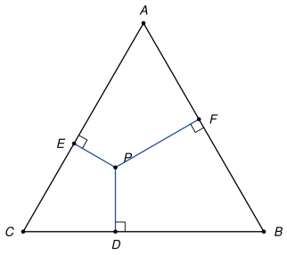

## Statement

Soit $ABC$ un triangle équilatéral de côté $a$, et soit $P$ un point à l'intérieur de ce triangle. On note $D$, $E$ et $F$ les projetés orthogonaux du point $P$ sur les côtés $[BC]$, $[CA]$ et $[AB]$.

1. Montrer que la somme $PD + PE + PF$ a toujours la même valeur, quelle que soit la position du point $P$ à l'intérieur du triangle.
2. Calculer cette valeur en fonction de $a$.

## Hints

1. Pour deviner la valeur, placez $P$ à un endroit commode : au centre du triangle, ou tout près du sommet $A$.
2. Reliez $P$ aux trois sommets. Le grand triangle est découpé en trois triangles. Dans le triangle $PBC$, que représente le segment $[PD]$ ?
3. Écrivez l'aire de chacun des trois petits triangles avec la formule « base fois hauteur divisé par deux », puis additionnez. Les trois bases ont la même longueur $a$.

## Solution

**Étape 1 : découper le triangle.** On relie $P$ aux trois sommets. Comme $P$ est à l'intérieur du triangle, les trois triangles $PBC$, $PCA$ et $PAB$ recouvrent exactement le triangle $ABC$, sans se chevaucher. Donc

$$\mathcal{A}(ABC) = \mathcal{A}(PBC) + \mathcal{A}(PCA) + \mathcal{A}(PAB),$$

où $\mathcal{A}$ désigne l'aire.

**Étape 2 : les trois petites aires.** Dans le triangle $PBC$, la droite $(PD)$ est perpendiculaire à $(BC)$ : le segment $[PD]$ est la hauteur issue de $P$. Avec la base $BC = a$, on a

$$\mathcal{A}(PBC) = \frac{a \times PD}{2}.$$

De même, $[PE]$ est la hauteur du triangle $PCA$ et $[PF]$ celle du triangle $PAB$, et les bases $CA$ et $AB$ mesurent aussi $a$ :

$$\mathcal{A}(PCA) = \frac{a \times PE}{2}, \qquad \mathcal{A}(PAB) = \frac{a \times PF}{2}.$$

**Étape 3 : la somme.** On additionne et on met $\frac{a}{2}$ en facteur :

$$\mathcal{A}(ABC) = \frac{a}{2}\,(PD + PE + PF), \qquad \text{donc} \qquad PD + PE + PF = \frac{2\,\mathcal{A}(ABC)}{a}.$$

Le membre de droite ne dépend que du triangle, pas de la position de $P$. La somme $PD + PE + PF$ est donc toujours la même. C'est ici que sert le fait que le triangle est équilatéral : les trois bases sont égales, ce qui permet de mettre $a$ en facteur.

**Étape 4 : la valeur.** Notons $h$ la hauteur du triangle $ABC$ issue de $A$, et $H$ son pied. On a $\mathcal{A}(ABC) = \frac{a \times h}{2}$, donc $\frac{2\,\mathcal{A}(ABC)}{a} = h$ : la somme cherchée est égale à la hauteur du triangle. C'est cohérent avec le cas où $P$ est tout près de $A$ : alors $PE$ et $PF$ sont presque nuls, et $PD$ est presque la hauteur.

Dans un triangle équilatéral, la hauteur issue de $A$ est aussi une médiane, donc $H$ est le milieu de $[BC]$ et $BH = \frac{a}{2}$. Le théorème de Pythagore dans le triangle $ABH$, rectangle en $H$, donne

$$h^2 = a^2 - \left(\frac{a}{2}\right)^2 = \frac{3a^2}{4}, \qquad \text{donc} \qquad h = \frac{\sqrt{3}}{2}\,a.$$

**Conclusion.** Pour tout point $P$ à l'intérieur du triangle équilatéral de côté $a$,

$$PD + PE + PF = \frac{\sqrt{3}}{2}\,a,$$

c'est-à-dire la hauteur du triangle.

## Going further

1. Que devient le résultat si $P$ est sur un côté du triangle ? Et si $P$ est à l'extérieur, par exemple de l'autre côté de $(BC)$ que $A$ ? (Une des trois aires doit alors être comptée avec un signe moins.)
2. Le même découpage marche-t-il pour un carré et les distances d'un point intérieur à ses quatre côtés ? Pour un triangle quelconque, quelle somme pondérée des trois distances est constante ?
