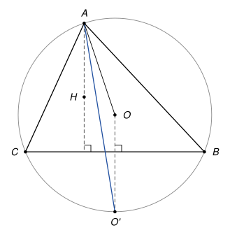

## Statement

Soit $ABC$ un triangle dont les trois angles sont aigus, et tel que $AB \neq AC$. On note $O$ le centre de son cercle circonscrit et $H$ son orthocentre.

La perpendiculaire à la droite $(BC)$ qui passe par $O$ coupe l'arc $BC$ du cercle circonscrit qui ne contient pas $A$ en un point $O'$.

Montrer que la droite $(AO')$ est la bissectrice de l'angle $\widehat{HAO}$.

## Hints

1. Les points $A$ et $O'$ sont tous les deux sur le cercle de centre $O$. Que peut-on dire du triangle $AOO'$ ?
2. La droite $(AH)$ est la hauteur issue de $A$. Comment sont placées l'une par rapport à l'autre les droites $(AH)$ et $(OO')$ ?
3. Coupez ces deux droites par la sécante $(AO')$ et cherchez des angles alternes-internes.

## Solution

**Étape 1 : un triangle isocèle.** Les points $A$ et $O'$ sont sur le cercle circonscrit, de centre $O$, donc $OA = OO'$. Le triangle $AOO'$ est isocèle en $O$, et ses angles à la base sont égaux :

$$\widehat{OAO'} = \widehat{OO'A}.$$

**Étape 2 : deux droites parallèles.** Le point $H$ est l'orthocentre, il est donc sur la hauteur issue de $A$ : la droite $(AH)$ est perpendiculaire à $(BC)$. La droite $(OO')$ est elle aussi perpendiculaire à $(BC)$ par définition. Deux droites perpendiculaires à une même droite sont parallèles :

$$(AH) \parallel (OO').$$

**Étape 3 : les angles alternes-internes.** Regardons le sens des demi-droites. Le triangle a ses trois angles aigus, donc son orthocentre $H$ et le centre $O$ de son cercle circonscrit sont à l'intérieur du triangle. La demi-droite $[AH)$ part donc de $A$ en direction de la droite $(BC)$. Le point $O'$ est sur l'arc qui ne contient pas $A$, donc de l'autre côté de $(BC)$, et la demi-droite $[O'O)$ part de $O'$ en direction du côté de $A$. Ces deux demi-droites sont parallèles et de sens contraires.

Les angles $\widehat{HAO'}$ et $\widehat{OO'A}$ sont alors des angles alternes-internes pour les parallèles $(AH)$ et $(OO')$ coupées par la sécante $(AO')$. Ils sont égaux :

$$\widehat{HAO'} = \widehat{OO'A}.$$

**Étape 4 : conclusion.** Des étapes 1 et 3 on tire

$$\widehat{HAO'} = \widehat{O'AO}.$$

Il reste à voir que $H$ et $O$ sont de part et d'autre de la droite $(AO')$. Sinon, les demi-droites $[AH)$ et $[AO)$ feraient le même angle avec $[AO')$, du même côté : elles seraient confondues. Alors $O$ serait sur la hauteur issue de $A$, qui serait aussi la médiatrice de $[BC]$, et on aurait $AB = AC$, ce qui est exclu. Donc la demi-droite $[AO')$ est à l'intérieur de l'angle $\widehat{HAO}$ et le coupe en deux angles égaux : la droite $(AO')$ est la bissectrice de l'angle $\widehat{HAO}$.

*Pourquoi les angles aigus ?* Seul compte l'angle en $A$ : si l'angle en $B$ ou en $C$ est obtus, $H$ sort du triangle mais la demi-droite $[AH)$ va toujours vers $(BC)$, et la preuve marche telle quelle. En revanche, si l'angle $\widehat{BAC}$ est obtus, l'orthocentre $H$ passe de l'autre côté de $A$ : la demi-droite $[AH)$ monte au lieu de descendre. Les étapes 1 et 2 restent vraies, mais l'étape 3 donne alors $\widehat{HAO'} = 180° - \widehat{OO'A}$, et la droite $(AO')$ devient la bissectrice de l'angle formé par $[AO)$ et le prolongement de $[HA]$ au-delà de $A$. L'énoncé d'origine oubliait cette hypothèse.

## Going further

1. La perpendiculaire à $(BC)$ passant par $O$ est la médiatrice de $[BC]$, donc $O'B = O'C$. En utilisant les angles inscrits qui interceptent les arcs $BO'$ et $O'C$, montrer que $(AO')$ est aussi la bissectrice de l'angle $\widehat{BAC}$.
2. En déduire que $\widehat{HAB} = \widehat{OAC}$ : la hauteur et le rayon issus de $A$ sont symétriques par rapport à la bissectrice de l'angle en $A$.
