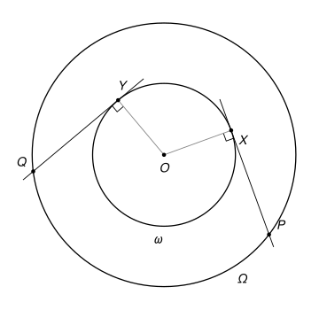

## Statement

Soit $\omega$ et $\Omega$ deux cercles de même centre $O$, le cercle $\omega$ étant à l'intérieur du cercle $\Omega$. Soit $X$ et $Y$ deux points distincts du cercle $\omega$.

La tangente à $\omega$ en $X$ coupe le cercle $\Omega$ en deux points, et on appelle $P$ l'un d'eux. La tangente à $\omega$ en $Y$ coupe aussi $\Omega$ en deux points, et on appelle $Q$ celui qui est du même côté de la droite $(XY)$ que $P$.

Montrer que les points $X$, $Y$, $P$ et $Q$ sont sur un même cercle.

## Hints

1. Tracez la médiatrice $d$ du segment $[XY]$. Par quel point remarquable passe-t-elle ?
2. Que deviennent les cercles $\omega$ et $\Omega$ par la symétrie d'axe $d$ ? Et la tangente à $\omega$ en $X$ ?
3. Montrez que $Q$ est le symétrique de $P$ par rapport à $d$. Considérez ensuite le cercle qui passe par $X$, $Y$ et $P$ : où est son centre ?

## Solution

On note $d$ la médiatrice du segment $[XY]$ et $s$ la symétrie d'axe $d$.

![La solution : la médiatrice d de [XY] en pointillés bleus, axe de symétrie de toute la figure, et le cercle rouge qui passe par X, Y, P et Q](10244-figure-2.svg)

**Étape 1 : la symétrie conserve les deux cercles.** On a $OX = OY$, donc $O$ est sur la médiatrice $d$. La symétrie $s$ laisse $O$ fixe et conserve les longueurs. Elle envoie donc tout cercle de centre $O$ sur lui-même : $s(\omega) = \omega$ et $s(\Omega) = \Omega$. Elle envoie aussi $X$ sur $Y$.

**Étape 2 : la symétrie échange les deux tangentes.** La tangente à $\omega$ en $X$ est la droite qui passe par $X$ et qui est perpendiculaire au rayon $(OX)$. Une symétrie conserve les angles droits. L'image de cette tangente est donc la droite qui passe par $s(X) = Y$ et qui est perpendiculaire à $(s(O)s(X)) = (OY)$ : c'est la tangente à $\omega$ en $Y$.

**Étape 3 : $s(P) = Q$.** Le point $P$ est sur $\Omega$ et sur la tangente en $X$. Son image $s(P)$ est donc sur $s(\Omega) = \Omega$ et sur la tangente en $Y$ : c'est l'un des deux points où cette tangente coupe $\Omega$.

Lequel ? La droite $(XY)$ est perpendiculaire à l'axe $d$. Un point et son symétrique sont sur une même perpendiculaire à $d$, c'est-à-dire sur une parallèle à $(XY)$, et à la même distance de $d$. Ils sont donc du même côté de $(XY)$. Ainsi $s(P)$ est du même côté de $(XY)$ que $P$, et $s(P) = Q$.

**Étape 4 : le cercle.** Les points $X$, $Y$, $P$ ne sont pas alignés. En effet, la tangente en $X$ ne coupe la droite $(XY)$ qu'en $X$ (la droite $(XY)$ coupe $\omega$ en deux points, ce n'est pas la tangente), et $P \neq X$ puisque $P$ est sur le grand cercle et $X$ sur le petit. Il existe donc un cercle $\Gamma$ qui passe par $X$, $Y$ et $P$.

Le centre de $\Gamma$ est à la même distance de $X$ et de $Y$ : il est sur la médiatrice $d$. La symétrie $s$ laisse ce centre fixe, donc elle envoie $\Gamma$ sur lui-même. Comme $P$ est sur $\Gamma$, son symétrique $Q$ est aussi sur $\Gamma$.

**Conclusion.** **Les quatre points $X$, $Y$, $P$ et $Q$ sont sur le cercle $\Gamma$.**

*Remarques.*

- Si par hasard $P$ est sur $d$, on a $Q = P$, et il ne reste que trois points, qui sont bien sur un même cercle.
- La condition « du même côté de $(XY)$ » est indispensable. Si l'on prend pour $Q$ l'autre point, le résultat est faux en général.
- Le corrigé officiel montre que $XYQP$ est un trapèze isocèle, puis conclut avec les angles. Les correcteurs signalent deux erreurs fréquentes : supposer que les droites $(PX)$ et $(QY)$ se coupent, alors qu'elles sont parallèles quand $X$ et $Y$ sont diamétralement opposés, et utiliser un « cas d'égalité » avec deux côtés et un angle non compris entre eux, qui est faux en général. L'argument du cercle $\Gamma$ évite ces deux pièges.
