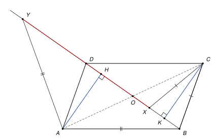

## Statement

Soit $ABCD$ un parallélogramme tel que $AB > AD$ et tel que l'angle $\widehat{ADB}$ soit aigu.

Soit $X$ le point de la demi-droite $[BD)$, autre que $B$, tel que $CX = CB$. Soit $Y$ le point de la demi-droite $[BD)$, autre que $B$, tel que $AY = AB$.

Montrer que $DX = DY$.

## Hints

1. Le triangle $CBX$ est isocèle en $C$. Où tombe le pied de la hauteur issue de $C$ ?
2. Appelez $H$ et $K$ les pieds des perpendiculaires à $(BD)$ issues de $A$ et de $C$, et $O$ le centre du parallélogramme. Que fait la symétrie de centre $O$ aux points $A$, $C$, $H$, $K$ ?
3. Graduez la droite $(BD)$ en prenant $O$ comme origine. Calculez les abscisses de $X$ et de $Y$.

## Solution

*Rappels.*

- *Triangle isocèle.* Dans un triangle isocèle, la hauteur issue du sommet principal coupe la base en son milieu.
- *Parallélogramme.* Les diagonales d'un parallélogramme se coupent en leur milieu $O$, et la symétrie de centre $O$ échange $A$ et $C$, ainsi que $B$ et $D$.
- *Symétrie centrale.* Une symétrie centrale transforme une droite en une droite parallèle (la même droite si elle passe par le centre), et elle conserve les angles, donc les angles droits.

On note $O$ le centre du parallélogramme, $H$ le pied de la perpendiculaire à $(BD)$ issue de $A$, et $K$ le pied de la perpendiculaire à $(BD)$ issue de $C$.

**Étape 1 : $H$ et $K$ sont symétriques par rapport à $O$.** La symétrie de centre $O$ envoie $A$ sur $C$, et la droite $(BD)$, qui passe par $O$, sur elle-même. La perpendiculaire à $(BD)$ passant par $A$ est donc envoyée sur la perpendiculaire à $(BD)$ passant par $C$. Le point $H$, où la première coupe $(BD)$, est envoyé sur le point où la seconde coupe $(BD)$, c'est-à-dire $K$. Donc $O$ est le milieu de $[HK]$.

**Étape 2 : $H$ est le milieu de $[BY]$, et $K$ celui de $[BX]$.** Le triangle $ABY$ est isocèle en $A$, puisque $AY = AB$. La hauteur issue de $A$ coupe la base $[BY]$ en son milieu, et cette hauteur est la perpendiculaire à $(BD)$ issue de $A$ : son pied est $H$. Donc $H$ est le milieu de $[BY]$. De même, le triangle $CBX$ est isocèle en $C$, donc $K$ est le milieu de $[BX]$.

**Étape 3 : le calcul.** Graduons la droite $(BD)$ en prenant $O$ comme origine, dans le sens de $B$ vers $D$. Notons $d = OB = OD$. Le point $B$ a pour abscisse $-d$ et le point $D$ a pour abscisse $d$. Notons $h$ l'abscisse de $H$. D'après l'étape 1, $K$ a pour abscisse $-h$.

L'abscisse du milieu d'un segment est la moyenne des abscisses de ses extrémités. Comme $H$ est le milieu de $[BY]$, l'abscisse $y$ de $Y$ vérifie
$$\frac{-d + y}{2} = h, \qquad \text{donc} \qquad y = d + 2h.$$
Comme $K$ est le milieu de $[BX]$, l'abscisse $x$ de $X$ vérifie
$$\frac{-d + x}{2} = -h, \qquad \text{donc} \qquad x = d - 2h.$$

La distance entre deux points de la droite est la valeur absolue de la différence de leurs abscisses :
$$DY = |y - d| = |2h| \qquad \text{et} \qquad DX = |x - d| = |-2h| = |2h|.$$

**Conclusion.** $DX = DY$ : le point $D$ est le milieu du segment $[XY]$.

*Remarques.*

- Le calcul n'utilise pas que $X$ et $Y$ sont sur la demi-droite $[BD)$ : il marche pour les seconds points d'intersection de la droite $(BD)$ avec le cercle de centre $C$ passant par $B$ et avec le cercle de centre $A$ passant par $B$. Les hypothèses de l'énoncé servent à garantir que ces points existent et sont bien sur la demi-droite $[BD)$.
- Le point $X$ est sur la demi-droite $[BD)$, et différent de $B$, exactement quand $K$ y est, c'est-à-dire quand l'angle $\widehat{CBD}$ est aigu. Or $\widehat{CBD} = \widehat{ADB}$ (angles alternes-internes, car $(AD) \parallel (BC)$). Sans l'hypothèse « $\widehat{ADB}$ aigu », le cercle de centre $C$ passant par $B$ ne recoupe pas la demi-droite $[BD)$, et l'énoncé n'a plus de sens. De même, $Y$ est bien placé quand $\widehat{ABD}$ est aigu, ce que garantit $AB > AD$ : dans le triangle $ABD$, l'angle en $B$ est en face du plus petit des deux côtés $AD$ et $AB$, il est plus petit que l'angle en $D$, il ne peut donc être ni droit ni obtus, sinon l'angle en $D$ le serait aussi et la somme des angles dépasserait $180°$.

## Going further

1. Avec les notations de l'étape 3, montrer que $AB^2 - AD^2 = 4\,h\,d$, en appliquant le théorème de Pythagore dans les triangles $ABH$ et $ADH$. En déduire que $h > 0$ quand $AB > AD$.
2. Que deviennent $X$ et $Y$ quand $ABCD$ est un losange ?
