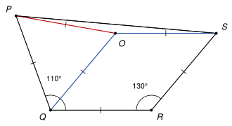

## Statement

On considère un quadrilatère convexe $PQRS$ tel que

$$PQ = QR = RS, \qquad \widehat{PQR} = 110° \qquad \text{et} \qquad \widehat{QRS} = 130°.$$

Calculer les angles $\widehat{SPQ}$ et $\widehat{RSP}$.

![Le quadrilatère PQRS, avec les trois côtés égaux [PQ], [QR], [RS] marqués d'un trait, et les angles de 110° en Q et de 130° en R](10284-figure-1.svg)

## Hints

1. Il y a trois segments de même longueur, mis bout à bout. Placez un point $O$ tel que $QRSO$ soit un losange.
2. Calculez l'angle $\widehat{OQR}$, puis l'angle $\widehat{PQO}$. Que remarquez-vous sur le triangle $PQO$ ?
3. Le triangle $OPS$ est isocèle. Calculez son angle au sommet $O$.

## Solution

*Rappels.*

- *Losange.* Un losange est un parallélogramme. Ses angles opposés sont égaux, et deux angles consécutifs ont pour somme $180°$.
- *Triangle isocèle.* Dans un triangle isocèle, les deux angles à la base sont égaux. Si l'angle au sommet vaut $60°$, le triangle est équilatéral.

**Étape 1 : un losange.** Plaçons le point $O$ tel que $QRSO$ soit un parallélogramme. Comme $QR = RS$, c'est un losange, et

$$OQ = OS = QR = RS.$$

Dans ce losange, l'angle en $O$ est opposé à l'angle en $R$, et les angles en $Q$ et en $S$ sont consécutifs à l'angle en $R$ :

$$\widehat{QOS} = \widehat{QRS} = 130°, \qquad \widehat{OQR} = \widehat{OSR} = 180° - 130° = 50°.$$

**Étape 2 : un triangle équilatéral.** Le point $O$ est à l'intérieur de l'angle $\widehat{PQR}$, donc

$$\widehat{PQO} = \widehat{PQR} - \widehat{OQR} = 110° - 50° = 60°.$$

Le triangle $PQO$ est isocèle en $Q$, car $QP = QR = QO$, et son angle au sommet vaut $60°$. Il est donc équilatéral : $OP = PQ$, et $\widehat{QOP} = \widehat{OPQ} = 60°$.

**Étape 3 : un triangle isocèle très aplati.** On a maintenant $OP = PQ$ et $OS = QR$, donc $OP = OS$ : le triangle $OPS$ est isocèle en $O$.

Autour du point $O$, les angles $\widehat{POQ} = 60°$ et $\widehat{QOS} = 130°$ sont côte à côte, de part et d'autre de $[OQ]$. Ensemble ils font $190°$, donc l'angle $\widehat{POS}$, de l'autre côté, vaut

$$\widehat{POS} = 360° - 190° = 170°.$$

Les deux angles à la base du triangle $OPS$ valent donc

$$\widehat{OPS} = \widehat{OSP} = \frac{180° - 170°}{2} = 5°.$$

**Étape 4 : les deux angles cherchés.** Le point $O$ est à l'intérieur du quadrilatère, donc

$$\widehat{SPQ} = \widehat{SPO} + \widehat{OPQ} = 5° + 60° = 65°,$$

$$\widehat{RSP} = \widehat{RSO} + \widehat{OSP} = 50° + 5° = 55°.$$

**Conclusion.** $\widehat{SPQ} = 65°$ et $\widehat{RSP} = 55°$.

On peut vérifier : $110° + 130° + 65° + 55° = 360°$, ce qui est bien la somme des angles d'un quadrilatère.

*Remarque.* La somme des angles d'un quadrilatère donne seulement $\widehat{SPQ} + \widehat{RSP} = 120°$. Il faut donc vraiment utiliser les trois longueurs égales pour séparer les deux angles. Le corrigé officiel le fait autrement, avec le symétrique de $R$ par rapport à la droite $(SP)$.

## Going further

1. Reprendre l'exercice avec $\widehat{PQR} = 100°$ et $\widehat{QRS} = 140°$.
2. On garde $PQ = QR = RS$, et on note $a = \widehat{PQR}$ et $b = \widehat{QRS}$, avec $a + b > 180°$ et $a \leq b$. Exprimer $\widehat{SPQ}$ et $\widehat{RSP}$ en fonction de $a$ et $b$.
