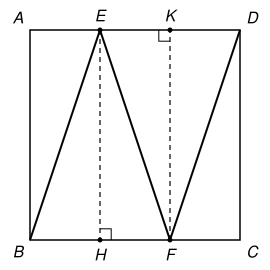

## Statement

Soit $ABCD$ un carré. On suppose qu'il existe un point $E$ sur le côté $[AD]$ et un point $F$ sur le côté $[BC]$ tels que
$$BE = EF = FD = 1 .$$
Quelle est l'aire du carré ?

## Hints

1. Fais une figure. Le triangle $BEF$ a deux côtés égaux : que sais-tu de sa hauteur issue de $E$ ?
2. Trace la hauteur issue de $E$ dans le triangle $BEF$, puis la hauteur issue de $F$ dans le triangle $EFD$. Elles découpent le carré en trois rectangles. Compare leurs largeurs.
3. Note $a$ le côté du carré. Que vaut $AE$ ? Utilise ensuite le théorème de Pythagore dans le triangle $ABE$.

## Solution

Notons $a$ le côté du carré. Plaçons $A$ en haut à gauche, $B$ en bas à gauche, $C$ en bas à droite et $D$ en haut à droite : le côté $[AD]$ est en haut et le côté $[BC]$ en bas.

**Deux triangles isocèles.** Le triangle $BEF$ est isocèle en $E$, puisque $EB = EF$. Soit $H$ le pied de la hauteur issue de $E$, sur $[BF]$. Dans un triangle isocèle, la hauteur issue du sommet principal est aussi la médiane : $H$ est le milieu de $[BF]$, donc $BH = HF$.

De même, le triangle $EFD$ est isocèle en $F$, puisque $FE = FD$. Soit $K$ le pied de la hauteur issue de $F$, sur $[ED]$. Alors $K$ est le milieu de $[ED]$, donc $EK = KD$.

**Trois rectangles.** Les droites $(EH)$ et $(FK)$ sont perpendiculaires aux côtés $[AD]$ et $[BC]$ du carré. Elles découpent le carré en trois rectangles : $ABHE$, $EHFK$ et $KFCD$. Dans un rectangle, les côtés opposés sont égaux, donc
$$AE = BH, \qquad EK = HF, \qquad KD = FC .$$

**Les trois largeurs sont égales.** On a $AE = BH$, puis $BH = HF$ (car $H$ est le milieu de $[BF]$), puis $HF = EK$, puis $EK = KD$ (car $K$ est le milieu de $[ED]$). Ainsi
$$AE = EK = KD .$$
Ces trois longueurs mises bout à bout forment le côté $[AD]$, de longueur $a$. Chacune vaut donc $\dfrac{a}{3}$. En particulier, $AE = \dfrac{a}{3}$.

**Le théorème de Pythagore.** Le triangle $ABE$ est rectangle en $A$, d'hypoténuse $[BE]$. Donc
$$BE^2 = AB^2 + AE^2, \qquad \text{soit} \qquad 1 = a^2 + \frac{a^2}{9} = \frac{10\,a^2}{9} .$$
On en déduit
$$a^2 = \frac{9}{10} .$$

**Conclusion.** L'aire du carré vaut $a^2 = \dfrac{9}{10}$, c'est-à-dire $\text{0,9}$.

*Vérification.* Avec $a^2 = \dfrac{9}{10}$, on a $AE = \dfrac{a}{3}$ et $BF = \dfrac{2a}{3}$. Le segment $[EF]$ a pour « décalage horizontal » $HF = \dfrac{a}{3}$ et pour « hauteur » $a$, donc $EF^2 = a^2 + \dfrac{a^2}{9} = 1$. De même $FD^2 = FC^2 + CD^2 = 1$. La figure existe bien.

## Going further

1. Même question avec quatre segments : on place $E$ et $G$ sur $[AD]$, $F$ sur $[BC]$, et l'on suppose $BE = EF = FG = GC = 1$ (le chemin $B, E, F, G, C$ fait des zigzags entre les deux côtés). Que vaut l'aire du carré ?
2. On remplace le carré par un rectangle $ABCD$ avec $AB = 1$ et $AD = L$. Montrer qu'on peut toujours trouver $E$ sur $[AD]$ et $F$ sur $[BC]$ tels que $BE = EF = FD$, et calculer cette longueur commune en fonction de $L$.
