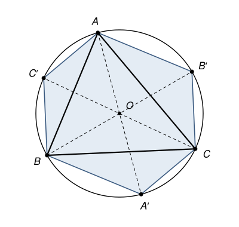

## Statement

Soit $ABC$ un triangle dont les trois angles sont aigus, et soit $O$ le centre de son cercle circonscrit $\Gamma$. Les droites $(AO)$, $(BO)$ et $(CO)$ recoupent le cercle $\Gamma$ en $A'$, $B'$ et $C'$ respectivement.

Démontrer que l'aire de l'hexagone $AC'BA'CB'$ est le double de l'aire du triangle $ABC$.

## Hints

1. Découpe l'hexagone en six triangles qui ont tous le sommet $O$, et le triangle $ABC$ en trois triangles qui ont aussi le sommet $O$.
2. Que dire des longueurs $OB$ et $OB'$ ? Les triangles $AOB$ et $AOB'$ ont le même sommet $A$ : compare leurs hauteurs issues de $A$.
3. Trouve de la même façon un autre triangle de l'hexagone qui a la même aire que $AOB$.

## Solution

Dans cette solution, on note $\mathcal{A}(XYZ)$ l'aire du triangle $XYZ$.

**Le découpage.** Comme les trois angles du triangle sont aigus, le centre $O$ du cercle circonscrit est à l'intérieur du triangle $ABC$. La droite $(AO)$ entre dans le triangle en $A$, passe par $O$, puis ressort du triangle en traversant le côté $[BC]$ avant de recouper le cercle. Le point $A'$ est donc sur l'arc $BC$ qui ne contient pas $A$. De même, $B'$ est sur l'arc $CA$ qui ne contient pas $B$, et $C'$ sur l'arc $AB$ qui ne contient pas $C$.

En faisant le tour du cercle, on rencontre donc les points dans l'ordre $A$, $C'$, $B$, $A'$, $C$, $B'$. Le point $O$ est à l'intérieur de l'hexagone, et en le joignant aux six sommets on découpe l'hexagone en six triangles :

$$\mathcal{A}(AC'BA'CB') = \mathcal{A}(AOC') + \mathcal{A}(C'OB) + \mathcal{A}(BOA') + \mathcal{A}(A'OC) + \mathcal{A}(COB') + \mathcal{A}(B'OA) .$$

De même, comme $O$ est à l'intérieur du triangle $ABC$ :

$$\mathcal{A}(ABC) = \mathcal{A}(AOB) + \mathcal{A}(BOC) + \mathcal{A}(COA) .$$

**Deux triangles de même aire.** Les points $B$, $O$ et $B'$ sont alignés, et $OB = OB'$, car ce sont deux rayons du cercle. Les triangles $AOB$ et $AOB'$ ont le même sommet $A$, et leurs bases $[OB]$ et $[OB']$ sont sur la même droite $(BB')$. Ils ont donc la même hauteur issue de $A$ : la distance de $A$ à la droite $(BB')$. Avec des bases de même longueur et la même hauteur, ils ont la même aire :

$$\mathcal{A}(AOB) = \mathcal{A}(B'OA) .$$

De la même façon, avec le sommet $B$ et les bases $[OA]$ et $[OA']$, qui sont sur la droite $(AA')$ :

$$\mathcal{A}(AOB) = \mathcal{A}(BOA') .$$

**Les six égalités.** On fait la même chose avec les deux autres triangles qui ont le sommet $O$ :

- $\mathcal{A}(BOC) = \mathcal{A}(C'OB)$ (sommet $B$, bases $[OC]$ et $[OC']$) et $\mathcal{A}(BOC) = \mathcal{A}(COB')$ (sommet $C$, bases $[OB]$ et $[OB']$) ;
- $\mathcal{A}(COA) = \mathcal{A}(A'OC)$ (sommet $C$, bases $[OA]$ et $[OA']$) et $\mathcal{A}(COA) = \mathcal{A}(AOC')$ (sommet $A$, bases $[OC]$ et $[OC']$).

Chacun des six triangles de l'hexagone apparaît une fois et une seule dans ces six égalités. En les additionnant :

$$2 \times [\mathcal{A}(AOB) + \mathcal{A}(BOC) + \mathcal{A}(COA)] = \mathcal{A}(AC'BA'CB') .$$

**Conclusion.** Le crochet vaut $\mathcal{A}(ABC)$, donc l'aire de l'hexagone $AC'BA'CB'$ est le double de l'aire du triangle $ABC$.

## Going further

Une autre preuve. Montre que le quadrilatère $BC'B'C$ est un rectangle : ses diagonales $[BB']$ et $[CC']$ ont la même longueur et le même milieu. Remarque ensuite que la symétrie de centre $O$ envoie le triangle $AB'C'$ sur le triangle $A'BC$. Peux-tu retrouver l'aire de l'hexagone à partir de ces deux faits ?
