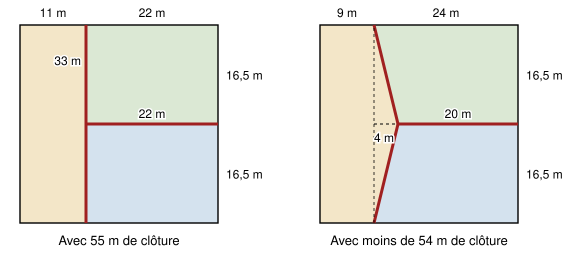

## Statement

Un paysan possède un pré carré de $33$ m de côté, déjà clôturé sur tout son pourtour. Il veut le partager en trois parcelles de même aire, en ajoutant des clôtures à l'intérieur du pré.

Un tel partage est-il possible en ajoutant :

a) au plus $55$ m de clôture ?

b) au plus $54$ m de clôture ?

## Hints

1. Quelle doit être l'aire de chacune des trois parcelles ?
2. Pour a), essaie avec trois rectangles.
3. Pour b), la clôture du a) forme un « T ». Que se passe-t-il si l'on remplace la longue clôture droite par deux morceaux obliques qui se rejoignent, en forme de « Y » couché ?
4. Cherche deux parcelles en forme de trapèze, de hauteur $\text{16,5}$ m. Leur aire est la bonne dès que la somme de leurs deux côtés parallèles vaut $44$ m. Essaie des côtés parallèles de $20$ m et de $24$ m, et calcule les morceaux obliques avec le théorème de Pythagore.

## Solution

L'aire du pré est $33 \times 33 = 1089$ m². Chaque parcelle doit donc avoir une aire de $1089 \div 3 = 363$ m².

**a) Oui, avec trois rectangles.** On pose une clôture droite de $33$ m, parallèle à un côté, à $11$ m du bord gauche. Elle découpe une parcelle de $11 \times 33 = 363$ m². Il reste un rectangle de $22$ m sur $33$ m. Une clôture de $22$ m à mi-hauteur le coupe en deux rectangles de $22 \times \text{16,5} = 363$ m². En tout, on a ajouté $33 + 22 = 55$ m de clôture.

**b) Oui, en penchant les clôtures.** On garde la clôture horizontale à mi-hauteur, mais on la raccourcit, et on remplace la clôture verticale par deux morceaux obliques. Précisément :

- on place un point $M$ à mi-hauteur, à $13$ m du bord gauche ;
- on pose une clôture horizontale de $M$ jusqu'au bord droit : elle mesure $33 - 13 = 20$ m ;
- on pose une clôture de $M$ jusqu'au point $P$ du bord du haut situé à $9$ m du coin en haut à gauche, et une autre de $M$ jusqu'au point $Q$ du bord du bas situé à $9$ m du coin en bas à gauche.

*Les aires.* La parcelle en haut à droite est un trapèze. Ses deux côtés parallèles sont horizontaux : le bord du haut, de $P$ jusqu'au coin, mesure $33 - 9 = 24$ m, et la clôture issue de $M$ mesure $20$ m. Sa hauteur est la moitié du côté, $\text{16,5}$ m. Son aire vaut donc

$$\frac{24 + 20}{2} \times \text{16,5} = 22 \times \text{16,5} = 363 \text{ m}^2 .$$

La parcelle en bas à droite est le même trapèze retourné : elle a aussi $363$ m². La troisième parcelle, un pentagone à gauche, a pour aire $1089 - 2 \times 363 = 363$ m². Les trois parcelles ont bien la même aire.

*La longueur de clôture.* Entre $M$ et $P$, on se déplace de $13 - 9 = 4$ m horizontalement et de $\text{16,5}$ m verticalement. D'après le théorème de Pythagore,

$$MP^2 = \text{16,5}^2 + 4^2 = \text{272,25} + 16 = \text{288,25} .$$

De même, $MQ^2 = \text{288,25}$. Or $17^2 = 289$, et $\text{288,25} < 289$. Comme ce sont des longueurs positives, on en déduit $MP < 17$ et $MQ < 17$. La longueur totale de clôture ajoutée est donc

$$MP + MQ + 20 < 17 + 17 + 20 = 54 \text{ m} .$$

Elle vaut environ $\text{53,96}$ m.

**Conclusion.** Les deux partages sont possibles : avec trois rectangles, il faut exactement $55$ m de clôture, et avec un pentagone et deux trapèzes, il suffit de moins de $54$ m.

## Going further

On peut garder la même forme en changeant un peu les nombres. Si la clôture horizontale mesure $22 - x$ mètres et le côté du haut des trapèzes $22 + x$ mètres, les trapèzes ont toujours la bonne aire, et la longueur totale de clôture vaut

$$(22 - x) + 2\sqrt{\text{16,5}^2 + (2x)^2} .$$

Vérifie cette formule, puis cherche avec une calculatrice la valeur de $x$ qui donne la clôture la plus courte. Que vaut alors la longueur ?
