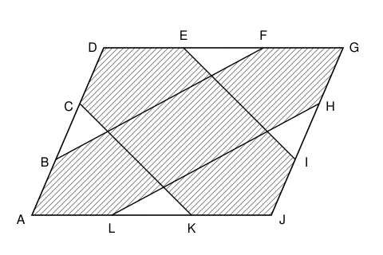

## Statement

$ADGJ$ est un parallélogramme d'aire $540\ \text{cm}^2$. Chacun de ses côtés est partagé en trois
segments de même longueur :

- $B$ et $C$ partagent $[AD]$, avec $B$ du côté de $A$ ;
- $E$ et $F$ partagent $[DG]$, avec $E$ du côté de $D$ ;
- $H$ et $I$ partagent $[GJ]$, avec $H$ du côté de $G$ ;
- $K$ et $L$ partagent $[JA]$, avec $K$ du côté de $J$.

On trace les segments $[CK]$, $[EI]$, $[BF]$ et $[LH]$, et on hachure la zone indiquée sur la
figure. Quelle est l'aire de la zone hachurée ?

## Hints

1. La zone blanche est formée de quatre petits triangles identiques. Il suffit de trouver
   l'aire d'un seul.
2. Trace les droites $(BI)$, $(CH)$, $(LE)$ et $(KF)$. Elles découpent $ADGJ$ en $9$ petits
   parallélogrammes. Quelle est l'aire de chacun ?
3. Montre que le segment $[CK]$ passe par le point où se coupent $(BI)$ et $(LE)$. Pense au
   théorème de la droite des milieux dans le triangle $ACK$.

## Solution

**Un quadrillage.** Traçons les droites $(BI)$ et $(CH)$, parallèles à $(AJ)$, et les droites
$(LE)$ et $(KF)$, parallèles à $(AD)$. Elles découpent $ADGJ$ en $9$ petits parallélogrammes
tous identiques, chacun avec des côtés égaux au tiers de $[AJ]$ et au tiers de $[AD]$. Chacun
a donc une aire de $540 \div 9 = 60\ \text{cm}^2$.

**Le segment $[CK]$ suit le quadrillage.** Dans le triangle $ACK$, le point $B$ est le milieu
de $[AC]$, puisque $AB = BC$. La droite $(BI)$ passe par $B$ et elle est parallèle à $(AK)$.
D'après le théorème de la droite des milieux, elle coupe $[CK]$ en son milieu. De même, $L$
est le milieu de $[AK]$ et la droite $(LE)$ est parallèle à $(AC)$, donc $(LE)$ coupe aussi
$[CK]$ en son milieu.

Le milieu de $[CK]$ est donc le point $M$ où se coupent $(BI)$ et $(LE)$. Ainsi $[CM]$ est une
diagonale du petit parallélogramme qui a pour côté $[BC]$, et $[MK]$ est une diagonale de celui
qui a pour côté $[LK]$.

Le même raisonnement, dans les triangles $BDF$, $EGI$ et $LJH$, montre que $[BF]$, $[EI]$ et
$[LH]$ sont, eux aussi, formés de diagonales de petits parallélogrammes.

**Ce qui est blanc.** Regardons le petit parallélogramme qui a pour côté $[BC]$. Les segments
$[CK]$ et $[BF]$ y tracent ses **deux** diagonales. Elles se coupent en son centre $O$ et le
découpent en quatre triangles. Seul le triangle $BCO$ est blanc, les trois autres sont
hachurés.

Ces quatre triangles ont la même aire. Par exemple, les triangles $OBC$ et $ONC$, où $N$ est le
sommet opposé à $B$, ont la même hauteur issue de $C$ et des bases $[OB]$ et $[ON]$ de même
longueur, puisque les diagonales d'un parallélogramme se coupent en leur milieu. Le triangle
blanc a donc pour aire $60 \div 4 = 15\ \text{cm}^2$.

Il en va de même pour les petits parallélogrammes qui ont pour côtés $[EF]$, $[HI]$ et $[LK]$.
Les cinq autres petits parallélogrammes, ceux des quatre coins et celui du centre, sont
entièrement hachurés.

**Conclusion.** La zone blanche est formée de quatre triangles de $15\ \text{cm}^2$, soit
$60\ \text{cm}^2$, c'est-à-dire un neuvième de l'aire totale. La zone hachurée a donc pour aire

$$540 - 60 = 480\ \text{cm}^2.$$

**L'aire de la zone hachurée vaut $480\ \text{cm}^2$.**
