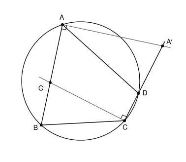

## Statement

Soit $ABCD$ un quadrilatère convexe dont les quatre sommets sont sur un même cercle.

- La perpendiculaire à $(AB)$ passant par $A$ coupe la droite $(CD)$ en $A'$.
- La perpendiculaire à $(CD)$ passant par $C$ coupe la droite $(AB)$ en $C'$.

Montrer que la droite $(A'C')$ est parallèle à la diagonale $(BD)$.

## Hints

1. Les angles $\widehat{C'AA'}$ et $\widehat{C'CA'}$ sont droits. Que peut-on dire des quatre points $A$, $C$, $A'$, $C'$ ?
2. Ces quatre points sont sur le cercle de diamètre $[A'C']$. Dans ce cercle, comparez $\widehat{AC'A'}$ et $\widehat{ACA'}$.
3. Dans le premier cercle, comparez $\widehat{ACD}$ et $\widehat{ABD}$.
4. Il reste à reconnaître deux angles correspondants.

## Solution

**Un outil : le théorème de l'angle inscrit.** Dans un cercle, un angle inscrit vaut la moitié de l'angle au centre qui intercepte le même arc. Par conséquent, deux angles inscrits qui interceptent le même arc, avec leurs sommets du même côté de la corde, sont égaux.

On suit la position des points de la figure : $A'$ est sur la demi-droite $[CD)$, au-delà de $D$, et $C'$ est sur le segment $[AB]$.

**Étape 1 : un deuxième cercle.** Le triangle $AA'C'$ est rectangle en $A$, donc $A$ est sur le cercle de diamètre $[A'C']$. Le triangle $CA'C'$ est rectangle en $C$, donc $C$ est aussi sur ce cercle. Les quatre points $A$, $C$, $A'$, $C'$ sont donc sur un même cercle, de diamètre $[A'C']$.

**Étape 2 : dans ce deuxième cercle.** Les angles inscrits $\widehat{AC'A'}$ et $\widehat{ACA'}$ interceptent le même arc $AA'$, et $C'$ et $C$ sont du même côté de la corde $[AA']$. Donc

$$\widehat{AC'A'} = \widehat{ACA'} .$$

Comme $A'$ est sur la demi-droite $[CD)$, on a $\widehat{ACA'} = \widehat{ACD}$.

**Étape 3 : dans le premier cercle.** Les angles inscrits $\widehat{ACD}$ et $\widehat{ABD}$ interceptent le même arc $AD$, et $C$ et $B$ sont du même côté de la corde $[AD]$, car $ABCD$ est convexe. Donc

$$\widehat{ACD} = \widehat{ABD} .$$

En mettant bout à bout les étapes 2 et 3 :

$$\widehat{AC'A'} = \widehat{ABD} .$$

**Étape 4 : des angles correspondants.** Les droites $(C'A')$ et $(BD)$ sont coupées par la droite $(AB)$. Les demi-droites $[C'A)$ et $[BA)$ vont dans le même sens, et $A'$ et $D$ sont du même côté de $(AB)$. Les angles $\widehat{AC'A'}$ et $\widehat{ABD}$ sont donc des angles correspondants. Ils sont égaux, donc

$$(A'C') \parallel (BD) .$$

Si les points sont placés autrement, certains angles de cette démonstration sont remplacés par leurs suppléments, et la conclusion reste la même.

## Going further

La droite perpendiculaire à $(AB)$ en $A$ recoupe le premier cercle au point $B^*$ diamétralement opposé à $B$, car l'angle $\widehat{BAB^*}$ est droit. De même, la perpendiculaire à $(CD)$ en $C$ passe par le point $D^*$ diamétralement opposé à $D$. Le quadrilatère $BDB^*D^*$ est un rectangle, donc $(B^*D^*)$ est parallèle à $(BD)$. Les lycéens qui connaissent le théorème de Pascal sur l'hexagone $AB^*D^*CDB$ y trouveront une autre démonstration.
