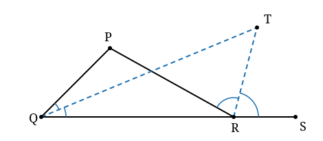

## Statement

Dans un triangle $PQR$, on prolonge le côté $[QR]$ au-delà de $R$ jusqu'à un point $S$.

On trace la bissectrice de l'angle $\widehat{PQR}$ et la bissectrice de l'angle $\widehat{PRS}$.
Ces deux droites se coupent en un point $T$.

Montrer que
$$\widehat{QTR} = \frac{1}{2}\,\widehat{QPR}.$$

## Hints

1. Donne des noms aux angles. Pose $\widehat{QPR} = a$, et appelle $c$ chacune des deux moitiés
   de l'angle en $Q$, et $d$ chacune des deux moitiés de l'angle $\widehat{PRS}$.
2. Dans le triangle $PQR$, exprime $\widehat{PRS}$, c'est-à-dire $2d$, en fonction de $a$ et
   de $c$. Pense à la somme des angles d'un triangle.
3. Fais maintenant le même travail dans le triangle $QTR$ : que vaut l'angle $\widehat{TRS}$,
   c'est-à-dire $d$ ?
4. Tu as deux égalités. Élimine $d$ entre les deux.

## Solution

**Les noms des angles.**

Posons
$$\widehat{QPR} = a, \qquad \widehat{PQT} = \widehat{TQR} = c, \qquad \widehat{PRT} = \widehat{TRS} = d.$$
L'angle en $Q$ du triangle $PQR$ vaut donc $2c$, et l'angle $\widehat{PRS}$ vaut $2d$.

**Un outil : l'angle extérieur.**

Dans un triangle, un angle extérieur est égal à la somme des deux angles du triangle qui ne le
touchent pas. En effet, si les trois angles d'un triangle sont $x$, $y$, $z$, alors
$x + y + z = 180°$, et l'angle extérieur associé à $z$ vaut $180° - z = x + y$.

**Première égalité : dans le triangle $PQR$.**

L'angle $\widehat{PRS}$ est un angle extérieur du triangle $PQR$ en $R$, puisque $S$ est sur le
prolongement de $[QR]$. Les deux angles qui ne le touchent pas sont $\widehat{QPR} = a$ et
$\widehat{PQR} = 2c$. Donc
$$2d = a + 2c .$$

En divisant par $2$ :
$$d = \frac{a}{2} + c, \qquad \text{c'est-à-dire} \qquad d - c = \frac{a}{2}.$$

**Seconde égalité : dans le triangle $QTR$.**

Regardons maintenant le triangle $QTR$. Le point $S$ est aussi sur le prolongement de $[QR]$
au-delà de $R$, donc $\widehat{TRS}$ est un angle extérieur de ce triangle en $R$. Les deux angles
qui ne le touchent pas sont $\widehat{TQR} = c$ et $\widehat{QTR}$. Donc
$$d = c + \widehat{QTR}, \qquad \text{c'est-à-dire} \qquad \widehat{QTR} = d - c.$$

**Conclusion.**

En rapprochant les deux égalités obtenues :
$$\widehat{QTR} = d - c = \frac{a}{2} = \frac{1}{2}\,\widehat{QPR}.$$

C'est bien ce qu'il fallait démontrer.

## Going further

Le résultat ne dépend ni de la forme du triangle, ni de la position de $S$ sur le prolongement.
Vérifie-le sur un cas simple : prends un triangle équilatéral $PQR$. Alors $a = 60°$, $2c = 60°$
donc $c = 30°$, et $\widehat{PRS} = 120°$ donc $d = 60°$. On trouve bien
$\widehat{QTR} = 60° - 30° = 30° = \frac{60°}{2}$.
