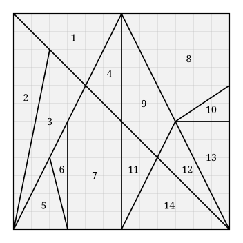

## Statement

Le **Stomachion** est sans doute le plus vieux casse-tête connu : il a au moins $2\,200$ ans,
et on l'attribue à Archimède. C'est un carré découpé en $14$ pièces, que l'on doit
réassembler pour former d'autres figures.

Voici ce découpage, posé sur un quadrillage. Le carré mesure $12$ carreaux de côté, et tous
les coins des pièces tombent exactement sur des nœuds du quadrillage.

1. Calcule l'aire de chacune des $14$ pièces, en carreaux.
2. Vérifie ton travail : la somme des $14$ aires doit valoir l'aire du carré.
3. Que remarques-tu sur ces $14$ nombres ? Quelle fraction du carré la plus grosse pièce
   représente-t-elle ?

## Hints

1. Repère d'abord les coordonnées des sommets de chaque pièce en lisant le quadrillage. Prends
   le coin en bas à gauche du carré comme origine.
2. Pour un triangle qui a un côté horizontal ou vertical, tu connais la formule : la moitié du
   produit de ce côté par la hauteur correspondante, mesurée en carreaux.
3. Pour un triangle tout penché, comme la pièce $3$, enferme-le dans le plus petit rectangle du
   quadrillage possible. L'aire du triangle est celle du rectangle moins les trois triangles
   rectangles qui restent, et ceux-là sont faciles.
4. Pour les pièces à quatre ou cinq côtés ($7$, $8$, $9$), coupe-les en deux morceaux par une
   bonne diagonale.
5. Pour la question 3, range les $14$ aires dans l'ordre croissant et cherche ce qu'elles ont
   toutes en commun. Regarde leurs diviseurs.

## Solution

**Les coordonnées.** En plaçant l'origine au coin en bas à gauche, les $14$ pièces ont pour
sommets :

| pièce | sommets | pièce | sommets |
| --- | --- | --- | --- |
| $1$ | $(0,12)\ (6,12)\ (4,8)$ | $8$ | $(6,12)\ (12,12)\ (12,8)\ (9,6)$ |
| $2$ | $(0,12)\ (2,10)\ (0,0)$ | $9$ | $(6,6)\ (6,12)\ (9,6)\ (8,4)$ |
| $3$ | $(0,0)\ (2,10)\ (4,8)$ | $10$ | $(9,6)\ (12,8)\ (12,6)$ |
| $4$ | $(4,8)\ (6,12)\ (6,6)$ | $11$ | $(6,0)\ (6,6)\ (8,4)$ |
| $5$ | $(0,0)\ (3,0)\ (2,4)$ | $12$ | $(8,4)\ (9,6)\ (12,0)$ |
| $6$ | $(2,4)\ (3,6)\ (3,0)$ | $13$ | $(9,6)\ (12,6)\ (12,0)$ |
| $7$ | $(3,0)\ (3,6)\ (4,8)\ (6,6)\ (6,0)$ | $14$ | $(6,0)\ (8,4)\ (12,0)$ |

**Les pièces faciles.** Ce sont celles qui ont un côté horizontal ou vertical : il sert de
base, et la hauteur se lit directement.

- **Pièce $1$** : base $6$ sur le bord du haut, hauteur $12 - 8 = 4$, aire $\dfrac{6 \times 4}{2} = 12$.
- **Pièce $2$** : base $12$ sur le bord de gauche, hauteur $2$, aire $12$.
- **Pièce $4$** : base $6$ (le segment vertical de $(6,6)$ à $(6,12)$), hauteur $6 - 4 = 2$, aire $6$.
- **Pièce $5$** : base $3$ sur le bord du bas, hauteur $4$, aire $6$.
- **Pièce $6$** : base $6$ (le segment vertical de $(3,0)$ à $(3,6)$), hauteur $1$, aire $3$.
- **Pièce $10$** : base $2$ (sur le bord de droite, de $(12,6)$ à $(12,8)$), hauteur $3$, aire $3$.
- **Pièce $11$** : base $6$ (le segment vertical de $(6,0)$ à $(6,6)$), hauteur $2$, aire $6$.
- **Pièce $13$** : base $6$ (sur le bord de droite, de $(12,0)$ à $(12,6)$), hauteur $3$, aire $9$.
- **Pièce $14$** : base $6$ sur le bord du bas, hauteur $4$, aire $12$.

**La pièce $3$, complètement penchée.** On l'enferme dans le rectangle allant de $(0,0)$ à
$(4,10)$, d'aire $40$, et on retire les trois triangles rectangles qui dépassent :

$$40 - \underbrace{\frac{2 \times 10}{2}}_{10} - \underbrace{\frac{2 \times 2}{2}}_{2} - \underbrace{\frac{4 \times 8}{2}}_{16} = 40 - 28 = 12 .$$

**La pièce $12$**, même méthode, dans le rectangle allant de $(8,0)$ à $(12,6)$, d'aire $24$ :

$$24 - \frac{1 \times 2}{2} - \frac{3 \times 6}{2} - \frac{4 \times 4}{2} = 24 - 1 - 9 - 8 = 6 .$$

**Les pièces à plus de trois côtés.** On les coupe.

- **Pièce $7$** (cinq côtés) : le rectangle de $(3,0)$ à $(6,6)$, d'aire $18$, plus le triangle
  $(3,6)\ (4,8)\ (6,6)$ de base $3$ et de hauteur $2$, d'aire $3$. Total $21$.
- **Pièce $8$** : coupée par la diagonale de $(6,12)$ à $(12,8)$ en deux triangles, l'un de
  base $6$ et de hauteur $4$ (aire $12$), l'autre d'aire $12$ également. Total $24$.
- **Pièce $9$** : coupée par le segment de $(6,6)$ à $(9,6)$, qui est horizontal, en deux
  triangles de base $3$. L'un a pour hauteur $6$ (aire $9$), l'autre pour hauteur $2$ (aire
  $3$). Total $12$.

**Le tableau des aires.**

| pièce | $1$ | $2$ | $3$ | $4$ | $5$ | $6$ | $7$ | $8$ | $9$ | $10$ | $11$ | $12$ | $13$ | $14$ |
| --- | --- | --- | --- | --- | --- | --- | --- | --- | --- | --- | --- | --- | --- | --- |
| aire | $12$ | $12$ | $12$ | $6$ | $6$ | $3$ | $21$ | $24$ | $12$ | $3$ | $6$ | $6$ | $9$ | $12$ |

**2. La vérification.**

$$12 + 12 + 12 + 6 + 6 + 3 + 21 + 24 + 12 + 3 + 6 + 6 + 9 + 12 = 144 = 12 \times 12 .$$

C'est bien l'aire du carré : aucune pièce n'a été oubliée et aucune aire n'est fausse.

**3. Ce que l'on remarque.**

Les aires sont $3, 3, 6, 6, 6, 6, 9, 12, 12, 12, 12, 12, 21, 24$ : **toutes sont des multiples
de $3$**. Aucune n'est un nombre impair non multiple de trois, aucune n'est un demi-carreau,
alors que rien ne l'imposait.

Autrement dit, si l'on découpe le carré en $48$ parts égales de $3$ carreaux chacune
($144 = 48 \times 3$), **chaque pièce vaut un nombre entier de ces parts** :

$$\boxed{\text{l'aire de chaque pièce est un nombre entier de quarante-huitièmes du carré.}}$$

Les $14$ pièces valent respectivement $4, 4, 4, 2, 2, 1, 7, 8, 4, 1, 2, 2, 3, 4$
quarante-huitièmes, et ces nombres font bien $48$ au total.

La plus grosse pièce est la $8$, d'aire $24$ :

$$\frac{24}{144} = \frac{1}{6} .$$

Elle occupe **un sixième** du carré à elle seule. La plus petite, la $6$ ou la $10$, en occupe
$\dfrac{3}{144} = \dfrac{1}{48}$ : la plus grosse fait huit fois la plus petite.

## Going further

1. Un ordinateur a dénombré $536$ façons vraiment différentes de reformer le carré avec les
   $14$ pièces. Trouves-en une autre que celle du dessin.
2. Les pièces $2$ et $3$, recollées le long de leur côté commun, forment un triangle. Quels
   sont ses sommets, et quelle est son aire ? Même question pour les pièces $5$ et $6$, puis
   pour les pièces $11$ et $14$. *(Les deux premières paires restent collées dans toutes les
   solutions connues du casse-tête.)*
3. Il existe une formule, le **théorème de Pick**, qui donne l'aire d'un polygone dont tous
   les sommets sont sur des nœuds à partir du seul comptage des nœuds. Applique-la à la
   pièce $3$ et vérifie que tu retrouves $12$ sans aucun calcul d'aire.
