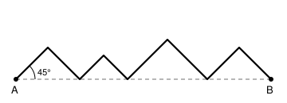

## Statement

Sur la figure ci-dessous, $A$ et $B$ sont deux points tels que $AB = 1$. Une ligne brisée part de $A$, arrive en $B$, et **tous** ses segments font un angle de $45°$ avec la droite $(AB)$. Elle redescend chaque fois jusqu'à la droite $(AB)$ avant de remonter.

Sur le dessin, la ligne a quatre sommets au-dessus de $(AB)$, mais on pourrait en mettre $n$, et de tailles quelconques.

Quelle est la longueur totale de la ligne brisée ?

## Hints

1. Commence par le cas le plus simple : un seul sommet, exactement au-dessus du milieu de $[AB]$. Quelle est la longueur de la ligne ?
2. Dans ce cas, la ligne est formée de deux côtés d'un triangle rectangle isocèle. Le théorème de Pythagore donne la longueur d'un côté oblique en fonction de sa « largeur » horizontale.
3. Dans un triangle rectangle **isocèle**, si les deux côtés de l'angle droit mesurent $c$, combien mesure l'hypoténuse ?
4. Reviens à la figure complète. Pour chaque segment de la ligne brisée, note sa largeur horizontale. Que vaut la somme de toutes ces largeurs ?
5. Chaque segment mesure $\sqrt{2}$ fois sa largeur horizontale. Additionne.

## Solution

**La réponse ne dépend ni du nombre de sommets, ni de leurs positions : la longueur vaut toujours $\sqrt{2}$.**

**Un seul segment d'abord.**

Prenons l'un des segments de la ligne brisée, par exemple celui qui part de $A$ et monte vers le premier sommet $S$. Appelons $H$ le point de $(AB)$ situé juste sous $S$.

Le triangle $AHS$ est rectangle en $H$. L'angle en $A$ vaut $45°$, donc l'angle en $S$ vaut $180° - 90° - 45° = 45°$ lui aussi : le triangle est **isocèle**, et $SH = AH$.

Notons $c = AH$ cette largeur horizontale. Le théorème de Pythagore donne
$$AS^2 = AH^2 + SH^2 = c^2 + c^2 = 2c^2 ,$$
donc
$$AS = c\sqrt{2} .$$

Le même calcul vaut pour **tous** les segments de la ligne, qu'ils montent ou qu'ils descendent : chacun d'eux mesure $\sqrt{2}$ fois sa largeur horizontale.

**On additionne.**

Notons $c_1, c_2, \ldots, c_k$ les largeurs horizontales des $k$ segments de la ligne brisée, dans l'ordre. Comme la ligne va de $A$ à $B$ en avançant toujours vers la droite, ces largeurs se mettent bout à bout et recouvrent exactement le segment $[AB]$ :
$$c_1 + c_2 + \cdots + c_k = AB = 1 .$$

La longueur totale de la ligne brisée vaut donc
$$L = c_1\sqrt{2} + c_2\sqrt{2} + \cdots + c_k\sqrt{2} = (c_1 + c_2 + \cdots + c_k)\sqrt{2} = 1 \times \sqrt{2} .$$

**Conclusion.** La ligne brisée mesure $\sqrt{2}$, soit environ $\text{1,41}$, quel que soit le nombre de sommets et quelles que soient leurs positions.

**Une autre façon de le voir.** Faites glisser tous les segments qui montent vers la gauche, en les mettant bout à bout, et tous les segments qui descendent aussi. On reconstitue exactement les deux côtés d'un grand triangle rectangle isocèle de base $[AB]$, c'est-à-dire la moitié d'un carré de côté $1$. La ligne brisée a donc la même longueur que la diagonale de ce carré.

## Going further

1. Que devient la réponse si les segments font un angle de $60°$ avec $(AB)$ au lieu de $45°$ ?
2. On garde l'angle de $45°$ mais on autorise la ligne à descendre aussi **au-dessous** de $(AB)$, tout en allant toujours de la gauche vers la droite. La longueur change-t-elle ?
3. Et si on autorise la ligne à revenir en arrière ? Donne un exemple où la longueur dépasse $\sqrt{2}$.
