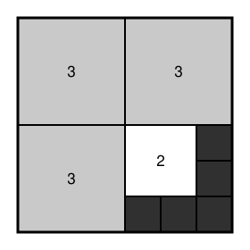

## Statement

Peut-on découper un carré en **neuf** carrés, puis colorier un de ces neuf carrés en blanc, trois en gris et les cinq autres en noir, de façon que

- deux carrés de la **même** couleur aient la **même** taille,
- deux carrés de couleurs **différentes** aient des tailles **différentes** ?

Si oui, montrer un découpage. Si non, expliquer pourquoi c'est impossible.

## Hints

1. Rien n'oblige les neuf carrés à être rangés en grille $3 \times 3$. Ils peuvent avoir trois tailles différentes, et de fait il le faut bien.
2. Cherchez un grand carré dont le côté est un petit nombre entier, et des petits carrés dont les côtés sont eux aussi des nombres entiers.
3. Commencez par couper le grand carré en quatre quarts égaux. Trois de ces quarts vous donnent déjà trois carrés identiques.
4. Il reste alors à découper le quatrième quart en un carré et cinq carrés plus petits. Placez le carré moyen dans un coin du quart et regardez ce qui reste.

## Solution

**Oui, c'est possible.** Voici une façon de faire.

Partons d'un carré de côté $6$ et coupons-le en quatre quarts égaux, chacun de côté $3$.

Trois de ces quarts restent tels quels : ce sont **trois carrés de côté $3$**, qu'on colorie en **gris**.

Dans le quatrième quart, qui est un carré de côté $3$, on place dans un coin un **carré de côté $2$**, qu'on colorie en **blanc**. Ce qui reste est un coude (une forme en L) d'aire

$$3 \times 3 - 2 \times 2 = 9 - 4 = 5 .$$

Ce coude a une épaisseur de $1$ partout : il se découpe donc exactement en **cinq carrés de côté $1$**, qu'on colorie en **noir**.

**Vérifions que tout est en règle.**

- Nombre de carrés : $3 + 1 + 5 = 9$. ✔
- Couleurs : $1$ blanc, $3$ gris, $5$ noirs. ✔
- Même couleur, même taille : les trois gris mesurent tous $3$, les cinq noirs mesurent tous $1$. ✔
- Couleurs différentes, tailles différentes : $3$, $2$ et $1$ sont bien trois nombres distincts. ✔
- Les aires se recollent : $3 \times 3^2 + 1 \times 2^2 + 5 \times 1^2 = 27 + 4 + 5 = 36 = 6^2$. ✔

**Conclusion.** Le découpage ci-dessus répond à la question : c'est donc possible.

## Going further

Un conseil de méthode, donné par les correcteurs de l'épreuve : plusieurs candidats ont passé beaucoup de temps à essayer de démontrer que c'était **impossible**, et s'y sont épuisés. Quand une démonstration d'impossibilité devient longue et pénible, c'est souvent le signe qu'il existe en fait une solution, et qu'il vaut mieux se remettre à chercher un exemple.

Une question pour continuer : avec un carré de côté $6$, on a utilisé les tailles $3$, $2$ et $1$. Existe-t-il d'autres découpages, avec d'autres tailles ?
