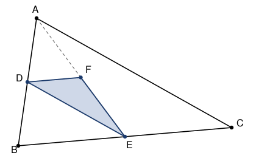

## Statement

Un triangle $ABC$ a une aire égale à $944$.

On appelle $D$ le milieu de $[AB]$, $E$ le milieu de $[BC]$, et $F$ le milieu de $[AE]$.

Quelle est l'aire du triangle $DEF$ ?

## Hints

1. Une médiane d'un triangle le coupe en deux triangles de même aire. Pourquoi ?
2. Compare l'aire de $ABE$ à celle de $ABC$ : le point $E$ est le milieu de $[BC]$.
3. Passe ensuite de $ABE$ à $ADE$ en utilisant que $D$ est le milieu de $[AB]$, puis de $ADE$ à
   $DEF$ en utilisant que $F$ est le milieu de $[AE]$.

## Solution

**Le point de départ : une médiane coupe un triangle en deux parties de même aire.**

Si $M$ est le milieu d'un côté $[XY]$ d'un triangle $XYZ$, alors les triangles $XMZ$ et $MYZ$
ont des bases $[XM]$ et $[MY]$ de même longueur, portées par la même droite, et ils ont le
même sommet $Z$, donc la même hauteur issue de $Z$. Leurs aires sont donc égales, et chacune
vaut la moitié de l'aire de $XYZ$.

Nous allons appliquer cette remarque trois fois de suite.

**Premier pas : de $ABC$ à $ABE$.** Le point $E$ est le milieu de $[BC]$, donc $[AE]$ est une
médiane du triangle $ABC$. Ainsi

$$\text{aire}(ABE) = \frac{1}{2} \times \text{aire}(ABC) = \frac{944}{2} = 472.$$

**Deuxième pas : de $ABE$ à $ADE$.** Regardons maintenant le triangle $ABE$. Le point $D$ est
le milieu de $[AB]$, donc $[ED]$ est une médiane du triangle $ABE$. Ainsi

$$\text{aire}(ADE) = \frac{1}{2} \times \text{aire}(ABE) = \frac{472}{2} = 236.$$

**Troisième pas : de $ADE$ à $DEF$.** Regardons enfin le triangle $ADE$. Le point $F$ est le
milieu de $[AE]$, donc $[DF]$ est une médiane du triangle $ADE$. Ainsi

$$\text{aire}(DEF) = \frac{1}{2} \times \text{aire}(ADE) = \frac{236}{2} = 118.$$

**L'aire du triangle $DEF$ vaut $118$.**

## Going further

En résumé, $DEF$ occupe le huitième de $ABC$ : trois passages au milieu, donc trois divisions
par $2$. L'aire de départ $944$ avait été choisie pour que $944 = 8 \times 118$ tombe juste.
