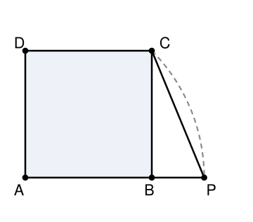

## Statement

$ABCD$ est un carré.

On trace le cercle de centre $A$ qui passe par $C$. Ce cercle coupe la demi-droite $[AB)$ en un point $P$.

Combien mesure l'angle $\widehat{PCB}$ ?

## Hints

1. Que vaut $AP$ ? Relisez la définition du cercle : tous ses points sont à la même distance de son centre.
2. Le triangle $APC$ a donc deux côtés de même longueur. Qu'est-ce que cela dit de ses angles ?
3. Que vaut l'angle $\widehat{CAB}$ dans un carré ? C'est un angle que vous connaissez : la diagonale d'un carré coupe l'angle droit en deux.
4. Une fois $\widehat{ACP}$ trouvé, il reste à enlever la part de l'angle qui se trouve à l'intérieur du carré, c'est-à-dire $\widehat{ACB}$.

## Solution

**Étape 1 : le triangle $APC$ est isocèle.**

Le point $P$ et le point $C$ sont tous les deux sur le cercle de centre $A$. Ils sont donc à la même distance de $A$ :

$$AP = AC.$$

Le triangle $APC$ est donc isocèle en $A$, et ses deux angles à la base sont égaux :

$$\widehat{APC} = \widehat{ACP}.$$

**Étape 2 : l'angle au sommet.**

Dans le carré $ABCD$, la diagonale $[AC]$ partage l'angle droit $\widehat{DAB}$ en deux angles égaux. Donc

$$\widehat{CAP} = \widehat{CAB} = \dfrac{90^\circ}{2} = 45^\circ.$$

(Le point $P$ est sur la demi-droite $[AB)$, donc l'angle $\widehat{CAP}$ est bien le même que $\widehat{CAB}$.)

**Étape 3 : les angles à la base.**

La somme des angles du triangle $APC$ vaut $180^\circ$ :

$$\widehat{PAC} + \widehat{APC} + \widehat{ACP} = 180^\circ.$$

Comme les deux derniers sont égaux,

$$45^\circ + 2 \times \widehat{ACP} = 180^\circ,$$

donc $2 \times \widehat{ACP} = 135^\circ$, et

$$\widehat{ACP} = \dfrac{135^\circ}{2} = \text{67,5}^\circ.$$

**Étape 4 : on retranche.**

Pour la même raison qu'à l'étape 2, la diagonale $[CA]$ partage l'angle droit $\widehat{BCD}$ en deux, donc $\widehat{ACB} = 45^\circ$.

Sur la figure, la demi-droite $[CB)$ est située entre $[CA)$ et $[CP)$. On peut donc soustraire :

$$\widehat{PCB} = \widehat{ACP} - \widehat{ACB} = \text{67,5}^\circ - 45^\circ = \text{22,5}^\circ.$$

**Conclusion.**

$$\boxed{\widehat{PCB} = \text{22,5}^\circ.}$$

*Une remarque de correcteur.* Une preuve qui n'utilise nulle part le fait que $P$ est sur le cercle de centre $A$ passant par $C$ ne peut pas être juste : c'est cette hypothèse, et elle seule, qui fixe la position de $P$. Quand une hypothèse de l'énoncé ne sert jamais, c'est presque toujours le signe qu'une étape est fausse.

## Going further

1. Et si l'on remplaçait le carré par un rectangle de longueur double de sa largeur ? L'angle $\widehat{PCB}$ tomberait-il encore sur une valeur aussi simple ?
2. Le point $P$ tombe-t-il à l'intérieur du segment $[AB]$ ou au-delà de $B$ ? Justifiez sans calculer de longueur, juste en comparant $AC$ et $AB$.
