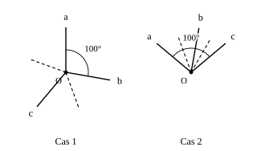

## Statement

Trois demi-droites partent d'un même point $O$. Prises deux par deux, elles forment trois angles, et chacun de ces trois angles mesure moins de $180°$.

L'un de ces trois angles mesure $100°$.

On trace la bissectrice de chacun des deux autres angles. Quelle mesure peut avoir l'angle formé par ces deux bissectrices ? Trouver **toutes** les valeurs possibles.

## Hints

1. Commence par un cas simple : deux angles côte à côte, qui se touchent le long d'une demi-droite commune. Si le premier mesure $30°$ et le second $50°$, combien mesure l'angle entre leurs deux bissectrices ? Recommence avec d'autres nombres. Que remarques-tu ?
2. Fais plusieurs dessins de trois demi-droites issues d'un même point. Les dessins n'ont pas tous la même allure. Combien d'allures différentes trouves-tu ?
3. Il y a deux allures possibles. Ou bien les trois angles se partagent le tour complet du point, et leur somme vaut $360°$. Ou bien une des demi-droites est à l'intérieur de l'angle formé par les deux autres, et le plus grand des trois angles est alors la somme des deux plus petits.
4. Dans chaque allure, demande-toi ensuite lequel des trois angles vaut $100°$. Cela ne donne pas toujours la même réponse.

## Solution

**Un outil à préparer : deux angles côte à côte.**

Soient deux angles $\widehat{POQ}$ et $\widehat{QOR}$ placés côte à côte, c'est-à-dire que la demi-droite $[OQ)$ leur est commune et se trouve entre $[OP)$ et $[OR)$.

La bissectrice du premier coupe $\widehat{POQ}$ en deux, donc elle fait un angle $\tfrac{1}{2}\widehat{POQ}$ avec $[OQ)$. De même, la bissectrice du second fait un angle $\tfrac{1}{2}\widehat{QOR}$ avec $[OQ)$, de l'autre côté. L'angle entre les deux bissectrices vaut donc

$$\frac{1}{2}\widehat{POQ} + \frac{1}{2}\widehat{QOR} = \frac{\widehat{POQ} + \widehat{QOR}}{2}.$$

**Retenons :** pour deux angles côte à côte, l'angle entre leurs bissectrices est **la moitié de leur somme**.

**Les deux allures possibles du dessin.**

Trois demi-droites issues de $O$ découpent le tour du point en trois secteurs, dont la somme fait $360°$. Deux situations seulement peuvent se produire.

- **Cas 1.** Aucune demi-droite n'est à l'intérieur de l'angle des deux autres. Les trois angles de l'énoncé sont alors les trois secteurs eux-mêmes, et leur somme vaut $360°$.
- **Cas 2.** Une demi-droite est à l'intérieur de l'angle formé par les deux autres. En appelant $p$ et $q$ les deux angles qu'elle délimite, les trois angles de l'énoncé sont $p$, $q$ et $p+q$ : le plus grand est la somme des deux autres.

**Cas 1 : les trois angles font le tour.**

Les deux angles autres que celui de $100°$ ont pour somme

$$360° - 100° = 260°.$$

Ces deux angles sont côte à côte. D'après l'outil, l'angle entre leurs bissectrices vaut

$$\frac{260°}{2} = 130°.$$

**Cas 2, d'abord si $100°$ est le plus grand angle.**

Alors $p + q = 100°$, et les deux autres angles sont $p$ et $q$, qui sont côte à côte. L'angle entre leurs bissectrices vaut

$$\frac{100°}{2} = 50°.$$

**Cas 2, ensuite si $100°$ est un des deux petits angles.**

Disons $p = 100°$. Les deux autres angles sont alors $q$ et $p + q = 100° + q$. Cette fois ils ne sont pas côte à côte : le petit est contenu dans le grand. Repérons chaque demi-droite par l'angle qu'elle fait avec la première, comme des graduations :

| demi-droite | la première | celle du milieu | la dernière |
|---|---|---|---|
| graduation | $0$ | $100°$ | $100° + q$ |

La bissectrice d'un angle se trouve à la graduation du milieu de ses deux côtés.

- L'angle $q$ a ses côtés aux graduations $100°$ et $100°+q$ : sa bissectrice est à $100° + \dfrac{q}{2}$.
- L'angle $100°+q$ a ses côtés aux graduations $0$ et $100°+q$ : sa bissectrice est à $\dfrac{100°+q}{2} = 50° + \dfrac{q}{2}$.

L'angle entre les deux bissectrices est la différence :

$$\left(100° + \frac{q}{2}\right) - \left(50° + \frac{q}{2}\right) = 50°.$$

On retrouve $50°$, quelle que soit la valeur de $q$.

**Conclusion.**

L'angle entre les deux bissectrices vaut $130°$ dans le premier cas et $50°$ dans le second. Les deux valeurs possibles sont donc

$$50° \quad \text{et} \quad 130°.$$

## Going further

1. Les deux réponses $50°$ et $130°$ sont supplémentaires. Est-ce un hasard ? Reprends le problème en remplaçant $100°$ par un angle $\alpha$ quelconque et compare les deux réponses.
2. Dans le cas 1, peut-on choisir les trois angles de façon que les deux bissectrices soient perpendiculaires ?
