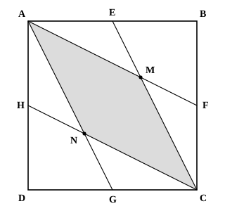

## Statement

On considère un carré $ABCD$ de côté $1$ et les milieux $E$, $F$, $G$ et $H$ de ses côtés $[AB]$, $[BC]$, $[CD]$ et $[DA]$ respectivement. Les droites $(AF)$ et $(EC)$ se coupent en $M$, les droites $(AG)$ et $(CH)$ se coupent en $N$.

1. Montrer que $AMCN$ est un losange.
2. Déterminer l'aire du losange $AMCN$.

## Hints

1. Trace la diagonale $[BD]$ du carré. Où semblent se trouver $M$ et $N$ ?
2. Regarde le triangle $ABC$ tout seul. $E$ est le milieu de $[AB]$ et $F$ est le milieu de $[BC]$ : que sont les droites $(CE)$ et $(AF)$ pour ce triangle ?
3. Les trois médianes d'un triangle se coupent en un même point, le centre de gravité, situé aux deux tiers de chaque médiane en partant du sommet. La troisième médiane du triangle $ABC$ part de $B$ : vers quel point va-t-elle ?
4. Fais le même travail avec le triangle $ACD$ pour le point $N$. Tu obtiendras que $M$ et $N$ partagent la diagonale $[BD]$ en trois parties égales.
5. Dans un carré, chaque diagonale est la médiatrice de l'autre. Que peux-tu alors dire des longueurs $MA$ et $MC$ ? Et de $NA$ et $NC$ ?
6. Pour l'aire : l'aire d'un losange vaut la moitié du produit de ses diagonales. Le carré est lui-même un losange, ce qui donne la valeur du produit $AC \times BD$.

## Solution

Appelons $O$ le centre du carré, c'est-à-dire le point d'intersection des diagonales $[AC]$ et $[BD]$. Rappelons deux propriétés du carré, qui vont servir :

- les diagonales se coupent en leur milieu, donc $O$ est le milieu de $[AC]$ et le milieu de $[BD]$ ;
- les diagonales sont perpendiculaires, donc $(BD)$ est la **médiatrice** de $[AC]$.

### Étape 1 : le point M est le centre de gravité du triangle ABC

Oublions un instant le carré et regardons le seul triangle $ABC$.

- $E$ est le milieu de $[AB]$, donc $(CE)$ est la médiane du triangle $ABC$ issue de $C$ ;
- $F$ est le milieu de $[BC]$, donc $(AF)$ est la médiane du triangle $ABC$ issue de $A$.

Le point $M$, intersection de ces deux médianes, est donc le **centre de gravité** du triangle $ABC$.

Or les trois médianes d'un triangle passent par le centre de gravité. La troisième médiane du triangle $ABC$ est celle issue de $B$, et elle rejoint le milieu de $[AC]$, c'est-à-dire le point $O$. Donc :

$$M \text{ appartient à la droite } (BO), \text{ c'est-à-dire à la diagonale } (BD)$$

De plus, le centre de gravité se trouve aux deux tiers de chaque médiane en partant du sommet, donc

$$BM = \frac{2}{3}\,BO = \frac{2}{3} \times \frac{BD}{2} = \frac{BD}{3}$$

### Étape 2 : le point N est le centre de gravité du triangle ACD

Le même raisonnement s'applique au triangle $ACD$ :

- $H$ est le milieu de $[AD]$, donc $(CH)$ est la médiane issue de $C$ ;
- $G$ est le milieu de $[DC]$, donc $(AG)$ est la médiane issue de $A$.

Donc $N$ est le centre de gravité du triangle $ACD$, il appartient à la médiane issue de $D$, qui rejoint elle aussi le milieu $O$ de $[AC]$. Donc $N$ est sur la diagonale $(BD)$, et

$$DN = \frac{2}{3}\,DO = \frac{BD}{3}$$

**Les points $M$ et $N$ partagent donc la diagonale $[BD]$ en trois parties égales :**

$$BM = MN = ND = \frac{BD}{3}$$

En particulier $M$ est entre $B$ et $O$, $N$ est entre $O$ et $D$, et

$$OM = BO - BM = \frac{BD}{2} - \frac{BD}{3} = \frac{BD}{6} \qquad ON = DO - DN = \frac{BD}{6}$$

donc **$O$ est le milieu de $[MN]$**.

### Question 1 : AMCN est un losange

Regardons le quadrilatère $AMCN$. Ses diagonales sont $[AC]$ et $[MN]$.

- Elles se coupent en $O$, qui est à la fois le milieu de $[AC]$ et le milieu de $[MN]$. Un quadrilatère dont les diagonales se coupent en leur milieu est un **parallélogramme**.
- Elles sont perpendiculaires, puisque $[MN]$ est porté par la diagonale $(BD)$ du carré, perpendiculaire à $(AC)$.

Un parallélogramme dont les diagonales sont perpendiculaires est un **losange**. Donc $AMCN$ est bien un losange.

(On peut aussi le voir directement : $M$ et $N$ sont sur $(BD)$, qui est la médiatrice de $[AC]$, donc $MA = MC$ et $NA = NC$ ; et comme $AMCN$ est un parallélogramme, ses côtés opposés sont égaux, d'où les quatre côtés égaux.)

### Question 2 : l'aire du losange

L'aire d'un losange est la moitié du produit de ses diagonales. Pour $AMCN$ :

$$\mathcal{A} = \frac{1}{2} \times AC \times MN$$

Or $MN = \dfrac{BD}{3}$, donc

$$\mathcal{A} = \frac{1}{2} \times AC \times \frac{BD}{3} = \frac{1}{3} \times \left(\frac{1}{2} \times AC \times BD\right)$$

Le carré $ABCD$ est lui aussi un losange (ses quatre côtés sont égaux), donc la même formule donne son aire :

$$\frac{1}{2} \times AC \times BD = \text{aire du carré} = 1^2 = 1$$

Par conséquent

$$\mathcal{A} = \frac{1}{3} \times 1 = \frac{1}{3}$$

**Conclusion.** $AMCN$ est un losange, et son aire vaut $\dfrac{1}{3}$, c'est-à-dire le tiers de l'aire du carré.

*Remarque.* On peut aussi calculer les diagonales : le théorème de Pythagore donne $AC^2 = 1^2 + 1^2 = 2$, donc $AC = BD = \sqrt{2}$ et $MN = \dfrac{\sqrt{2}}{3}$. L'aire vaut alors $\dfrac{1}{2} \times \sqrt{2} \times \dfrac{\sqrt{2}}{3} = \dfrac{2}{6} = \dfrac{1}{3}$, le même résultat.

## Going further

1. Montrer que le triangle $ABM$ a pour aire $\dfrac{1}{6}$. (Sa base $[AB]$ mesure $1$ ; quelle est sa hauteur ?)
2. Les quatre droites $(AF)$, $(EC)$, $(AG)$ et $(CH)$ découpent le carré en plusieurs morceaux, dont le losange. Combien y en a-t-il, et quelles sont leurs aires ?
