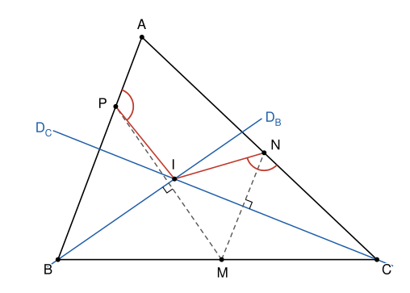

## Statement

Soit $ABC$ un triangle. On choisit un point $M$ sur le côté $[BC]$, un point $N$ sur le côté $[CA]$ et un point $P$ sur le côté $[AB]$, tous les trois distincts des sommets du triangle, de sorte que

$$BM = BP \qquad \text{et} \qquad CM = CN .$$

On note $D_B$ la droite qui passe par $B$ et qui est perpendiculaire à $(MP)$, et $D_C$ la droite qui passe par $C$ et qui est perpendiculaire à $(MN)$. Ces deux droites se coupent en un point $I$.

Démontrer que les angles $\widehat{IPA}$ et $\widehat{INC}$ sont égaux.

## Hints

1. Le point $B$ est à la même distance de $M$ et de $P$. Sur quelle droite remarquable se trouve-t-il ?
2. Montre que $D_B$ est la médiatrice de $[MP]$. Que fait la symétrie d'axe $D_B$ aux points $M$, $P$, $B$ et $I$ ?
3. Déduis-en un angle en $M$ égal à $\widehat{BPI}$, puis un autre angle en $M$ égal à $\widehat{CNI}$.
4. Que vaut la somme $\widehat{BMI} + \widehat{CMI}$ ? Et la somme $\widehat{API} + \widehat{BPI}$ ?

## Solution

**La droite $D_B$ est la médiatrice de $[MP]$.** Comme $BM = BP$, le point $B$ est à la même distance de $M$ et de $P$, donc il est sur la médiatrice de $[MP]$. Cette médiatrice est une droite perpendiculaire à $(MP)$ qui passe par $B$. Or il n'y a qu'une seule droite qui passe par $B$ et qui est perpendiculaire à $(MP)$ : c'est $D_B$. Donc $D_B$ est la médiatrice de $[MP]$.

De la même façon, comme $CM = CN$, la droite $D_C$ est la médiatrice de $[MN]$.

**Une première paire d'angles égaux.** Dans la symétrie d'axe $D_B$, le point $M$ a pour image $P$, puisque $D_B$ est la médiatrice de $[MP]$. Les points $B$ et $I$ sont sur l'axe, donc ils restent à leur place. L'angle $\widehat{BMI}$ a donc pour image l'angle $\widehat{BPI}$. Une symétrie conserve les angles, donc

$$\widehat{BPI} = \widehat{BMI} .$$

**Une deuxième paire.** De même, dans la symétrie d'axe $D_C$, le point $M$ a pour image $N$, et les points $C$ et $I$ restent à leur place. Donc

$$\widehat{CNI} = \widehat{CMI} .$$

**Les deux angles en $M$.** Le point $M$ est sur le segment $[BC]$, entre $B$ et $C$. Les angles $\widehat{BMI}$ et $\widehat{CMI}$ sont donc supplémentaires :

$$\widehat{BMI} + \widehat{CMI} = 180^\circ .$$

En remplaçant chacun par l'angle égal trouvé plus haut, on obtient

$$\widehat{BPI} + \widehat{CNI} = 180^\circ .$$

**Conclusion.** Le point $P$ est sur le segment $[AB]$, entre $A$ et $B$, donc les angles $\widehat{API}$ et $\widehat{BPI}$ sont supplémentaires : $\widehat{API} = 180^\circ - \widehat{BPI}$. D'après l'égalité précédente, $180^\circ - \widehat{BPI} = \widehat{CNI}$. Donc

$$\widehat{IPA} = \widehat{INC} .$$

## Going further

1. Montrer que $IM = IN = IP$ : le point $I$ est le centre d'un cercle qui passe par $M$, $N$ et $P$.
2. Montrer que $D_B$ coupe l'angle $\widehat{ABC}$ en deux angles égaux, et de même pour $D_C$ et l'angle $\widehat{ACB}$. Le point $I$ ne dépend donc pas du choix de $M$. Pourquoi ?
