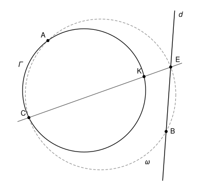

## Statement

On considère un cercle fixe $\Gamma$ passant par un point $A$, et une droite fixe $(d)$ passant par un point $B$.

Un cercle variable $\omega$ passe par $A$ et par $B$. Il recoupe le cercle $\Gamma$ en un point $C$ et la droite $(d)$ en un point $E$. La droite $(CE)$ recoupe le cercle $\Gamma$ en un point $K$.

Montrer que le point $K$ est le même quel que soit le cercle $\omega$ choisi.

## Hints

1. Pour montrer qu'un point ne bouge pas, on peut le construire à partir d'objets qui ne bougent pas. Quels points de la figure ne dépendent pas de $\omega$ ?
2. La droite $(AB)$ recoupe $\Gamma$ en un point $F$ qui ne dépend pas de $\omega$. Tracez la droite $(FK)$ : que remarquez-vous ?
3. Pour montrer que $(FK)$ est parallèle à $(d)$, comparez l'angle $\widehat{FKC}$ avec l'angle $\widehat{FAC}$ dans le cercle $\Gamma$, puis l'angle $\widehat{BAC}$ avec l'angle $\widehat{BEC}$ dans le cercle $\omega$.
4. Les angles $\widehat{FKC}$ et $\widehat{BEC}$ sont des angles correspondants pour les droites $(KF)$ et $(EB)$ coupées par la droite $(CE)$.

## Solution

**Un outil : le théorème de l'angle inscrit.** Dans un cercle, un angle inscrit vaut la moitié de l'angle au centre qui intercepte le même arc. Par conséquent, deux angles inscrits qui interceptent le même arc, avec leurs sommets du même côté de la corde, sont égaux.

On suit la position des points de la figure.

**Étape 1 : un point qui ne dépend pas de $\omega$.** La droite $(AB)$ recoupe le cercle $\Gamma$ en un point $F$. Ce point est construit avec $\Gamma$, $A$ et $B$ seulement, il ne dépend donc pas de $\omega$. Sur la figure, $F$ est entre $A$ et $B$. Nous allons montrer que **la droite $(FK)$ est parallèle à $(d)$**.

**Étape 2 : dans le cercle $\Gamma$.** Les points $A$, $C$, $F$, $K$ sont sur $\Gamma$. Les angles inscrits $\widehat{FKC}$ et $\widehat{FAC}$ interceptent le même arc $FC$, et $K$ et $A$ sont du même côté de la corde $[FC]$. Donc

$$\widehat{FKC} = \widehat{FAC} .$$

Comme $F$ est sur le segment $[AB]$, les demi-droites $[AF)$ et $[AB)$ sont les mêmes, donc $\widehat{FAC} = \widehat{BAC}$.

**Étape 3 : dans le cercle $\omega$.** Les points $A$, $B$, $C$, $E$ sont sur $\omega$. Les angles inscrits $\widehat{BAC}$ et $\widehat{BEC}$ interceptent le même arc $BC$, et $A$ et $E$ sont du même côté de la corde $[BC]$. Donc

$$\widehat{BAC} = \widehat{BEC} .$$

En mettant bout à bout les étapes 2 et 3 :

$$\widehat{FKC} = \widehat{BEC} .$$

**Étape 4 : des angles correspondants.** Les points $C$, $K$, $E$ sont alignés, dans cet ordre. Les droites $(KF)$ et $(EB)$ sont coupées par la droite $(CE)$, et $F$ et $B$ sont du même côté de $(CE)$. Les angles $\widehat{FKC}$ et $\widehat{BEC}$ sont donc des angles correspondants. Ils sont égaux, donc les droites $(KF)$ et $(EB)$ sont parallèles. Comme $(EB)$ est la droite $(d)$ :

$$(FK) \parallel (d) .$$

**Conclusion.** Le point $K$ est sur le cercle $\Gamma$ et sur la droite qui passe par $F$ et qui est parallèle à $(d)$. Cette droite ne dépend pas de $\omega$, et elle recoupe $\Gamma$ en un seul autre point que $F$. **Le point $K$ est ce point-là, quel que soit le cercle $\omega$ : il ne bouge pas.**

Si les points sont placés autrement que sur la figure, certains des angles ci-dessus sont remplacés par leurs suppléments. En effet, deux angles inscrits qui interceptent la même corde, avec leurs sommets de part et d'autre de cette corde, ont une somme de $180^\circ$. Le raisonnement et la conclusion restent les mêmes.

## Going further

Pour ne pas avoir à distinguer les cas de figure, les olympiades utilisent les angles orientés de droites, comptés à $180^\circ$ près. Avec eux, l'égalité « deux angles inscrits qui interceptent la même corde sont égaux » est vraie dans toutes les positions, et la démonstration ci-dessus s'écrit en une ligne.

Le cœur de l'exercice est souvent appelé le théorème de Reim : si deux cercles se coupent en $A$ et $C$, et si deux droites passant par $A$ et par $C$ recoupent le premier cercle en $F$ et $K$ et le second en $B$ et $E$, alors $(FK)$ et $(BE)$ sont parallèles.
