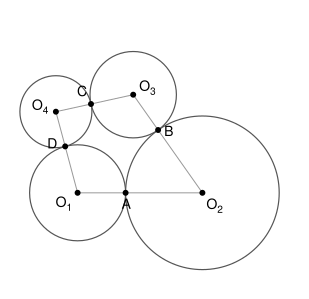

## Statement

On considère quatre cercles $\Gamma_1$, $\Gamma_2$, $\Gamma_3$, $\Gamma_4$, de centres $O_1$, $O_2$, $O_3$, $O_4$. Aucun ne déborde sur un autre : leurs intérieurs ne se chevauchent pas. De plus :

- $\Gamma_1$ et $\Gamma_2$ se touchent en un point $A$ ;
- $\Gamma_2$ et $\Gamma_3$ se touchent en un point $B$ ;
- $\Gamma_3$ et $\Gamma_4$ se touchent en un point $C$ ;
- $\Gamma_4$ et $\Gamma_1$ se touchent en un point $D$.

On suppose que le quadrilatère $O_1O_2O_3O_4$ est convexe.

Démontrer que les quatre points $A$, $B$, $C$ et $D$ sont sur un même cercle.

## Hints

1. Où se trouve le point de contact de deux cercles tangents extérieurement, par rapport à leurs deux centres ?
2. Regardez le triangle $O_1DA$. Quelle est sa nature ? Exprimez ses angles à l'aide de l'angle du quadrilatère en $O_1$.
3. Calculez l'angle $\widehat{DAB}$ à l'aide des angles du quadrilatère en $O_1$ et en $O_2$. Faites de même pour $\widehat{BCD}$.
4. Pour montrer que quatre points sont sur un même cercle, il suffit de montrer que deux angles opposés du quadrilatère qu'ils forment ont pour somme $180^\circ$.

## Solution

**Les outils.**

- Quand deux cercles se touchent et que chacun est à l'extérieur de l'autre, le point de contact est sur le segment qui joint les deux centres. Donc $A \in [O_1O_2]$, $B \in [O_2O_3]$, $C \in [O_3O_4]$ et $D \in [O_4O_1]$.
- *Le théorème de l'angle inscrit* : un angle inscrit dans un cercle vaut la moitié de l'angle au centre qui intercepte le même arc. On en déduit que, dans un quadrilatère convexe dont les quatre sommets sont sur un cercle, deux angles opposés ont pour somme $180^\circ$ (les deux angles au centre correspondants font ensemble un tour complet, $360^\circ$).
- *La réciproque* : si un quadrilatère convexe $ABCD$ vérifie $\widehat{DAB} + \widehat{BCD} = 180^\circ$, alors ses quatre sommets sont sur un même cercle. En effet, traçons le cercle qui passe par $A$, $B$ et $D$. Si $C$ était à l'intérieur de ce cercle, la demi-droite $[BC)$ le recouperait en un point $C'$ au-delà de $C$. Le quadrilatère $ABC'D$ serait inscrit, donc $\widehat{BC'D} = 180^\circ - \widehat{DAB} = \widehat{BCD}$. Mais $\widehat{BCD}$ est un angle extérieur du triangle $CC'D$, donc il est strictement plus grand que $\widehat{CC'D} = \widehat{BC'D}$ : contradiction. Si $C$ était à l'extérieur, le segment $[BC]$ couperait le cercle en un point $C'$ entre $B$ et $C$, et cette fois c'est $\widehat{BC'D}$ qui serait un angle extérieur du triangle $C'CD$, strictement plus grand que $\widehat{BCD}$ : de nouveau une contradiction. Donc $C$ est sur le cercle.

On note $o_1$, $o_2$, $o_3$, $o_4$ les angles du quadrilatère $O_1O_2O_3O_4$ en ses quatre sommets. Comme ce quadrilatère est convexe, $o_1 + o_2 + o_3 + o_4 = 360^\circ$.

**Étape 1 : des triangles isocèles.** Les points $A$ et $D$ sont tous deux sur $\Gamma_1$, donc $O_1A = O_1D$ : le triangle $O_1DA$ est isocèle en $O_1$. Son angle en $O_1$ est l'angle $o_1$ du quadrilatère, puisque $D$ est sur $[O_1O_4]$ et $A$ sur $[O_1O_2]$. Ses deux angles à la base sont donc égaux à

$$\widehat{O_1AD} = \frac{180^\circ - o_1}{2} = 90^\circ - \frac{o_1}{2}.$$

De même, le triangle $O_2AB$ est isocèle en $O_2$, d'angle $o_2$ au sommet, donc

$$\widehat{O_2AB} = 90^\circ - \frac{o_2}{2}.$$

**Étape 2 : l'angle en $A$.** Les points $O_1$, $A$, $O_2$ sont alignés, $A$ entre les deux. Les points $D$ et $B$ sont du même côté de la droite $(O_1O_2)$, celui de l'intérieur du quadrilatère. Les trois angles $\widehat{O_1AD}$, $\widehat{DAB}$ et $\widehat{BAO_2}$ remplissent donc l'angle plat en $A$ :

$$\widehat{DAB} = 180^\circ - \left(90^\circ - \frac{o_1}{2}\right) - \left(90^\circ - \frac{o_2}{2}\right) = \frac{o_1 + o_2}{2}.$$

**Étape 3 : l'angle en $C$.** Exactement de la même façon, avec les triangles isocèles $O_3BC$ et $O_4CD$ :

$$\widehat{BCD} = \frac{o_3 + o_4}{2}.$$

**Étape 4 : conclusion.** Les points $A$, $B$, $C$, $D$ sont sur les côtés du quadrilatère convexe $O_1O_2O_3O_4$, un sur chaque côté, donc $ABCD$ est lui aussi un quadrilatère convexe. Et

$$\widehat{DAB} + \widehat{BCD} = \frac{o_1 + o_2 + o_3 + o_4}{2} = \frac{360^\circ}{2} = 180^\circ.$$

D'après la réciproque rappelée plus haut, **les points $A$, $B$, $C$ et $D$ sont sur un même cercle.**

## Going further

1. Le résultat reste vrai sans supposer le quadrilatère des centres convexe, mais il faut alors suivre les angles avec plus de soin. Cherchez une disposition des quatre cercles où le quadrilatère $O_1O_2O_3O_4$ n'est pas convexe.
2. Quand les quatre cercles ont le même rayon, quelle est la nature du quadrilatère $O_1O_2O_3O_4$ ? Et celle de $ABCD$ ? Retrouvez le résultat sans angle inscrit dans ce cas.
