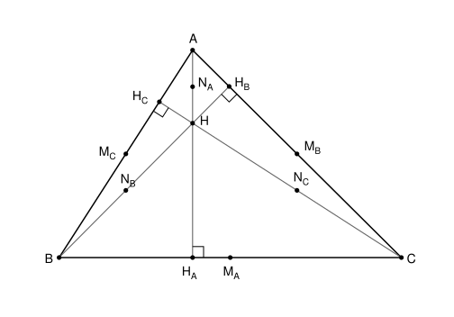

## Statement

Soit $ABC$ un triangle sans angle droit, et $H$ son orthocentre, le point où se coupent ses trois hauteurs. On note :

- $H_A$ le pied de la hauteur issue de $A$, $M_A$ le milieu du côté $[BC]$, et $N_A$ le milieu du segment $[AH]$ ;
- $H_B$, $M_B$, $N_B$ les points définis de la même façon à partir du sommet $B$ (pied de la hauteur issue de $B$, milieu de $[CA]$, milieu de $[BH]$) ;
- $H_C$, $M_C$, $N_C$ les points définis de la même façon à partir du sommet $C$.

Démontrer que ces neuf points sont tous sur un même cercle.

## Hints

1. L'angle $\widehat{N_A H_A M_A}$ est droit. Quel cercle contient alors $H_A$ ?
2. Essayez de montrer que $M_B$ est sur le cercle de diamètre $[N_A M_A]$. Les droites $(N_A M_B)$ et $(M_B M_A)$ sont parallèles à des droites bien connues du triangle.
3. Une fois que le cercle de diamètre $[N_A M_A]$ passe par $M_A$, $M_B$ et $M_C$, recommencez le raisonnement en partant du sommet $B$ au lieu de $A$. Combien de cercles passent par trois points non alignés ?

## Solution

**Deux outils de 4e.**

- *Droite des milieux.* Dans un triangle, la droite qui joint les milieux de deux côtés est parallèle au troisième côté.
- *Cercle de diamètre.* Si l'angle $\widehat{UXV}$ est droit, alors le point $X$ est sur le cercle de diamètre $[UV]$.

On note $\Omega$ le cercle de diamètre $[N_A M_A]$.

**Étape 1 : $H_A$ est sur $\Omega$.** Le point $N_A$ est sur la hauteur $(AH_A)$, et le point $M_A$ est sur la droite $(BC)$. Ces deux droites sont perpendiculaires en $H_A$, donc l'angle $\widehat{N_A H_A M_A}$ est droit, et $H_A$ est sur $\Omega$. (Si le triangle est isocèle en $A$, alors $H_A = M_A$, qui est déjà sur $\Omega$.)

**Étape 2 : $M_B$ est sur $\Omega$.**

- Dans le triangle $AHC$, le point $N_A$ est le milieu de $[AH]$ et $M_B$ est le milieu de $[AC]$. Par la droite des milieux, $(N_A M_B)$ est parallèle à $(HC)$.
- Dans le triangle $ABC$, $M_A$ et $M_B$ sont les milieux de $[BC]$ et $[CA]$, donc $(M_A M_B)$ est parallèle à $(AB)$.
- Or $(HC)$ est la hauteur issue de $C$ : elle est perpendiculaire à $(AB)$.

Deux droites respectivement parallèles à deux droites perpendiculaires sont perpendiculaires. Donc $(N_A M_B) \perp (M_B M_A)$ : l'angle $\widehat{N_A M_B M_A}$ est droit, et $M_B$ est sur $\Omega$.

**Étape 3 : $M_C$ est sur $\Omega$.** C'est le même raisonnement dans les triangles $AHB$ et $ABC$ : $(N_A M_C)$ est parallèle à $(HB)$, $(M_A M_C)$ est parallèle à $(AC)$, et $(HB) \perp (AC)$. L'angle $\widehat{N_A M_C M_A}$ est droit.

**Bilan provisoire.** Le cercle $\Omega$ passe par $M_A$, $M_B$, $M_C$, $N_A$ et $H_A$.

**Étape 4 : on change de sommet.** Les trois milieux $M_A$, $M_B$, $M_C$ ne sont pas alignés, et par trois points non alignés il passe **un seul** cercle. Le cercle $\Omega$ est donc tout simplement le cercle qui passe par les trois milieux des côtés. Cette description ne privilégie plus le sommet $A$.

Refaisons les étapes 1 à 3 en partant du sommet $B$ : le cercle de diamètre $[N_B M_B]$ passe par $N_B$, $M_B$, $H_B$, $M_C$ et $M_A$. Il passe donc par les trois milieux des côtés : c'est encore $\Omega$. Ainsi $N_B$ et $H_B$ sont sur $\Omega$.

En partant du sommet $C$, on obtient de même que $N_C$ et $H_C$ sont sur $\Omega$.

**Conclusion.** Les neuf points $H_A$, $H_B$, $H_C$, $M_A$, $M_B$, $M_C$, $N_A$, $N_B$, $N_C$ sont tous sur le cercle $\Omega$. On l'appelle le **cercle des neuf points**, ou **cercle d'Euler** du triangle.

## Going further

1. Montrez que $[N_A M_A]$, $[N_B M_B]$ et $[N_C M_C]$ sont trois diamètres de $\Omega$. Qu'en déduire pour le centre de $\Omega$ ?
2. Montrez que le rayon de $\Omega$ est la moitié du rayon du cercle circonscrit au triangle $ABC$. (Comparez le triangle $M_A M_B M_C$ au triangle $ABC$.)
