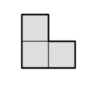
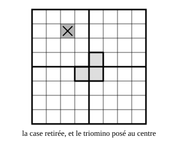

## Statement

On appelle **triomino en L** la figure formée de trois carreaux disposés en coin :

On se donne un carré quadrillé dont le côté mesure $2^n$ carreaux, c'est-à-dire un carré $2 \times 2$, ou $4 \times 4$, ou $8 \times 8$, ou $16 \times 16$, et ainsi de suite. On lui retire un carreau :

a) un carreau situé dans un coin ;

b) un carreau quelconque, sans savoir lequel.

Montrer que dans les deux cas, la figure qui reste peut être découpée en triominos en L. Les triominos peuvent être tournés dans n'importe quel sens, mais ils ne doivent ni se chevaucher ni dépasser.

## Hints

1. Commence par le plus petit cas possible : un carré $2 \times 2$ dont on a retiré un carreau. Que reste-t-il exactement ?
2. Passe au carré $4 \times 4$. Coupe-le en quatre carrés $2 \times 2$ par une coupe horizontale et une coupe verticale au milieu. Dans combien de ces petits carrés se trouve le carreau manquant ?
3. Les trois autres petits carrés sont complets, et tu ne sais pas les découper tels quels. Comment leur faire perdre un carreau à chacun, d'un seul coup ? Regarde les quatre carreaux qui se touchent au centre du grand carré.
4. Une fois le triomino posé au centre, chacun des quatre petits carrés a exactement un carreau en moins. Tu es ramené au même problème, en deux fois plus petit. Recommence.

## Solution

*L'idée : on construit de proche en proche. On sait faire pour le plus petit carré, et on montre que savoir faire pour un carré de côté $2^n$ permet de savoir faire pour le carré deux fois plus grand.*

On démontre directement la question b), la plus générale : le carreau retiré est quelconque. La question a) en sera un cas particulier.

### Le point de départ : le carré 2 × 2

Ce carré contient $4$ carreaux. Si on en retire un, il en reste trois, et ces trois carreaux forment exactement un triomino en L. Le découpage est donc immédiat, et cela marche quel que soit le carreau retiré.

### Le passage du côté 2ⁿ au côté 2ⁿ⁺¹

Supposons qu'on sache découper tout carré de côté $2^n$ privé d'un carreau quelconque. Prenons maintenant un carré de côté $2^{n+1}$, privé lui aussi d'un carreau quelconque.

**Étape 1. Couper le grand carré en quatre.**

Une coupe horizontale et une coupe verticale passant par le centre partagent le grand carré en quatre carrés égaux, de côté $2^{n+1} : 2 = 2^n$.

Le carreau manquant se trouve dans l'un de ces quatre petits carrés, appelons-le le carré *entamé*. Les trois autres petits carrés sont complets.

**Étape 2. Poser un triomino au centre.**

Regardons les quatre carreaux qui se touchent au centre du grand carré : il y en a exactement un dans chaque petit carré, et c'est à chaque fois le carreau du coin tourné vers le centre.

Posons un triomino en L sur les trois de ces carreaux qui appartiennent aux trois carrés complets. Ces trois carreaux se touchent bien en coin, ils forment donc exactement un triomino.

**Étape 3. Se ramener au cas plus petit.**

Après cette opération, chacun des quatre petits carrés de côté $2^n$ a perdu exactement un carreau :

- le carré entamé a perdu le carreau retiré au départ ;
- chacun des trois autres a perdu son carreau du centre, recouvert par le triomino.

Or on a supposé qu'on savait découper un carré de côté $2^n$ privé d'un carreau quelconque. On découpe donc chacun des quatre petits carrés.

**Étape 4. Rassembler.**

Les quatre découpages, plus le triomino posé au centre, recouvrent ensemble tout le grand carré privé de son carreau, sans chevauchement ni dépassement. C'est le découpage cherché.

### Conclusion

Le résultat est vrai pour le carré $2 \times 2$. Comme il se transmet du côté $2^n$ au côté $2^{n+1}$, il est vrai pour le carré $4 \times 4$, donc pour le carré $8 \times 8$, donc pour le carré $16 \times 16$, et ainsi de suite sans fin.

Tout carré de côté $2^n$ privé d'un carreau, où qu'il soit, se découpe en triominos en L. En particulier, cela règle aussi la question a), où le carreau retiré est dans un coin.

### Une vérification qui rassure

Un triomino couvre $3$ carreaux, donc le nombre de carreaux à couvrir doit être un multiple de $3$. Vérifions-le.

Le carré de côté $2^n$ contient $2^n \times 2^n = 4^n$ carreaux, et il en reste $4^n - 1$ après avoir retiré un carreau. Est-ce toujours un multiple de $3$ ?

Pour $n = 1$ : $4 - 1 = 3$, oui. Et si $4^n - 1$ est un multiple de $3$, alors

$$4^{n+1} - 1 = 4 \times 4^n - 1 = 4 \times (4^n - 1) + 3$$

est la somme de deux multiples de $3$, donc un multiple de $3$. De proche en proche, c'est vrai pour tout $n$. Le compte tombe juste.

## Going further

Essaie la même chose avec un carré de côté $3^n$ carreaux, par exemple $3 \times 3$ ou $9 \times 9$, privé d'un carreau. Cette fois c'est impossible, et il suffit de compter les carreaux pour le voir : il en reste $9^n - 1$, c'est-à-dire $8$, ou $80$, ou $728$… Aucun de ces nombres n'est un multiple de $3$, alors qu'un découpage en triominos en demanderait un.
