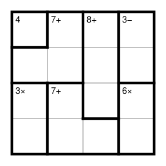

## Statement

Le KenKen est une grille de nombres. Voici les règles pour une grille $4 \times 4$.

- On écrit un nombre de $1$ à $4$ dans chaque case, de façon que **chaque ligne et chaque colonne contienne $1$, $2$, $3$ et $4$, une fois chacun**.
- La grille est découpée en paquets de cases, appelés **cages**, dessinés en trait gras. Chaque cage porte un objectif, écrit en petit dans sa case en haut à gauche.
- Un objectif « $8+$ » signifie que la **somme** des nombres de la cage vaut $8$ ; « $3\times$ » que leur **produit** vaut $3$ ; « $3-$ » que la **différence** des deux nombres de la cage vaut $3$ ; un objectif sans signe, comme « $4$ », donne directement le nombre de la case.
- Dans une même cage, les nombres peuvent être placés dans n'importe quel ordre, et deux d'entre eux peuvent être égaux, à condition bien sûr de ne pas se retrouver sur une même ligne ni sur une même colonne.

Remplir la grille ci-dessous, et **expliquer chaque étape** : à chaque nombre écrit doit correspondre une raison.

## Hints

1. Commencer par la cage qui ne contient qu'une seule case.
2. Chercher les cages où il n'y a presque pas de choix : avec des nombres de $1$ à $4$, quelles paires ont une différence de $3$ ? Quelles paires ont un produit de $3$ ?
3. La somme des quatre nombres d'une colonne vaut toujours $1 + 2 + 3 + 4 = 10$. Que vaut donc la case du bas de la troisième colonne, sachant que les trois cases au-dessus forment une cage de somme $8$ ?
4. Une fois quelques cases remplies, avancer par élimination : dans une ligne ou une colonne où trois nombres sont connus, le quatrième l'est aussi.

## Solution

Numérotons les lignes de $1$ (en haut) à $4$ (en bas) et les colonnes de $1$ (à gauche) à $4$ (à droite). La case de la ligne $i$ et de la colonne $j$ est notée $(i ; j)$.

La grille finale est

$$4 \quad 2 \quad 3 \quad 1$$
$$2 \quad 3 \quad 1 \quad 4$$
$$3 \quad 1 \quad 4 \quad 2$$
$$1 \quad 4 \quad 2 \quad 3$$

Voici comment on y arrive, une raison à la fois.

**1. La cage d'une seule case.** La cage en haut à gauche ne contient qu'une case et porte l'objectif $4$ : donc $(1 ; 1) = 4$.

**2. La cage « $3-$ ».** Elle contient les deux cases $(1 ; 4)$ et $(2 ; 4)$, et la différence de leurs nombres vaut $3$. Avec des nombres de $1$ à $4$, la seule possibilité est $\{1 ; 4\}$, dans un ordre à déterminer.

**3. La cage « $3\times$ ».** Elle contient $(3 ; 1)$ et $(4 ; 1)$, de produit $3$. La seule possibilité est $\{1 ; 3\}$.

**4. Le haut de la dernière colonne.** La ligne $1$ contient déjà un $4$, en $(1 ; 1)$. Donc $(1 ; 4) \neq 4$, et d'après l'étape 2 :
$$(1 ; 4) = 1 \qquad \text{et} \qquad (2 ; 4) = 4 .$$

**5. La deuxième case de la première colonne.** La colonne $1$ contient $4$ en haut et, d'après l'étape 3, les nombres $1$ et $3$ dans ses deux cases du bas. Il ne reste que $2$ pour la case du milieu :
$$(2 ; 1) = 2 .$$

**6. Le bas de la troisième colonne.** La cage « $8+$ » occupe les trois cases du haut de la colonne $3$. Or les quatre nombres d'une colonne ont pour somme $1 + 2 + 3 + 4 = 10$. Donc
$$(4 ; 3) = 10 - 8 = 2 .$$

**7. La cage « $6\times$ ».** Elle contient $(3 ; 4)$ et $(4 ; 4)$, de produit $6$ : c'est $\{2 ; 3\}$. Mais la ligne $4$ contient déjà un $2$, en $(4 ; 3)$. Donc
$$(4 ; 4) = 3 \qquad \text{et} \qquad (3 ; 4) = 2 .$$

**8. Le bas de la première colonne.** La ligne $4$ contient maintenant un $3$, en $(4 ; 4)$. Or la cage « $3\times$ » contient $1$ et $3$. Donc $(4 ; 1) \neq 3$ :
$$(4 ; 1) = 1 \qquad \text{et} \qquad (3 ; 1) = 3 .$$

**9. La ligne 4 se termine.** Elle contient $1$, $2$ et $3$ en colonnes $1$, $3$ et $4$. Il manque le $4$ :
$$(4 ; 2) = 4 .$$

**10. La cage « $7+$ » du bas.** Elle contient $(3 ; 2)$, $(4 ; 2)$ et $(4 ; 3)$, de somme $7$. On connaît déjà $(4 ; 2) = 4$ et $(4 ; 3) = 2$, donc
$$(3 ; 2) = 7 - 4 - 2 = 1 .$$

**11. Le haut de la deuxième colonne.** La colonne $2$ contient déjà $1$ et $4$ ; il reste $2$ et $3$ pour $(1 ; 2)$ et $(2 ; 2)$. Or la ligne $2$ contient déjà un $2$, en $(2 ; 1)$. Donc
$$(2 ; 2) = 3 \qquad \text{et} \qquad (1 ; 2) = 2 .$$

*Au passage, vérifions la cage « $7+$ » du haut, formée de $(1 ; 2)$, $(2 ; 1)$ et $(2 ; 2)$ : $2 + 2 + 3 = 7$. C'est bon. Les deux $2$ y sont bien sur des lignes et des colonnes différentes.*

**12. La troisième colonne.** Chaque ligne est maintenant remplie sauf sa case de la colonne $3$, et il suffit de compléter :
$$(1 ; 3) = 3, \qquad (2 ; 3) = 1, \qquad (3 ; 3) = 4 .$$

Vérifions la cage « $8+$ » : $3 + 1 + 4 = 8$. C'est bon.

**Vérification finale.** Chaque ligne et chaque colonne contient bien $1$, $2$, $3$, $4$ une fois chacun, et les sept cages atteignent leur objectif :
$$4, \qquad 2+2+3 = 7, \qquad 3+1+4 = 8, \qquad 4-1 = 3, \qquad 3 \times 1 = 3, \qquad 1+4+2 = 7, \qquad 2 \times 3 = 6 .$$

La grille était donc entièrement forcée : à aucun moment il n'a fallu deviner. C'est ce qu'on demande d'une bonne grille de KenKen, et c'est aussi ce qui fait de sa résolution une véritable petite démonstration.

## Going further

1. Fabriquer soi-même une grille $4 \times 4$ : remplir d'abord une grille valable, puis la découper en cages et calculer les objectifs. Donner la grille vide à un camarade et vérifier qu'il n'a qu'une seule façon de la remplir.
2. Dans une grille $6 \times 6$, quelle est la somme des six nombres d'une ligne ? Et leur produit ? En quoi cela peut-il aider ?
3. Dans une grille $4 \times 4$, combien de façons y a-t-il de remplir la grille en respectant seulement la règle des lignes et des colonnes, sans aucune cage ?
