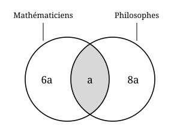

## Statement

Dans une ville, un mathématicien sur sept est philosophe, et un philosophe sur neuf est mathématicien.

Dans cette ville, $360$ philosophes ne sont pas mathématiciens.

Combien de mathématiciens ne sont pas philosophes ?

## Hints

1. Certaines personnes sont à la fois mathématiciennes et philosophes. Ce sont elles qui relient les deux phrases de l'énoncé. Donne un nom à leur nombre, par exemple $a$.
2. « Un mathématicien sur sept est philosophe » veut dire que les mathématiciens philosophes forment le septième de tous les mathématiciens. Si ces personnes sont au nombre de $a$, combien y a-t-il de mathématiciens en tout ?
3. Dessine deux patates qui se chevauchent, une pour les mathématiciens, une pour les philosophes. Écris dans chacune des trois zones le nombre de personnes qu'elle contient, en fonction de $a$.

## Solution

**L'idée : nommer le nombre de personnes qui sont les deux à la fois.**

Appelons $a$ le nombre de personnes de la ville qui sont à la fois mathématiciennes et philosophes.

**Le nombre de mathématiciens.**

Un mathématicien sur sept est philosophe : les mathématiciens philosophes forment donc le septième de tous les mathématiciens. Il y a $a$ mathématiciens philosophes, donc

$$\text{nombre de mathématiciens} = 7a$$

Parmi eux, $a$ sont philosophes. Donc le nombre de mathématiciens qui ne sont **pas** philosophes vaut

$$7a - a = 6a$$

**Le nombre de philosophes.**

Un philosophe sur neuf est mathématicien, donc de la même façon

$$\text{nombre de philosophes} = 9a$$

et le nombre de philosophes qui ne sont **pas** mathématiciens vaut

$$9a - a = 8a$$

**Le schéma.**

**On termine.**

L'énoncé dit que $360$ philosophes ne sont pas mathématiciens, c'est-à-dire

$$8a = 360 \quad \text{donc} \quad a = 45$$

Le nombre cherché est celui des mathématiciens qui ne sont pas philosophes :

$$6a = 6 \times 45 = 270$$

**Il y a $270$ mathématiciens qui ne sont pas philosophes.**

*Remarque.* On peut même se passer de calculer $a$ : le nombre cherché est $6a$, et on connaît $8a$. Comme $6a$ est les $\tfrac{6}{8}$ de $8a$, on obtient directement $\tfrac{6}{8} \times 360 = 270$.

## Going further

1. Combien y a-t-il de mathématiciens dans cette ville ? Et de philosophes ?
2. Si l'on apprend en plus que la ville compte $10\,000$ habitants, quelle proportion d'entre eux est mathématicienne ou philosophe ?
3. Pourquoi l'énoncé ne pouvait-il pas dire « $361$ philosophes ne sont pas mathématiciens » ?
