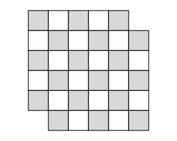

## Statement

Dans un damier $6 \times 6$, on découpe deux cases d'angle situées sur une même diagonale, comme sur la figure.

Peut-on découper la partie restante en dominos de deux cases ?

Un domino recouvre exactement deux cases voisines du damier, soit côte à côte, soit l'une au-dessus de l'autre.

## Hints

1. Commence par compter les cases restantes, et le nombre de dominos qu'il faudrait. Le compte tombe-t-il juste ?
2. Essayer des découpages au hasard ne prouvera jamais que c'est impossible : il y a bien trop de possibilités. Il faut trouver un argument.
3. Colorie le damier comme un échiquier, en alternant deux couleurs. De quelle couleur sont les deux cases que l'on a enlevées ?
4. Quelles que soient sa position et son orientation, combien de cases de chaque couleur un domino recouvre-t-il ?

## Solution

**Réponse : non, c'est impossible.**

**Étape 1. Le compte des cases ne suffit pas.**

Le damier a $6 \times 6 = 36$ cases. On en enlève $2$, il en reste $34$. Comme $34 = 17 \times 2$, il faudrait exactement $17$ dominos. Le compte tombe juste : ce n'est donc pas par là qu'on trouvera l'obstacle.

**Étape 2. L'idée : on colorie le damier.**

Colorions le damier comme un échiquier, en alternant deux couleurs, de sorte que deux cases voisines soient toujours de couleurs différentes.

Sur un damier $6 \times 6$ complet, il y a autant de cases de chaque couleur : $18$ et $18$.

Mais les deux cases d'angle que l'on a enlevées sont situées sur une même diagonale, et **deux cases d'angle situées sur une même diagonale sont de la même couleur**. On enlève donc deux cases de la même couleur. Il reste :

- $18$ cases grises ;
- $16$ cases blanches.

**Étape 3. Ce que fait un domino.**

Un domino recouvre deux cases voisines. Or deux cases voisines sont toujours de couleurs différentes. Donc, **où qu'on le pose et dans quelque sens que ce soit, un domino recouvre exactement une case grise et une case blanche.**

**Étape 4. La contradiction.**

Supposons qu'un découpage en $17$ dominos existe. Chaque domino recouvre une case grise et une case blanche, donc les $17$ dominos recouvrent en tout $17$ cases grises et $17$ cases blanches.

Or la figure à recouvrir contient $18$ cases grises et $16$ cases blanches. C'est impossible.

**Conclusion.** On ne peut pas découper cette figure en dominos.

*Remarque pour l'animateur.* Beaucoup d'élèves proposent comme « preuve » deux ou trois tentatives ratées. Il faut prendre le temps d'expliquer pourquoi ce n'est pas une démonstration : il faudrait examiner toutes les façons de poser les dominos, et elles sont en nombre gigantesque. Le coloriage, lui, règle tous les cas d'un coup.

## Going further

1. Même question avec un damier $8 \times 8$ dont on enlève deux cases d'angle opposées.
2. Et si on enlève deux cases de couleurs **différentes** ? Le raisonnement ci-dessus ne s'applique plus. Essaie sur un damier $4 \times 4$ avec plusieurs choix de cases : arrives-tu toujours à paver ce qui reste ?
3. On revient au damier $6 \times 6$ complet, mais on veut le découper en $12$ pièces de trois cases en ligne. Le coloriage en échiquier aide-t-il encore ? (Voir l'exercice sur les bandes de trois cases.)
