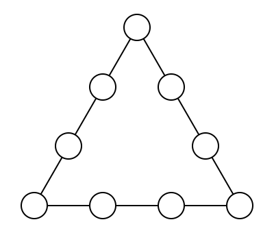

## Statement

Place les nombres $1, 2, 3, \ldots, 8, 9$ dans les neuf ronds de la figure, chacun une seule
fois, de façon que la somme des quatre nombres situés sur chaque côté du triangle soit égale
à $19$.

Attention : les ronds placés aux sommets appartiennent chacun à deux côtés.

## Hints

1. Ne cherche pas au hasard. Commence par additionner les trois sommes de côté, celle du côté
   gauche, celle du côté droit et celle du bas.
2. Dans ce grand total, chaque nombre de $1$ à $9$ apparaît. Mais certains apparaissent deux
   fois. Lesquels, et pourquoi ?
3. Tu devrais trouver $3 \times 19 = 45 + (\text{somme des trois sommets})$, où $45 = 1 + 2 + \cdots + 9$.
4. La somme des trois sommets est donc connue. Choisis trois nombres qui conviennent, puis
   complète chaque côté.

## Solution

**Étape 1 : la somme des trois sommets.**

Additionnons les sommes des trois côtés. Le total vaut
$$3 \times 19 = 57 .$$

Dans cette addition, chaque nombre placé au milieu d'un côté est compté une seule fois, car il
n'appartient qu'à un seul côté. En revanche, chaque nombre placé à un sommet est compté
**deux fois**, car il appartient à deux côtés.

Donc :
$$57 = \underbrace{(1 + 2 + \cdots + 9)}_{\text{chaque nombre une fois}} + (\text{somme des trois sommets}) .$$

Or $1 + 2 + \cdots + 9 = 45$. On en déduit
$$\text{somme des trois sommets} = 57 - 45 = 12 .$$

**Étape 2 : trouver un placement.**

Essayons les sommets $1$, $4$ et $7$, dont la somme vaut bien $12$. Il reste à placer
$2, 3, 5, 6, 8, 9$, deux par côté.

- Côté entre $1$ et $4$ : il faut deux nombres de somme $19 - 1 - 4 = 14$. On prend $5$ et $9$.
- Côté entre $4$ et $7$ : il faut deux nombres de somme $19 - 4 - 7 = 8$. On prend $2$ et $6$.
- Côté entre $7$ et $1$ : il faut deux nombres de somme $19 - 7 - 1 = 11$. Il reste $3$ et $8$,
  et $3 + 8 = 11$. Parfait.

**Vérification.**

- Premier côté : $1 + 5 + 9 + 4 = 19$.
- Deuxième côté : $4 + 2 + 6 + 7 = 19$.
- Troisième côté : $7 + 3 + 8 + 1 = 19$.

Les neuf nombres $1, 2, 3, 4, 5, 6, 7, 8, 9$ sont bien utilisés chacun une fois.

**Conclusion.** Le placement ci-dessus convient : sommets $1$, $4$, $7$, puis $5$ et $9$ entre
$1$ et $4$, puis $2$ et $6$ entre $4$ et $7$, puis $3$ et $8$ entre $7$ et $1$.

## Going further

L'étape 1 n'a laissé qu'une seule information, mais elle est décisive : les sommets doivent
totaliser $12$. Beaucoup de triplets totalisent $12$, et tous ne marchent pas. On peut vérifier
qu'il y a exactement **deux** choix de sommets possibles : $\{1, 4, 7\}$ et $\{2, 3, 7\}$.

Essaie de compléter le triangle avec les sommets $2$, $3$, $7$. Puis cherche pourquoi un triplet
comme $\{1, 2, 9\}$, de somme $12$ lui aussi, ne peut pas marcher.
