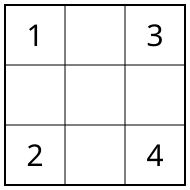

## Statement

Daniel écrit les nombres de $1$ à $9$ dans les neuf cases d'un tableau carré de $3$ cases sur $3$, un nombre par case. Il commence par placer $1$, $2$, $3$ et $4$ dans les quatre coins, comme ci-dessous, puis il remplit les cinq cases restantes avec $5$, $6$, $7$, $8$ et $9$.

Deux cases sont dites **voisines** lorsqu'elles ont un côté commun.

Une fois le tableau rempli, Daniel constate que la somme des nombres écrits dans les cases voisines de la case du $5$ vaut $9$.

Quelle est alors la somme des nombres écrits dans les cases voisines de la case du $6$ ?

## Hints

1. Combien de voisines a la case du centre ? Et une case du milieu d'un bord ?
2. Le nombre $5$ peut-il être au centre ? Calculez la somme des voisines de la case centrale.
3. Le $5$ est donc au milieu d'un bord. Ses voisines sont deux coins et le centre. Les coins sont connus : il y a quatre bords à essayer.
4. Attention : le nombre du centre fait partie de $5$, $6$, $7$, $8$, $9$. Cela élimine des cas.
5. Une fois le centre connu, la somme cherchée se calcule sans savoir où sont $7$, $8$ et $9$.

## Solution

Les cinq cases encore vides sont la case **centrale** et les quatre cases du **milieu des bords**. Elles reçoivent les nombres $5$, $6$, $7$, $8$, $9$, dont la somme vaut

$$5 + 6 + 7 + 8 + 9 = 35 .$$

Deux remarques de départ :

- la case centrale a quatre voisines, qui sont exactement les quatre cases du milieu des bords. La somme de ses voisines vaut donc $35$ moins le nombre du centre ;
- une case du milieu d'un bord a trois voisines : deux coins et le centre.

### Où est le $5$ ?

**Le $5$ n'est pas au centre.** Sinon la somme de ses voisines vaudrait $35 - 5 = 30$, et non $9$.

**Le $5$ est donc au milieu d'un bord.** Notons $c$ le nombre écrit au centre. La somme des voisines du $5$ vaut alors

$$(\text{somme des deux coins de ce bord}) + c = 9 .$$

Les quatre bords donnent quatre équations :

| bord | coins | équation | conclusion |
|---|---|---|---|
| haut | $1$ et $3$ | $4 + c = 9$ | $c = 5$ |
| gauche | $1$ et $2$ | $3 + c = 9$ | $c = 6$ |
| droit | $3$ et $4$ | $7 + c = 9$ | $c = 2$ |
| bas | $2$ et $4$ | $6 + c = 9$ | $c = 3$ |

Éliminons :

- $c = 5$ est impossible, car le $5$ est justement sur le bord du haut dans ce cas ;
- $c = 2$ et $c = 3$ sont impossibles, car $2$ et $3$ sont déjà dans des coins : le centre reçoit forcément un nombre de $5$ à $9$.

Il reste un seul cas : le $5$ est au milieu du bord gauche, et le centre porte

$$c = 6 .$$

### La somme cherchée

Le $6$ est au centre. Ses voisines sont les quatre cases du milieu des bords, qui portent les nombres restants $5$, $7$, $8$ et $9$. Leur somme vaut

$$5 + 7 + 8 + 9 = 29 .$$

**Conclusion.** La somme des nombres voisins du $6$ vaut $29$.

**Remarque.** On ne sait toujours pas où sont $7$, $8$ et $9$ : l'énoncé ne le dit pas, et plusieurs tableaux différents conviennent. Mais la question posée, elle, a une seule réponse, car la somme des quatre bords ne dépend pas de leur ordre.

## Going further

1. Vérifiez qu'il existe bien un tableau complet qui respecte l'énoncé, en plaçant $7$, $8$ et $9$ comme vous voulez. Combien de tableaux conviennent en tout ?
2. Si Daniel avait annoncé $12$ au lieu de $9$, pourrait-on encore savoir où est le $5$ ?
3. Quelle est la plus grande valeur possible pour la somme des voisines du $9$ ?
