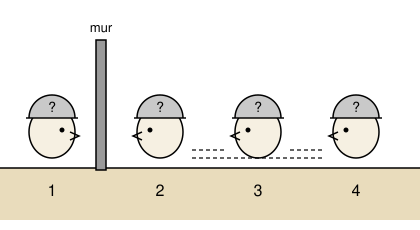

## Statement

Quatre personnes, numérotées $1$, $2$, $3$, $4$ de gauche à droite, sont enterrées dans le sable
jusqu'au cou. Elles ne peuvent ni bouger la tête, ni se retourner.

Un mur sépare la personne $1$ de la personne $2$. Les personnes $1$ et $2$ regardent ce mur : elles
ne voient donc rien d'autre. La personne $3$ voit la tête de la personne $2$. La personne $4$ voit
les têtes des personnes $2$ et $3$.

On a posé un chapeau sur chaque tête : **deux chapeaux blancs et deux chapeaux noirs**. Tout le
monde connaît cette répartition. Personne ne voit son propre chapeau.

Le geôlier annonce :

> Si l'une d'entre vous annonce la couleur de son propre chapeau **et explique pourquoi**, je vous
> libère toutes les quatre. Mais si quelqu'un se trompe, ou devine juste par chance sans
> raisonnement correct, vous êtes toutes perdues.

Les quatre personnes sont également intelligentes, elles réfléchissent toutes à la même vitesse,
et chacune parle dès qu'elle est sûre.

Que se passe-t-il ? Qui parle, que dit-elle, et pourquoi ?

## Hints

1. Commence par la personne qui voit le plus de choses : la personne $4$. Dans quel cas
   connaîtrait-elle immédiatement la couleur de son chapeau ?
2. La personne $4$ ne dit rien. Ce silence n'est pas rien : c'est une information, et les autres
   peuvent l'utiliser.
3. Qui peut se servir de ce silence ? Regarde qui voit exactement la même chose que la personne
   $4$, à un chapeau près.
4. Les personnes $1$ et $2$ ne voient rien du tout. Peuvent-elles espérer conclure quoi que ce
   soit ?

## Solution

**Étape 1 : la personne $4$.**

La personne $4$ voit les chapeaux de $2$ et de $3$. Il y a deux cas.

- Si ces deux chapeaux sont de la **même couleur**, par exemple deux blancs, alors les deux
  chapeaux noirs sont sur les têtes de $1$ et de $4$. La personne $4$ sait donc aussitôt qu'elle
  porte un chapeau noir, et elle parle immédiatement.
- Si ces deux chapeaux sont de **couleurs différentes**, alors il reste un chapeau blanc et un
  chapeau noir pour $1$ et $4$, sans aucun moyen de savoir lequel est pour elle. La personne $4$
  ne peut rien dire.

**Étape 2 : le silence devient une information.**

La personne $4$ ne dit rien. Les autres attendent, comprennent qu'elle ne sait pas, et en
concluent que le premier cas est exclu :

> Les chapeaux des personnes $2$ et $3$ sont de couleurs **différentes**.

**Étape 3 : la personne $3$ conclut.**

La personne $3$ voit le chapeau de la personne $2$. Elle vient d'apprendre que son propre chapeau
n'est pas de la même couleur que celui-là. Donc :

- si elle voit un chapeau blanc sur la tête de $2$, elle annonce « mon chapeau est noir » ;
- si elle voit un chapeau noir sur la tête de $2$, elle annonce « mon chapeau est blanc ».

Dans les deux cas elle est certaine, et elle peut expliquer son raisonnement. Tout le monde est
libéré.

**Étape 4 : et les autres ?**

Les personnes $1$ et $2$ ne voient aucun chapeau. Pour elles, les deux couleurs restent possibles
jusqu'au bout : elles ne peuvent jamais rien annoncer. C'est bien la personne $3$, et elle seule,
qui sauve le groupe.

**Conclusion.** Après un court silence de la personne $4$, la personne $3$ annonce la couleur
opposée à celle qu'elle voit sur la tête de la personne $2$, et tout le monde est libéré.

## Going further

Remarque que la personne qui s'en sort est celle qui voit le **moins** de chapeaux parmi celles
qui en voient. Ce n'est pas un hasard : c'est justement parce qu'elle voit peu qu'elle peut
compléter son information avec le silence de celle qui voit plus.

Que se passerait-il si le geôlier avait trois chapeaux blancs et un noir, toujours avec la même
disposition ? Cherche qui parle alors, et au bout de combien de silences.
