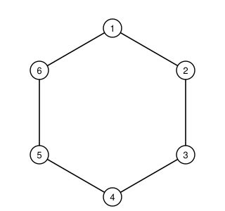

## Statement

Six arbres poussent aux six sommets d'un hexagone régulier. Sur chaque arbre se pose un
oiseau, soit six oiseaux en tout.

Toutes les minutes, **deux** oiseaux s'envolent en même temps, et chacun d'eux va se poser sur
l'un des deux arbres voisins du sien (à gauche ou à droite, à son choix). Plusieurs oiseaux
peuvent très bien se retrouver sur le même arbre.

Peut-on, au bout d'un certain temps, avoir réuni les six oiseaux sur un seul et même arbre ?

## Hints

1. Pour montrer qu'une chose est *impossible*, cherche une quantité qui ne change jamais.
2. Colorie un sommet sur deux. Que remarques-tu sur les voisins d'un sommet colorié ?
3. Compte les oiseaux posés sur les trois arbres coloriés. Comment ce nombre évolue-t-il
   quand deux oiseaux s'envolent ?

## Solution

**La réponse est non.** Voici pourquoi.

**Le coloriage.** Numérotons les arbres de $1$ à $6$ en tournant autour de l'hexagone, et
peignons en gris les arbres $1$, $3$ et $5$. Ces trois arbres forment un triangle équilatéral.

Point essentiel : **les deux voisins d'un arbre gris sont blancs, et les deux voisins d'un
arbre blanc sont gris.** En effet, les voisins de l'arbre $1$ sont les arbres $2$ et $6$, ceux
de l'arbre $3$ sont $2$ et $4$, et ainsi de suite.

**L'invariant.** Appelons $g$ le nombre d'oiseaux posés sur les trois arbres gris. Au départ,
il y a un oiseau par arbre, donc
$$g = 3,$$
qui est **impair**.

Regardons ce qui se passe pendant une minute, quand deux oiseaux changent d'arbre. Chaque
oiseau passe forcément d'un gris à un blanc, ou d'un blanc à un gris. Trois cas :

- les deux oiseaux étaient sur des arbres gris : ils partent tous les deux vers des arbres
  blancs, donc $g$ diminue de $2$ ;
- les deux oiseaux étaient sur des arbres blancs : ils arrivent tous les deux sur des arbres
  gris, donc $g$ augmente de $2$ ;
- l'un était sur un gris, l'autre sur un blanc : l'un part, l'autre arrive, donc $g$ ne change
  pas.

Dans les trois cas, $g$ varie de $-2$, de $0$ ou de $+2$ : **la parité de $g$ ne change jamais.**
Comme $g$ vaut $3$ au départ, $g$ restera impair pour toujours.

**La conclusion.** Si les six oiseaux étaient réunis sur un seul arbre, alors :

- ou bien cet arbre est gris, et $g = 6$ ;
- ou bien cet arbre est blanc, et $g = 0$.

Dans les deux cas $g$ serait **pair**, ce qui est impossible.

Les six oiseaux ne pourront donc jamais se retrouver tous sur le même arbre.

## Going further

Et si, toutes les minutes, c'était **un seul** oiseau qui changeait d'arbre ? Alors $g$ change
de parité à chaque minute, l'argument tombe, et on vérifie facilement qu'on peut effectivement
rassembler les six oiseaux sur un arbre.
