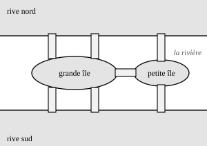

## Statement

Une rivière traverse la ville de Königsberg, et deux îles se trouvent dans son lit. Les deux rives et les deux îles sont reliées par sept ponts :

- de la grande île partent deux ponts vers chacune des deux rives, et un pont vers la petite île ;
- de la petite île partent, en plus de ce dernier pont, un pont vers chacune des deux rives.

Un promeneur veut traverser chacun des sept ponts, et chacun une seule fois. Il a le droit de partir d'où il veut et d'arriver où il veut.

Y parviendra-t-il ?

## Hints

1. Essaie quelques promenades sur le plan. Tu vas sans doute rester bloqué à chaque fois. Il faut donc prouver que c'est impossible, et non chercher plus longtemps.
2. Compte, pour chacun des quatre morceaux de terre (les deux rives et les deux îles), le nombre de ponts qui y aboutissent. Que remarques-tu sur ces quatre nombres ?
3. Prends un morceau de terre où le promeneur ne commence pas et ne finit pas sa promenade. Chaque fois qu'il y arrive, que doit-il faire juste après ?
4. Les ponts de ce morceau de terre se rangent donc par paires : un pont pour arriver, un pont pour repartir. Que peux-tu dire de leur nombre ?
5. Une promenade n'a qu'un seul point de départ et qu'un seul point d'arrivée. Combien de morceaux de terre peuvent alors porter un nombre impair de ponts ?

## Solution

**Étape 1. Compter les ponts de chaque morceau de terre.**

La ville est faite de quatre morceaux de terre. Comptons les ponts qui aboutissent sur chacun :

| morceau de terre | ponts qui y aboutissent | nombre |
|---|---|---|
| grande île | $2$ vers le nord, $2$ vers le sud, $1$ vers la petite île | $5$ |
| petite île | $1$ vers la grande île, $1$ vers le nord, $1$ vers le sud | $3$ |
| rive nord | $2$ depuis la grande île, $1$ depuis la petite | $3$ |
| rive sud | $2$ depuis la grande île, $1$ depuis la petite | $3$ |

Ces quatre nombres sont **tous impairs**. Retenons cela.

*Contrôle du comptage :* $5 + 3 + 3 + 3 = 14$, et c'est bien le double de $7$, car chaque pont a été compté une fois à chacune de ses deux extrémités.

**Étape 2. L'idée : regarder ce qui se passe sur un morceau de terre traversé.**

Supposons que le promeneur réussisse, et regardons un morceau de terre $T$ où il ne commence pas et ne finit pas sa promenade.

Chaque fois que le promeneur arrive sur $T$, il n'y reste pas : comme sa promenade ne s'y termine pas, il doit repartir, donc emprunter un autre pont. À chaque passage sur $T$, il consomme donc exactement **deux** ponts de $T$ : un pour arriver, un pour repartir. Et jamais le même pont deux fois, puisqu'il traverse chaque pont une seule fois.

Comme à la fin tous les ponts de $T$ ont été utilisés, ces ponts se rangent tous par paires. Le nombre de ponts de $T$ est donc **pair**.

**Étape 3. La conséquence.**

Retournons cette phrase : si un morceau de terre porte un nombre **impair** de ponts, il ne peut pas être un simple morceau de passage. C'est forcément le **départ** ou l'**arrivée** de la promenade.

Or une promenade a un seul départ et une seule arrivée. Au plus **deux** morceaux de terre peuvent donc porter un nombre impair de ponts.

**Étape 4. La contradiction.**

À l'étape 1, nous avons trouvé **quatre** morceaux de terre portant un nombre impair de ponts. C'est deux de trop.

**Conclusion.**

Une telle promenade est **impossible** : le promeneur ne pourra pas traverser les sept ponts de Königsberg en empruntant chacun exactement une fois.

**Ce qu'il faut retenir.** Pour qu'une telle promenade existe, il ne faut pas plus de deux endroits où aboutit un nombre impair de chemins. C'est ce qu'a découvert le mathématicien Leonhard Euler en 1736, en étudiant précisément cette ville.

## Going further

1. On construit un huitième pont, qui relie directement la rive nord à la rive sud. La promenade devient-elle possible ?
2. Si oui, sur quel morceau de terre faut-il obligatoirement commencer, et sur lequel faut-il finir ?
3. On voudrait maintenant une promenade qui emprunte chaque pont une seule fois **et** qui revienne à son point de départ. Combien de ponts faut-il ajouter au plan d'origine, et entre quels morceaux de terre ?
