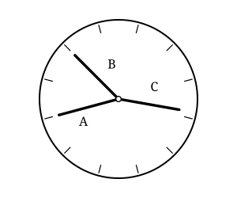

## Statement

Julien a vu dans un musée une horloge étrange. Son cadran ne porte aucun chiffre, et on ne
voit même pas où se trouve le haut de l'horloge. Pire : l'aiguille des heures, celle des
minutes et celle des secondes ont exactement la même longueur.

Le cadran porte seulement douze repères régulièrement espacés, un par heure.

Sur la figure, les aiguilles $A$ et $B$ pointent exactement sur des repères, tandis que
l'aiguille $C$ n'a pas tout à fait atteint un repère.

Quelle heure l'horloge indiquait-elle ?

## Hints

1. Suppose que l'aiguille des heures pointe exactement sur un repère. Quelle heure est-il
   alors, et où se trouvent les deux autres aiguilles ?
2. Sur la figure, aucune aiguille n'est confondue avec une autre. Que peux-tu en conclure sur
   l'aiguille $C$ ?
3. Les aiguilles $A$ et $B$ pointent sur des repères. Si l'une des deux est l'aiguille des
   minutes, il est un nombre entier de minutes : où se trouve alors l'aiguille des secondes ?
4. Il reste deux possibilités : $A$ est l'aiguille des secondes, ou bien $B$ l'est. Essaie les
   deux. Dans l'un des deux cas, la position de l'aiguille des heures devient impossible.

## Solution

**L'idée : on élimine les possibilités une par une.**

**Étape 1. L'aiguille des heures est $C$.**

Supposons que l'aiguille des heures pointe exactement sur un repère. Cela veut dire qu'il est
une heure pile : $0$ minute et $0$ seconde. Mais alors l'aiguille des minutes et l'aiguille
des secondes pointeraient toutes les deux sur le repère de midi, et elles seraient confondues.

Or sur la figure les trois aiguilles sont bien séparées. L'aiguille des heures ne pointe donc
pas exactement sur un repère : c'est l'aiguille $C$.

**Étape 2. L'une de $A$ et $B$ montre les secondes, et elle pointe sur le repère de midi.**

Les aiguilles $A$ et $B$ pointent exactement sur des repères. L'une des deux est l'aiguille des
minutes ; elle pointe sur un repère, donc il est un nombre **entier** de minutes, et il est
$0$ seconde. L'aiguille des secondes pointe donc sur le repère de midi.

Autrement dit : celle de $A$ et $B$ qui montre les secondes nous indique où est le repère de
midi. Il reste deux cas à examiner.

**Étape 3. Premier cas : $B$ est l'aiguille des secondes.**

Alors le repère de midi est celui que pointe $B$, et $A$ est l'aiguille des minutes. En
partant de $B$ et en tournant dans le sens des aiguilles d'une montre, $A$ pointe le dixième
repère : il est donc $50$ minutes.

Vérifions avec l'aiguille des heures. En $50$ minutes, l'aiguille des heures parcourt
$\frac{50}{60} = \frac{5}{6}$ de l'intervalle entre deux repères : elle doit se trouver entre
deux repères, tout près du suivant. C'est bien ce que montre la figure : en partant de $B$
dans le sens des aiguilles d'une montre, $C$ est passée devant quatre repères et n'a pas tout
à fait atteint le cinquième.

Tout concorde : il est $4$ heures $50$.

**Étape 4. Second cas : $A$ est l'aiguille des secondes. C'est impossible.**

Alors le repère de midi serait celui que pointe $A$, et $B$ serait l'aiguille des minutes. En
partant de $A$ dans le sens des aiguilles d'une montre, $B$ pointe le deuxième repère : il
serait $10$ minutes.

Mais en $10$ minutes l'aiguille des heures ne parcourt que $\frac{10}{60} = \frac{1}{6}$ de
l'intervalle entre deux repères : elle devrait se trouver **juste après** un repère. Or sur la
figure, $C$ se trouve **juste avant** un repère. C'est contradictoire : ce cas est impossible.

**Conclusion.**

L'horloge indiquait $4$ heures $50$ (et $0$ seconde). $C$ est l'aiguille des heures, $A$ celle
des minutes et $B$ celle des secondes.

## Going further

1. Peut-on affirmer qu'il était $4$ h $50$ du matin ?
2. Combien de fois par jour les trois aiguilles d'une horloge pointent-elles toutes les trois
   exactement sur des repères au même instant ?
