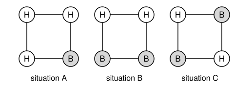

## Statement

Devant l'entrée de la grotte aux trésors se trouve un tonneau. Son couvercle est percé de quatre
trous identiques, placés aux quatre coins d'un carré. Dans chaque trou se trouve un hareng, soit
la tête en haut, soit la tête en bas. Ali-Baba ne voit pas les harengs.

À chaque essai, Ali-Baba plonge les mains dans **deux** trous de son choix : deux trous voisins
(sur un côté du carré) ou deux trous opposés (sur une diagonale). Il sent alors dans quel sens
sont les deux harengs de ces trous, et il peut retourner l'un des deux, ou les deux, ou aucun.

La porte de la grotte s'ouvre dès que les quatre harengs sont dans le même sens : tous la tête en
haut, ou tous la tête en bas.

La difficulté : dès qu'Ali-Baba retire ses mains, le tonneau se met à tourner très vite sur
lui-même. Quand il s'arrête, Ali-Baba ne peut plus savoir dans quels trous il avait mis les
mains.

Trouver une méthode qui permet à Ali-Baba d'ouvrir la grotte **à coup sûr**, en un nombre fini
d'essais.

## Hints

1. Comme le tonneau tourne, la seule chose qu'Ali-Baba choisit vraiment, c'est de prendre deux
   trous voisins ou deux trous opposés.
2. Fais la liste des situations où la porte reste fermée, en ne regardant que la forme : il y en
   a trois.
3. Commence par t'arranger pour qu'au moins trois harengs aient la tête en haut. Deux essais
   suffisent.
4. S'il reste un seul hareng la tête en bas, essaie d'arriver à une situation où les deux harengs
   tête en bas sont voisins.

## Solution

Écrivons H pour un hareng tête en haut et B pour un hareng tête en bas.

**Les situations où la porte reste fermée.**

Comme le tonneau tourne, seule compte la forme de la situation. Quand la porte est fermée, il y
a trois cas possibles, à une rotation près (et en échangeant H et B, ce qui ne change rien au
problème) :

- **situation A** : un hareng est dans un sens et les trois autres dans l'autre sens ;
- **situation B** : deux harengs H voisins et deux harengs B voisins ;
- **situation C** : les harengs alternent, les deux H sur une diagonale et les deux B sur
  l'autre.

**Essais 1 et 2 : obtenir trois H.**

1. Ali-Baba prend deux trous voisins et met les deux harengs la tête en haut.
2. Il prend deux trous opposés et met les deux harengs la tête en haut.

Une diagonale contient toujours exactement un des deux trous d'un côté. Les deux essais ont donc
touché trois trous différents, qui contiennent maintenant des harengs H. Si la porte ne s'ouvre
pas, le quatrième hareng est B : on est dans la situation A, avec un seul B.

**Essai 3 : chercher le B sur une diagonale.**

3. Ali-Baba prend deux trous opposés.
   - S'il sent un B, il le retourne. Les quatre harengs sont H et la porte s'ouvre.
   - Sinon, les deux harengs sont H et le B est sur l'autre diagonale. Il retourne **un seul**
     des deux harengs. Il y a maintenant deux B, un sur chaque diagonale. Or deux trous qui ne
     sont pas sur la même diagonale sont voisins : on est dans la situation B.

**Essai 4 : deux trous voisins dans la situation B.**

4. Ali-Baba prend deux trous voisins et retourne les deux harengs.
   - S'il a pris les deux H, ou les deux B, les quatre harengs sont maintenant dans le même sens
     et la porte s'ouvre.
   - S'il a pris un H et un B, ils s'échangent. Numérotons les trous $1, 2, 3, 4$ dans l'ordre
     autour du carré, avec les B en $1$ et $2$. Ali-Baba a pris les trous $2$ et $3$, ou bien les
     trous $4$ et $1$. Dans le premier cas, les B sont maintenant en $1$ et $3$, dans le second
     en $2$ et $4$ : les B sont sur une diagonale, c'est la situation C.

**Essai 5 : deux trous opposés dans la situation C.**

5. Dans la situation C, les deux harengs d'une même diagonale sont dans le même sens. Ali-Baba
   prend deux trous opposés et retourne les deux harengs. Les quatre harengs sont alors dans le
   même sens, et la porte s'ouvre.

**Conclusion : en suivant ces cinq essais dans l'ordre, et en s'arrêtant dès que la porte
s'ouvre, Ali-Baba est sûr d'entrer dans la grotte.**
