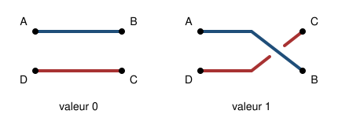

## Statement

Quatre enfants tiennent deux cordes, chacun un bout, aux quatre coins d'un carré imaginaire. Au départ les deux cordes sont parallèles : cet enchevêtrement **vaut 0**.

Deux coups sont autorisés.

- **Torsion**, notée $T$ : les deux enfants de droite échangent leurs places, l'un passant par-dessus la corde de l'autre.
- **Rotation**, notée $R$ : les quatre enfants font ensemble un quart de tour, dans le même sens.

John Conway a découvert qu'on peut attribuer un **nombre** à chaque enchevêtrement, de telle façon que :

- une torsion **ajoute $1$** au nombre ;
- une rotation remplace le nombre $x$ par $-\dfrac{1}{x}$.

Il n'existe **pas** de coup « détorsion ». C'est ce qui rend le jeu intéressant : pour défaire un nœud, il faut en rajouter.

Dans tout l'exercice on oublie les cordes et on ne travaille que sur les nombres. Ramener l'enchevêtrement à sa position de départ, c'est ramener le nombre à $0$.

1. On a fait trois torsions, on est donc au nombre $3$. Trouver une suite de coups qui ramène à $0$. Il en existe une de huit coups.
2. Même question en partant de $n$ torsions, c'est-à-dire du nombre $n$. Décrire une méthode qui marche pour tout $n$, et dire combien de coups elle demande.

## Hints

1. Après une rotation, le nombre devient négatif et très petit en valeur absolue. Que faut-il faire ensuite pour se rapprocher de $0$ ?
2. Commence par le cas le plus simple : le nombre $1$. Deux coups suffisent.
3. Pars de $3$, joue $R$ puis $T$ : tu obtiens $\dfrac{2}{3}$. Pars de $2$, joue $R$ puis $T$ : tu obtiens $\dfrac{1}{2}$. Tu es tombé sur des fractions de la forme $\dfrac{k}{k+1}$.
4. Calcule ce que les trois coups $R$, $T$, $T$ font à la fraction $\dfrac{k}{k+1}$. Tu obtiendras une fraction de la même forme, mais plus petite.

## Solution

**Question 1.** Voici une suite de huit coups qui ramène $3$ à $0$ :

$$R,\ T,\ R,\ T,\ T,\ R,\ T,\ T .$$

Le calcul, étape par étape :

$$3 \ \xrightarrow{\ R\ } \ -\frac{1}{3} \ \xrightarrow{\ T\ } \ \frac{2}{3} \ \xrightarrow{\ R\ } \ -\frac{3}{2} \ \xrightarrow{\ T\ } \ -\frac{1}{2} \ \xrightarrow{\ T\ } \ \frac{1}{2} \ \xrightarrow{\ R\ } \ -2 \ \xrightarrow{\ T\ } \ -1 \ \xrightarrow{\ T\ } \ 0 .$$

**Question 2.** La méthode repose sur une seule observation.

*Observation.* Prenons une fraction de la forme $\dfrac{k}{k+1}$, avec $k$ entier, $k \geqslant 1$, et jouons $R$, $T$, $T$ :

$$\frac{k}{k+1} \ \xrightarrow{\ R\ } \ -\frac{k+1}{k} \ \xrightarrow{\ T\ } \ -\frac{1}{k} \ \xrightarrow{\ T\ } \ \frac{k-1}{k} .$$

On retombe sur une fraction **de la même forme**, avec $k$ diminué de $1$. Les trois coups $R$, $T$, $T$ font donc descendre d'un cran la suite

$$\frac{n-1}{n}, \quad \frac{n-2}{n-1}, \quad \ldots, \quad \frac{2}{3}, \quad \frac{1}{2}, \quad \frac{0}{1} = 0 .$$

*La méthode.* Partons du nombre $n$.

- Deux coups $R$, $T$ pour entrer dans la suite :
$$n \ \xrightarrow{\ R\ } \ -\frac{1}{n} \ \xrightarrow{\ T\ } \ \frac{n-1}{n} .$$
- Puis on répète $R$, $T$, $T$ jusqu'à tomber sur $0$. Comme on part de $\dfrac{n-1}{n}$, c'est-à-dire de $k = n-1$, et qu'il faut arriver à $k = 0$, il faut répéter le bloc $n-1$ fois.

Au total la suite de coups est

$$R,\ T, \quad \underbrace{R,\ T,\ T, \quad \ldots \quad R,\ T,\ T}_{n-1 \text{ blocs}} ,$$

ce qui fait

$$2 + 3(n-1) = 3n - 1 \quad \text{coups.}$$

**Vérification pour $n = 3$** : $3 \times 3 - 1 = 8$, ce qui est bien la réponse de la question 1.

**Conclusion.** Trois torsions se défont en $8$ coups, et $n$ torsions en $3n - 1$ coups.

## Going further

Cette suite de $3n-1$ coups est en fait la **plus courte possible** : on peut le vérifier à l'ordinateur en explorant tous les chemins. Autrement dit, plus on tord, plus il faut de travail pour défaire, et le prix à payer croît régulièrement, trois coups par torsion supplémentaire.

Et la méthode ne sert pas qu'aux nombres entiers. Par exemple, l'enchevêtrement obtenu par trois torsions, une rotation, puis trois torsions vaut

$$0 \ \xrightarrow{\ TTT\ } \ 3 \ \xrightarrow{\ R\ } \ -\frac{1}{3} \ \xrightarrow{\ TTT\ } \ \frac{8}{3} ,$$

et il se défait en douze coups : $R, T, R, T, T, R, T, T, T, R, T, T$.
