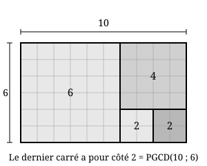

## Statement

On prend un rectangle quadrillé de $m$ carreaux sur $n$ carreaux. On y découpe, en suivant les lignes du quadrillage, le plus grand carré possible. Puis on recommence avec le rectangle qui reste, et ainsi de suite.

À la fin, il ne reste plus qu'un carré. Quelle est la longueur de son côté ?

## Hints

1. Faire l'expérience sur un exemple : partir d'un rectangle $10 \times 6$ et noter les dimensions des rectangles successifs. Recommencer avec $21 \times 15$.
2. Si le rectangle mesure $a$ sur $b$ avec $a > b$, quel est le côté du plus grand carré qu'on peut découper ? Quelles sont les dimensions du rectangle qui reste ?
3. On passe donc du couple $(a \, ; b)$ au couple $(a - b \, ; b)$. Cela ne rappelle-t-il rien ?
4. Montrer que $\mathrm{PGCD}(a, b) = \mathrm{PGCD}(a - b, b)$. Que vaut le PGCD des deux côtés d'un carré ?

## Solution

**Étape 1 : ce que fait une découpe.**

Soit un rectangle de $a$ carreaux sur $b$ carreaux, avec $a > b$. Le plus grand carré qu'on peut y découper le long du quadrillage a pour côté $b$, le plus petit des deux côtés. Une fois ce carré enlevé, il reste un rectangle de
$$(a - b) \text{ carreaux sur } b \text{ carreaux}.$$

Autrement dit, à chaque découpe, le couple des dimensions passe de $(a \, ; b)$ à $(a - b \, ; b)$.

**Étape 2 : le PGCD ne change pas.**

*Affirmation :* pour $a > b$, on a $\mathrm{PGCD}(a, b) = \mathrm{PGCD}(a - b, b)$.

Démonstration. Montrons que les deux couples ont exactement les mêmes diviseurs communs.

- Si $d$ divise $a$ et $b$, alors $d$ divise $a - b$. Donc $d$ est un diviseur commun de $a - b$ et de $b$.
- Réciproquement, si $d$ divise $a - b$ et $b$, alors $d$ divise $(a - b) + b = a$. Donc $d$ est un diviseur commun de $a$ et de $b$.

Les deux couples ont donc la même liste de diviseurs communs, donc le même plus grand d'entre eux.

**Étape 3 : le processus s'arrête.**

À chaque découpe, la somme des deux dimensions diminue strictement (elle passe de $a + b$ à $a - b + b = a$), tout en restant un entier strictement positif. Le processus ne peut donc pas continuer indéfiniment : il s'arrête. Et il ne peut s'arrêter que lorsque les deux dimensions sont égales, c'est-à-dire lorsque le morceau restant est un carré.

**Étape 4 : conclusion.**

D'après l'étape 2, la quantité $\mathrm{PGCD}(\text{longueur}, \text{largeur})$ est la même au départ et à l'arrivée : c'est un **invariant** du découpage.

- Au départ, elle vaut $\mathrm{PGCD}(m, n)$.
- À l'arrivée, le morceau est un carré de côté $c$, et $\mathrm{PGCD}(c, c) = c$.

Donc
$$c = \mathrm{PGCD}(m, n)$$

**Le dernier carré a pour côté le PGCD des deux dimensions du rectangle de départ.**

**Vérification sur la figure.** Le rectangle $10 \times 6$ donne successivement :
$$(10 \, ; 6) \longrightarrow (4 \, ; 6) \longrightarrow (4 \, ; 2) \longrightarrow (2 \, ; 2).$$
Le dernier carré a pour côté $2$, et en effet $\mathrm{PGCD}(10, 6) = 2$.

**Ce qu'il faut retenir.** Ce découpage n'est rien d'autre que l'algorithme d'Euclide, mais fait avec des ciseaux : découper le plus grand carré possible, c'est retrancher le petit côté du grand.

## Going further

1. Pour quels rectangles le dernier carré est-il un simple carreau $1 \times 1$ ?
2. Combien de carrés obtient-on en tout pour un rectangle $21 \times 13$ ? Et pour $13 \times 8$ ? Ces nombres sont des termes de la suite de Fibonacci : que se passe-t-il ?
3. Si l'on veut un découpage qui dure très longtemps, quel rectangle de dimensions inférieures à $100$ faut-il choisir ?
