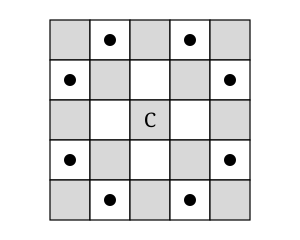

## Statement

Un cavalier d'échecs veut faire le tour de l'échiquier $8 \times 8$.

Peut-il partir de la case $a1$, passer par chacune des $64$ cases **exactement une fois**, et terminer son voyage sur la case $h8$ ?

*Rappel.* Le cavalier se déplace en L : deux cases dans une direction, puis une case perpendiculairement. Sur la figure, le cavalier est en $C$ et les points marquent les cases où il peut aller.

## Hints

1. Combien de coups le cavalier doit-il jouer en tout pour visiter $64$ cases en passant une seule fois par chacune ?
2. Regarde la figure : de quelle couleur est la case de départ du cavalier, et de quelle couleur sont les cases où il peut aller ?
3. Sur un échiquier, de quelle couleur sont les cases $a1$ et $h8$ ?
4. Le cavalier change de couleur à chaque coup. Sur quelle couleur se trouve-t-il après un nombre **impair** de coups ?

## Solution

**Réponse : non, c'est impossible.**

**Étape 1. Compter les coups.**

Le cavalier doit visiter $64$ cases, chacune une seule fois. La première case ne coûte aucun coup, et chaque coup fait découvrir une case nouvelle. Il joue donc

$$64 - 1 = 63 \text{ coups}$$

Retenons que $63$ est un nombre **impair**.

**Étape 2. À chaque coup, le cavalier change de couleur.**

Repérons une case par son numéro de colonne et son numéro de ligne, tous deux compris entre $1$ et $8$. Une case est noire ou blanche selon que la somme

$$\text{colonne} + \text{ligne}$$

est paire ou impaire : deux cases voisines, qui diffèrent de $1$ sur une seule coordonnée, ont bien des couleurs différentes.

Un coup de cavalier modifie une coordonnée de $2$ et l'autre de $1$. La somme colonne $+$ ligne change donc de

$$\pm 2 \pm 1$$

c'est-à-dire de $3$, $1$, $-1$ ou $-3$ : dans tous les cas d'un nombre **impair**. La parité de la somme change donc à chaque coup, autrement dit :

**à chaque coup, le cavalier passe d'une case d'une couleur à une case de l'autre couleur.**

C'est ce qu'on voit sur la figure : la case $C$ est grise et les huit cases accessibles sont toutes blanches.

**Étape 3. Les deux cases $a1$ et $h8$ ont la même couleur.**

Pour $a1$ : la colonne $a$ est la colonne $1$ et la ligne est $1$, donc la somme vaut $1 + 1 = 2$, un nombre pair.

Pour $h8$ : la colonne $h$ est la colonne $8$ et la ligne est $8$, donc la somme vaut $8 + 8 = 16$, un nombre pair lui aussi.

Ces deux cases sont donc **de la même couleur** (ce sont les deux coins d'une même grande diagonale de l'échiquier).

**Étape 4. La contradiction.**

Le cavalier part de $a1$. Après $1$ coup il est sur l'autre couleur, après $2$ coups il est revenu sur la couleur de $a1$, et ainsi de suite :

- après un nombre **pair** de coups, il est sur une case de la couleur de $a1$ ;
- après un nombre **impair** de coups, il est sur une case de l'autre couleur.

Or le voyage compte $63$ coups, un nombre impair. Le cavalier termine donc forcément sur une case de la couleur **opposée** à celle de $a1$.

Mais $h8$ est de la **même** couleur que $a1$. C'est contradictoire.

**Conclusion.** Le cavalier ne peut pas aller de $a1$ à $h8$ en passant exactement une fois par chaque case.

*Remarque pour l'animateur.* Certains élèves connaissent le célèbre « problème du cavalier » et affirmeront que c'est possible. Dans la version classique, le cavalier **revient à sa case de départ** : cela fait $64$ coups, un nombre pair, et la contradiction disparaît. Ce n'est pas la même question.

## Going further

1. Que dit le coloriage si on demande au cavalier de revenir à sa case de départ après avoir visité les $64$ cases ? Le parcours est-il alors interdit ?
2. Pour quels couples (case de départ, case d'arrivée) le coloriage n'interdit-il pas un tel voyage ?
3. Sur un échiquier $5 \times 5$, montrer qu'un voyage passant une seule fois par chacune des $25$ cases doit commencer et finir sur des cases de la même couleur, et dire laquelle. (Commencer par compter les cases de chaque couleur.)
