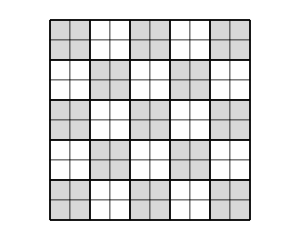

## Statement

Antoine recouvre sans peine un damier $10 \times 10$ avec des carrés de $2 \times 2$ cases. En revanche, avec des bandes de quatre cases en ligne, il n'y arrive jamais, quelle que soit sa façon de s'y prendre.

Est-ce seulement possible ? Autrement dit : peut-on recouvrir entièrement le damier $10 \times 10$ avec des bandes de quatre cases, sans trou et sans chevauchement ? Les bandes peuvent être posées horizontalement ou verticalement.

## Hints

1. Compte les cases du damier. Combien faudrait-il de bandes ? Le compte tombe-t-il juste ?
2. Essaie le coloriage en échiquier habituel. Combien de cases de chaque couleur une bande de quatre cases recouvre-t-elle ? Et un carré $2 \times 2$ ? Ce coloriage permet-il seulement de distinguer les deux pièces ?
3. Puisque le coloriage habituel ne distingue pas les deux pièces, il faut un coloriage **à plus grande échelle**. Découpe le damier en $25$ carrés de $2 \times 2$ cases, et colorie ces $25$ carrés comme un échiquier $5 \times 5$.
4. Compte les cases grises et les cases blanches de ce nouveau coloriage : y en a-t-il autant ? Puis regarde combien de cases de chaque couleur une bande recouvre.

## Solution

**Réponse : non, c'est impossible.**

**Étape 1. Le compte des cases ne suffit pas.**

Le damier a $10 \times 10 = 100$ cases et chaque bande en recouvre $4$. Comme $100 = 25 \times 4$, il faudrait exactement $25$ bandes. Le compte tombe juste : l'obstacle est ailleurs.

**Étape 2. Pourquoi le coloriage en échiquier habituel ne peut pas marcher.**

Sur un échiquier ordinaire, une bande de quatre cases recouvre $4$ cases consécutives d'une même ligne ou d'une même colonne, donc de couleurs alternées : $2$ noires et $2$ blanches.

Mais un carré $2 \times 2$ recouvre lui aussi $2$ cases noires et $2$ cases blanches. **Le coloriage en échiquier ne fait aucune différence entre les deux pièces.** Or Antoine réussit le pavage avec les carrés $2 \times 2$ : aucun argument fondé sur ce coloriage ne pourra donc interdire le pavage par les bandes. Il faut trouver autre chose.

**Étape 3. L'idée : un échiquier à plus grande échelle.**

Découpons le damier $10 \times 10$ en $25$ carrés de $2 \times 2$ cases, rangés en $5$ lignes et $5$ colonnes de carrés. Colorions maintenant **ces $25$ carrés** comme un échiquier $5 \times 5$ : chaque carré est entièrement gris ou entièrement blanc, et deux carrés voisins sont de couleurs différentes.

Comme $5$ est impair, l'échiquier $5 \times 5$ des carrés compte $13$ carrés gris et $12$ carrés blancs. Chaque carré contient $4$ cases, d'où :

$$13 \times 4 = 52 \text{ cases grises} \qquad \text{et} \qquad 12 \times 4 = 48 \text{ cases blanches}$$

Il y a donc **$4$ cases grises de plus** que de cases blanches.

**Étape 4. Ce que recouvre une bande.**

Montrons qu'une bande de quatre cases recouvre toujours $2$ cases grises et $2$ cases blanches.

Prenons une bande **horizontale**. Ses quatre cases sont sur une même ligne, donc dans une même ligne de carrés : leur couleur ne dépend que de la colonne. Les colonnes sont groupées deux par deux, $(1,2)$, $(3,4)$, $(5,6)$, $(7,8)$, $(9,10)$, un groupe par colonne de carrés, et les couleurs de deux groupes voisins sont différentes. Deux cas :

- la bande commence sur la **première** colonne d'un groupe : elle recouvre alors exactement deux groupes entiers, donc $2$ cases d'une couleur et $2$ cases de l'autre ;
- la bande commence sur la **seconde** colonne d'un groupe : elle recouvre la dernière colonne d'un groupe, puis un groupe entier, puis la première colonne du groupe suivant. Les trois groupes concernés ont les couleurs gris, blanc, gris (ou l'inverse), ce qui donne $1 + 2 + 1$ cases, soit encore $2$ cases de chaque couleur.

Dans les deux cas : $2$ grises et $2$ blanches. Pour une bande **verticale**, le raisonnement est le même en échangeant les rôles des lignes et des colonnes.

**Étape 5. La contradiction.**

Supposons qu'un pavage par $25$ bandes existe. Chaque bande recouvre $2$ cases grises, donc les $25$ bandes recouvrent en tout

$$25 \times 2 = 50 \text{ cases grises}$$

Or le damier en contient $52$. C'est impossible.

**Conclusion.** On ne peut pas paver un damier $10 \times 10$ avec des bandes de quatre cases.

*Ce qu'il faut retenir.* Quand le coloriage en échiquier ne distingue pas les pièces, on peut essayer de changer d'échelle : ici, on colorie des blocs de $2 \times 2$ au lieu de cases isolées.

## Going further

1. Voici un autre coloriage qui marche : dans chacun des $25$ carrés de $2 \times 2$, on marque une seule case, toujours à la même place (par exemple celle en bas à droite). Montrer qu'une bande de quatre cases recouvre toujours un nombre **pair** de cases marquées, puis conclure en comptant les cases marquées.
2. Peut-on paver un damier $8 \times 8$ avec des bandes de quatre cases ? Répondre en donnant un pavage ou une démonstration d'impossibilité.
3. Et un damier $6 \times 6$ ? Reprendre le coloriage par blocs de $2 \times 2$ et refaire le comptage.
