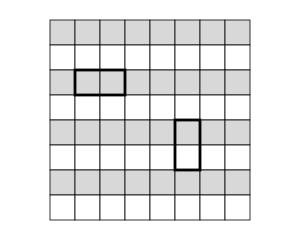

## Statement

Peut-on recouvrir entièrement un échiquier $8 \times 8$ avec $15$ dominos posés horizontalement et $17$ dominos posés verticalement, sans trou et sans chevauchement ?

Chaque domino recouvre deux cases voisines : deux cases côte à côte s'il est horizontal, deux cases l'une au-dessus de l'autre s'il est vertical.

## Hints

1. Compte les cases : le nombre de dominos est-il compatible avec la taille de l'échiquier ?
2. Le coloriage en échiquier habituel ne servira à rien : un domino horizontal et un domino vertical recouvrent tous les deux une case de chaque couleur. Il faut un coloriage qui **distingue les deux orientations**.
3. Colorie les **lignes** en alternance : une ligne grise, une ligne blanche, une ligne grise, … Combien de cases grises un domino horizontal recouvre-t-il ? Et un domino vertical ?
4. Compte le nombre total de cases grises recouvertes, et compare-le au nombre de cases grises de l'échiquier. Regarde si ces deux nombres ont la même parité.

## Solution

**Réponse : non, c'est impossible.**

**Étape 1. Le compte des cases ne suffit pas.**

Il y a $15 + 17 = 32$ dominos, qui recouvrent $32 \times 2 = 64$ cases, exactement le nombre de cases de l'échiquier. Le compte tombe juste : l'obstacle est ailleurs.

**Étape 2. L'idée : colorier en bandes horizontales.**

Le coloriage en échiquier ne peut rien donner ici, car un domino horizontal comme un domino vertical y recouvrent une case de chaque couleur : ce coloriage ne voit pas la différence entre les deux orientations.

Colorions donc l'échiquier en **bandes horizontales**, en alternant les couleurs ligne par ligne : lignes $1$, $3$, $5$, $7$ en gris, lignes $2$, $4$, $6$, $8$ en blanc.

Il y a $4$ lignes grises de $8$ cases, soit $4 \times 8 = 32$ cases grises (et $32$ cases blanches).

**Étape 3. Ce que recouvre chaque type de domino.**

- Un domino **horizontal** reste à l'intérieur d'une seule ligne, donc ses deux cases ont la même couleur. Il recouvre donc soit $2$ cases grises (s'il est sur une ligne grise), soit $0$ (s'il est sur une ligne blanche). **Dans les deux cas, un nombre pair.**
- Un domino **vertical** est à cheval sur deux lignes voisines, l'une grise et l'autre blanche. Il recouvre donc **exactement $1$ case grise**.

C'est ce qu'on voit sur la figure : le domino couché est entièrement dans une ligne grise, le domino debout a une case grise et une case blanche.

**Étape 4. La contradiction, par la parité.**

Supposons qu'un tel pavage existe, et comptons de deux façons les cases grises recouvertes.

D'une part, chaque case grise est recouverte exactement une fois, donc le total vaut $32$.

D'autre part, en additionnant la contribution de chaque domino :

- les $15$ dominos horizontaux apportent chacun $0$ ou $2$ cases grises, donc leur total est **pair** ;
- les $17$ dominos verticaux apportent chacun exactement $1$ case grise, donc leur total vaut $17$, un nombre **impair**.

La somme d'un nombre pair et d'un nombre impair est impaire. Le total des cases grises recouvertes serait donc **impair**.

Or ce total vaut $32$, qui est pair. C'est contradictoire.

**Conclusion.** On ne peut pas recouvrir l'échiquier $8 \times 8$ avec $15$ dominos horizontaux et $17$ dominos verticaux.

*Ce qu'il faut retenir.* Quand le coloriage en échiquier traite deux pièces de la même façon, on cherche un coloriage qui les sépare. Ici, les bandes horizontales « voient » l'orientation des dominos, ce que l'échiquier ne fait pas.

## Going further

1. Reprendre la démonstration sans supposer les nombres $15$ et $17$ : montrer que dans **tout** pavage de l'échiquier $8 \times 8$ par des dominos, le nombre de dominos verticaux est pair.
2. En coloriant cette fois en bandes **verticales**, montrer de même que le nombre de dominos horizontaux est pair.
3. Trouver un pavage de l'échiquier $8 \times 8$ avec $16$ dominos horizontaux et $16$ dominos verticaux. (Découper l'échiquier en deux rectangles de $8 \times 4$.)
4. Même étude sur un damier $6 \times 6$ : quelles répartitions entre dominos couchés et dominos debout sont interdites ?
