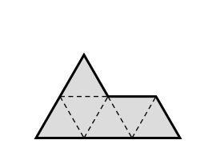

## Statement

On appelle **sphinx** la pièce ci-dessous. Elle est formée de six petits triangles
équilatéraux de côté $1$, assemblés comme sur la figure.

On dispose d'autant de sphinx que l'on veut, et on a le droit de les tourner et de les
retourner.

Peut-on paver entièrement un triangle équilatéral de côté $6$ avec des sphinx, sans trou et
sans chevauchement ?

## Hints

1. Commence par vérifier que l'aire ne bloque rien : combien de petits triangles de côté $1$
   le grand triangle contient-il, et ce nombre est-il un multiple de $6$ ?
2. Découpe le grand triangle en petits triangles de côté $1$. Ils ne sont pas tous orientés
   pareil : certains pointent vers le haut, d'autres vers le bas. Compte les uns et les autres.
3. Combien de triangles pointe en haut un sphinx recouvre-t-il ? Est-ce toujours le même
   nombre ? Et sa parité ?

## Solution

**La réponse est non**, et ce n'est pas une question d'aire.

**Le découpage du grand triangle.** Un triangle équilatéral de côté $6$ se découpe en
$6^2 = 36$ petits triangles équilatéraux de côté $1$. Comme $36 = 6 \times 6$, l'aire ne
s'oppose à rien : il faudrait exactement six sphinx.

Mais ces $36$ petits triangles ne sont pas orientés de la même façon. En parcourant le grand
triangle rangée par rangée, du sommet vers la base :

- la première rangée contient $1$ triangle pointe en haut ;
- la deuxième en contient $2$ pointe en haut et $1$ pointe en bas ;
- la troisième, $3$ pointe en haut et $2$ pointe en bas ;
- et ainsi de suite jusqu'à la sixième.

Au total :
$$\text{pointe en haut} : 1+2+3+4+5+6 = 21, \qquad
  \text{pointe en bas} : 1+2+3+4+5 = 15 .$$
On retrouve bien $21 + 15 = 36$. Retenons surtout ceci : **ces deux nombres sont impairs.**

**Ce que recouvre un sphinx.** Regardons la pièce : elle est faite de $4$ triangles orientés
d'un côté et de $2$ orientés de l'autre.

Quand on tourne le sphinx d'un sixième de tour, les pointes en haut deviennent des pointes en
bas et réciproquement : la pièce recouvre alors $2$ triangles pointe en haut et $4$ pointe en
bas. Quand on la retourne comme une crêpe, les orientations sont conservées.

Dans **toutes** les positions possibles, un sphinx recouvre donc soit $4$ pointe en haut et
$2$ pointe en bas, soit $2$ pointe en haut et $4$ pointe en bas. Dans les deux cas :

> un sphinx recouvre un nombre **pair** de triangles pointe en haut, et un nombre **pair** de
> triangles pointe en bas.

**La contradiction.** Si six sphinx pavaient le grand triangle, le nombre total de triangles
pointe en haut recouverts serait une somme de six nombres pairs, donc un nombre **pair**.

Or il faudrait recouvrir $21$ triangles pointe en haut, et $21$ est impair.

**Conclusion.** Il est impossible de paver le triangle équilatéral de côté $6$ avec des sphinx.

## Going further

Le même argument montre l'impossibilité pour tout triangle équilatéral de côté $n$ tel que le
nombre de triangles pointe en haut, $\dfrac{n(n+1)}{2}$, soit impair, c'est-à-dire pour
$n = 1, 2, 5, 6, 9, 10, 13, 14, \ldots$

Il ne dit rien des autres cas. Et le sphinx est une pièce remarquable : quatre sphinx
s'assemblent pour former un sphinx deux fois plus grand. On dit que c'est un *rep-tile*, et
c'est le seul pentagone connu à avoir cette propriété.
