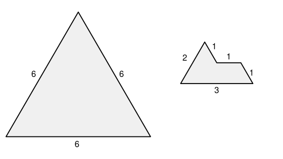
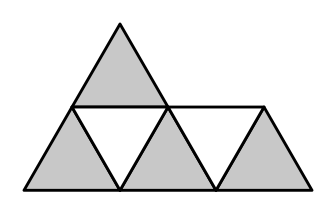

## Statement

On appelle **sphinx** la pièce dessinée à droite sur la figure : ses cinq côtés mesurent $3$, $1$, $1$, $1$ et $2$, et ses angles valent $60^\circ$, $120^\circ$ ou $240^\circ$. Un sphinx est formé de **six** triangles équilatéraux de côté $1$ collés les uns aux autres.

Peut-on paver le triangle équilatéral de côté $6$ avec des sphinx, c'est-à-dire le recouvrir entièrement, sans trou et sans chevauchement ? On a le droit de tourner les sphinx et de les retourner.

## Hints

1. Commence par les aires. Combien de sphinx faudrait-il ? Cela ne règle pas la question, mais cela montre au moins que l'aire n'est pas l'obstacle.
2. Découpe le grand triangle en petits triangles équilatéraux de côté $1$. Combien y en a-t-il ?
3. Ces petits triangles ne se ressemblent pas tous : certains pointent vers le haut, comme le grand triangle, et d'autres pointent vers le bas. Compte les uns et les autres séparément.
4. Fais le même comptage à l'intérieur d'un sphinx : combien de petits triangles pointe en haut, combien pointe en bas ? Et si l'on tourne le sphinx ?
5. Compare la parité des deux comptages.

## Solution

**Non, c'est impossible.**

**L'aire ne suffit pas à conclure.** Le triangle équilatéral de côté $6$ se découpe en $36$ triangles équilatéraux de côté $1$ : en partant du sommet, la première rangée en contient $1$, la deuxième $3$, la troisième $5$, et ainsi de suite jusqu'à $11$ pour la sixième, et

$$1 + 3 + 5 + 7 + 9 + 11 = 36 .$$

Un sphinx est formé de $6$ de ces petits triangles, et $36 = 6 \times 6$ : il faudrait donc exactement $6$ sphinx. L'aire ne bloque rien. L'obstacle est ailleurs.

**Les deux sortes de petits triangles.** Dans ce découpage, chaque petit triangle est soit **pointe en haut** (dans le même sens que le grand triangle), soit **pointe en bas**. Dans la rangée numéro $k$ en partant du sommet, il y a $k$ triangles pointe en haut et $k-1$ triangles pointe en bas. Donc, pour les six rangées :

$$\text{pointe en haut} : \; 1+2+3+4+5+6 = 21 , \qquad \text{pointe en bas} : \; 1+2+3+4+5 = 15 .$$

On retrouve bien $21 + 15 = 36$. Retenons surtout que **$21$ est impair**.

**Ce que couvre un sphinx.** Découpons un sphinx en ses six petits triangles :

Quatre de ces triangles pointent dans un sens (en gris sur la figure), et deux dans l'autre (en blanc).

Quand on pose un sphinx sur le découpage du grand triangle, deux choses peuvent arriver :

- soit il couvre $4$ triangles pointe en haut et $2$ triangles pointe en bas ;
- soit, s'il est tourné ou retourné de manière à échanger les deux sens, il couvre $2$ triangles pointe en haut et $4$ triangles pointe en bas.

**Dans les deux cas, le nombre de triangles pointe en haut couverts est pair** ($4$ ou $2$).

**On conclut.** Supposons qu'un pavage existe et qu'il utilise $6$ sphinx. Chaque sphinx couvre un nombre pair de triangles pointe en haut, donc le total couvert est une somme de six nombres pairs : c'est un nombre pair.

Or il faut couvrir exactement $21$ triangles pointe en haut, et $21$ est impair. Contradiction.

**Conclusion : on ne peut pas paver le triangle équilatéral de côté $6$ avec des sphinx.**

## Going further

L'argument ne se sert pas du nombre $6$ : il se sert seulement du fait que le nombre de triangles pointe en haut, à savoir $1+2+\cdots+n = \dfrac{n(n+1)}{2}$ pour un triangle de côté $n$, est impair. Cela se produit pour $n = 1, 2, 5, 6, 9, 10, 13, 14, \ldots$, et pour tous ces côtés le pavage par des sphinx est impossible.

Pour les autres valeurs de $n$, l'argument ne dit rien, et il faut chercher un pavage à la main. Le sphinx est d'ailleurs une pièce célèbre : quatre sphinx s'assemblent exactement en un sphinx deux fois plus grand.
