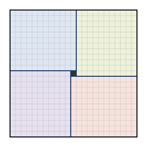

## Statement

1. Peut-on paver un damier $23 \times 23$ avec des carrés $2 \times 2$ et des carrés
   $3 \times 3$ ?
2. Et avec un carré $1 \times 1$, des carrés $2 \times 2$ et des carrés $3 \times 3$ ?

*Paver veut dire recouvrir entièrement le damier, sans trou et sans chevauchement, les pièces
étant posées sur les cases du quadrillage.*

## Hints

1. Pour la première question, cherche à colorier certaines cases de sorte que chaque pièce en
   recouvre toujours un nombre pair.
2. Essaie de colorier des colonnes entières. Une colonne sur combien ?
3. Un carré $3 \times 3$ occupe trois colonnes consécutives, un carré $2 \times 2$ en occupe
   deux. Combien de colonnes coloriées rencontrent-ils ?
4. Pour la seconde question, place le carré $1 \times 1$ au centre et regarde ce qui reste :
   on peut le découper en quatre rectangles identiques.

## Solution

### 1. Sans le carré $1 \times 1$, c'est impossible

**Le coloriage.** Numérotons les colonnes de $1$ à $23$ et colorions en noir les colonnes dont
le numéro est $1$, $4$, $7$, $10$, $13$, $16$, $19$, $22$, c'est-à-dire une colonne sur trois
en commençant par la première. Cela fait $8$ colonnes noires et donc $15$ colonnes blanches.

Le nombre de cases blanches vaut

$$15 \times 23 = 345,$$

qui est **impair**.

**Chaque pièce couvre un nombre pair de cases blanches.**

- Un carré $3 \times 3$ occupe trois colonnes consécutives. Parmi trois colonnes consécutives,
  il y en a exactement une de noire. Il recouvre donc $2$ colonnes blanches sur $3$ lignes,
  soit $6$ cases blanches : c'est pair.
- Un carré $2 \times 2$ occupe deux colonnes consécutives, dont au plus une est noire. Il
  recouvre donc soit $1$ colonne blanche sur $2$ lignes (soit $2$ cases blanches), soit
  $2$ colonnes blanches sur $2$ lignes (soit $4$ cases blanches). Dans les deux cas, c'est
  pair.

**La contradiction.** Si un pavage existait, le nombre total de cases blanches serait une somme
de nombres pairs, donc pair. Or il vaut $345$, qui est impair. **Un tel pavage est donc
impossible.**

### 2. Avec le carré $1 \times 1$, c'est possible

**Où mettre le carré $1 \times 1$.** Plaçons-le au centre exact du damier, c'est-à-dire sur la
case de la ligne $12$ et de la colonne $12$.

**Ce qui reste se découpe en quatre rectangles $11 \times 12$**, disposés en moulin :

- lignes $1$ à $11$, colonnes $1$ à $12$ ;
- lignes $1$ à $12$, colonnes $13$ à $23$ ;
- lignes $13$ à $23$, colonnes $12$ à $23$ ;
- lignes $12$ à $23$, colonnes $1$ à $11$.

On vérifie que ces quatre rectangles ne se chevauchent pas et qu'ils recouvrent tout sauf la
case centrale : leur aire totale vaut $4 \times 11 \times 12 = 528$, et
$23 \times 23 - 1 = 528$ également.

**Chaque rectangle $11 \times 12$ se pave.** Coupons-le en deux :

- un rectangle $9 \times 12$, que l'on pave avec $3 \times 4 = 12$ carrés $3 \times 3$ ;
- un rectangle $2 \times 12$, que l'on pave avec $6$ carrés $2 \times 2$.

**La réponse est donc : non à la première question, oui à la seconde.**

## Going further

Le coloriage en colonnes fonctionne parce que le nombre $23$ n'est pas un multiple de $3$ : il
reste $15$ colonnes blanches, un nombre impair, et c'est cette imparité qui bloque tout. Avec
un damier $24 \times 24$ le même coloriage donnerait $16$ colonnes blanches, donc un nombre
pair de cases blanches, et l'argument tomberait à plat. Et de fait, un damier $24 \times 24$
se pave sans difficulté avec des carrés $2 \times 2$.
