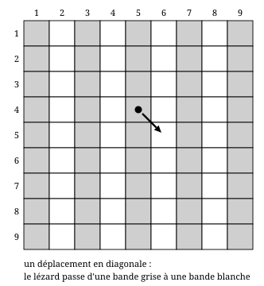
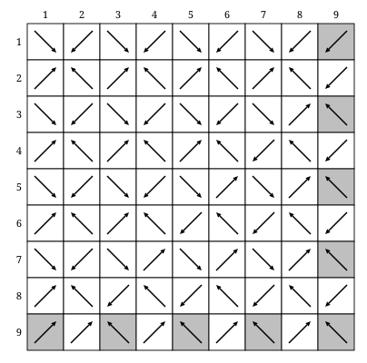

## Statement

Sur chaque case d'un carré $9 \times 9$ se trouve un lézard : il y en a donc $81$, un par case.

À un signal, tous les lézards se déplacent en même temps. Chacun passe sur une case voisine **en diagonale**, c'est-à-dire une des cases qui touchent la sienne par un coin. Aucun lézard n'a le droit de rester sur place, et aucun ne sort du carré.

Après ce déplacement, certaines cases portent plusieurs lézards et d'autres sont vides.

Quel est le nombre minimum de cases vides ?

## Hints

1. Commence par te convaincre qu'il y aura forcément des cases vides : si toutes les cases étaient occupées, chaque case porterait exactement un lézard.
2. Le coloriage en échiquier ne donne rien ici : un déplacement en diagonale garde la couleur de la case. Il faut colorier autrement.
3. Colorie le carré en **bandes verticales** : les colonnes $1, 3, 5, 7, 9$ en gris, les colonnes $2, 4, 6, 8$ en blanc. Combien de cases de chaque couleur ?
4. Quand un lézard se déplace en diagonale, son numéro de colonne change de $1$. De quelle couleur de bande part-il, et sur quelle couleur arrive-t-il ?
5. Les cases grises ne peuvent donc être occupées que par des lézards venus des bandes blanches. Combien y en a-t-il ?
6. Tu obtiens qu'au moins $9$ cases restent vides. Il faut encore montrer que $9$ est réalisable : il s'agit de construire un déplacement, pas seulement de compter.

## Solution

**Réponse : $9$ cases vides au minimum.**

Comme toujours pour un minimum, la démonstration a deux moitiés : montrer qu'on ne peut pas faire mieux, puis montrer qu'on peut faire aussi bien.

### Première moitié : il reste toujours au moins $9$ cases vides

**Le bon coloriage.** Le coloriage en échiquier est inutile ici : un déplacement en diagonale conserve la couleur de la case, donc il n'interdit rien.

Colorions plutôt le carré en **bandes verticales** : les colonnes de numéro impair ($1, 3, 5, 7, 9$) en gris, celles de numéro pair ($2, 4, 6, 8$) en blanc.

Comptons :

- bandes grises : $5$ colonnes de $9$ cases, soit $5 \times 9 = 45$ cases ;
- bandes blanches : $4$ colonnes de $9$ cases, soit $4 \times 9 = 36$ cases.

**Ce que fait un déplacement.** Un lézard qui se déplace en diagonale change de colonne : son numéro de colonne augmente ou diminue de $1$. Il passe donc toujours d'une colonne paire à une colonne impaire, ou l'inverse : **un lézard change toujours de couleur de bande.**

**La contradiction chiffrée.** Après le signal, un lézard posé sur une case grise vient forcément d'une case blanche. Or il n'y a que $36$ lézards sur les bandes blanches.

Les $45$ cases grises ne peuvent donc être occupées que par ces $36$ lézards au plus, et même si ceux-ci se répartissent le mieux possible, ils n'occupent pas plus de $36$ cases grises. Il reste donc au moins
$$45 - 36 = 9$$
cases grises vides.

### Seconde moitié : $9$ cases vides, c'est possible

Il faut maintenant exhiber un déplacement qui ne laisse que $9$ cases vides. En voici un : dans chaque case, la flèche indique vers quelle case part le lézard qui s'y trouve. Les neuf cases grisées sont celles qui resteront vides.

Voici comment cette figure est construite. On regarde les cases selon la parité de leur ligne et de leur colonne.

1. **Ligne paire et colonne paire** ($16$ cases) : le lézard part en haut à gauche. Les cases d'arrivée sont exactement les $16$ cases « ligne impaire, colonne impaire » situées dans les $7$ premières lignes et les $7$ premières colonnes, chacune recevant un lézard et un seul.
2. **Ligne impaire et colonne impaire, dans les $7$ premières lignes et les $7$ premières colonnes** ($16$ cases) : le lézard part en bas à droite. Les cases d'arrivée sont exactement les $16$ cases « ligne paire, colonne paire ».
3. **Ligne paire et colonne impaire** ($20$ cases) : en ligne $2$, les lézards des colonnes $1$, $3$, $5$, $7$ partent en haut à droite et celui de la colonne $9$ part en bas à gauche ; en ligne $4$, ce sont les trois premiers qui partent en haut à droite et les deux derniers en bas à gauche ; en ligne $6$, les deux premiers ; en ligne $8$, le premier seulement. Les $20$ cases d'arrivée sont exactement les $20$ cases « ligne impaire, colonne paire », chacune une fois.
4. **Ligne impaire et colonne paire** ($20$ cases) : la même règle, en échangeant les rôles des lignes et des colonnes. En colonne $2$, les lézards des lignes $1$, $3$, $5$, $7$ partent en bas à gauche et celui de la ligne $9$ en haut à droite ; en colonne $4$, les trois premiers ; en colonne $6$, les deux premiers ; en colonne $8$, le premier seulement. Les $20$ cases d'arrivée sont les $20$ cases « ligne paire, colonne impaire ».
5. **Les $9$ cases « ligne impaire, colonne impaire » restantes**, c'est-à-dire celles de la ligne $9$ ou de la colonne $9$ : leurs lézards partent en diagonale n'importe où, ils tomberont de toute façon sur une case déjà occupée.

Les points 1 à 4 remplissent toutes les cases, sauf les neuf cases du point 5, qui sont :
$$(9,1),\ (9,3),\ (9,5),\ (9,7),\ (9,9),\ (1,9),\ (3,9),\ (5,9),\ (7,9)$$
(ligne d'abord, colonne ensuite). Ce sont bien $9$ cases vides, et elles sont bien toutes dans des colonnes impaires, comme la première moitié l'annonçait.

**Conclusion.** Le nombre minimum de cases vides est $\mathbf{9}$.

## Going further

1. Refais la première moitié avec des bandes **horizontales** au lieu de bandes verticales. Que trouves-tu ? Qu'est-ce que cela apprend sur la position des cases vides quand il n'y en a que $9$ ?
2. Même question pour un carré $7 \times 7$, puis $11 \times 11$. Devines-tu la réponse pour un carré $(2n+1) \times (2n+1)$ ?
3. Et pour un carré $8 \times 8$ ? Le comptage par bandes ne donne plus rien : trouve un déplacement qui ne laisse aucune case vide.
