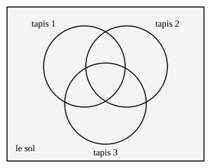

## Statement

Sur un sol d'aire $12$ m² sont posés trois tapis :

- le premier a une aire de $5$ m² ;
- le deuxième, une aire de $4$ m² ;
- le troisième, une aire de $3$ m².

Deux tapis quelconques se recouvrent sur une aire de $\text{1,5}$ m². Les trois tapis à la fois se recouvrent sur une aire de $\text{0,5}$ m².

1. Quelle est l'aire de la partie du sol qui n'est couverte par aucun tapis ?
2. Quelle est l'aire de la partie du sol qui est couverte par le premier tapis **et par lui seul** ?

## Hints

1. Fais un dessin comme celui de l'énoncé. Les trois tapis découpent la zone couverte en sept morceaux. Cherche à connaître l'aire de chacun.
2. Commence par le morceau du milieu, celui qui est couvert par les trois tapis : son aire est donnée.
3. Passe ensuite aux morceaux couverts par exactement deux tapis. L'énoncé donne l'aire commune à deux tapis, mais cette aire commune contient aussi le morceau du milieu. Comment obtenir le morceau couvert par ces deux tapis **seulement** ?
4. Termine par les morceaux couverts par un seul tapis : pars de l'aire du tapis entier et retire ce qu'il partage avec les autres.
5. Pour la question 1, additionne les sept morceaux, puis compare au sol.

## Solution

**L'idée : ne pas additionner les tapis tels quels, mais découper la zone couverte en morceaux qui ne se chevauchent pas.**

Les trois tapis découpent la zone couverte en sept morceaux :

- un morceau couvert par les **trois** tapis ;
- trois morceaux couverts par **exactement deux** tapis ;
- trois morceaux couverts par **un seul** tapis.

Calculons l'aire de chacun, en partant du centre.

**Le morceau du milieu.** L'énoncé le donne directement :
$$\text{aire couverte par les trois tapis} = \text{0,5} \ \text{m}^2 .$$

**Les morceaux couverts par exactement deux tapis.**

Prenons les tapis $1$ et $2$. Ils ont en commun une aire de $\text{1,5}$ m². Mais cette zone commune se compose de deux parties : celle où seuls les tapis $1$ et $2$ sont présents, et le morceau du milieu, où le tapis $3$ est là aussi. Donc

$$\text{aire couverte par } 1 \text{ et } 2 \text{ seulement} = \text{1,5} - \text{0,5} = 1 \ \text{m}^2 .$$

Les trois couples de tapis se recouvrent tous sur $\text{1,5}$ m², donc le même calcul vaut pour les couples $(1,3)$ et $(2,3)$ :

$$\text{chacun des trois morceaux « exactement deux tapis » a une aire de } 1 \ \text{m}^2 .$$

**Les morceaux couverts par un seul tapis.**

Le tapis $1$ a une aire totale de $5$ m². Cette aire se partage en quatre parties : la zone où il est seul, les deux zones qu'il partage avec exactement un autre tapis, et le morceau du milieu. Donc

$$\text{aire couverte par le tapis } 1 \text{ seul} = 5 - 1 - 1 - \text{0,5} = \text{2,5} \ \text{m}^2 .$$

**C'est la réponse à la question 2.**

De la même façon :

$$\text{tapis } 2 \text{ seul} = 4 - 1 - 1 - \text{0,5} = \text{1,5} \ \text{m}^2, \qquad
\text{tapis } 3 \text{ seul} = 3 - 1 - 1 - \text{0,5} = \text{0,5} \ \text{m}^2 .$$

**L'aire totale couverte.**

Les sept morceaux ne se chevauchent pas : on peut donc simplement additionner leurs aires.

$$\underbrace{\text{2,5} + \text{1,5} + \text{0,5}}_{\text{un seul tapis}} \;+\; \underbrace{1 + 1 + 1}_{\text{exactement deux}} \;+\; \underbrace{\text{0,5}}_{\text{les trois}} \;=\; \text{4,5} + 3 + \text{0,5} \;=\; 8 \ \text{m}^2 .$$

**La partie non couverte.**

$$12 - 8 = 4 \ \text{m}^2 .$$

**Réponses : la partie du sol laissée nue a une aire de $4$ m², et la partie couverte par le premier tapis seul a une aire de $\text{2,5}$ m².**

*Remarque. Le calcul de l'aire couverte peut aussi s'écrire d'un seul coup :*
$$5 + 4 + 3 \;-\; \text{1,5} - \text{1,5} - \text{1,5} \;+\; \text{0,5} = 8 .$$
*On additionne les trois tapis, mais chaque zone commune à deux tapis a alors été comptée deux fois : on la retire une fois. Le morceau du milieu, lui, a été compté trois fois puis retiré trois fois : il faut donc le rajouter une fois.*

## Going further

1. Vérifie que les trois tapis pourraient réellement être disposés ainsi. Par exemple, le tapis $3$ a une aire de $3$ m² et partage $\text{1,5}$ m² avec chacun des deux autres : est-ce compatible ?
2. Avec les mêmes tapis, quelle est la plus grande aire de sol que l'on pourrait laisser nue si l'on était libre de les déplacer ? Et la plus petite ?
3. Écris la formule générale donnant l'aire couverte par trois tapis $A$, $B$ et $C$ en fonction des aires de $A$, $B$, $C$, de leurs intersections deux à deux et de leur intersection commune.
