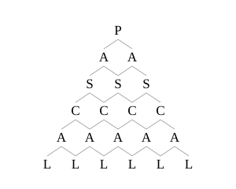

## Statement

On a écrit les lettres du mot PASCAL en triangle : un $P$ sur la première ligne, deux $A$ sur la deuxième, trois $S$ sur la troisième, et ainsi de suite jusqu'aux six $L$ de la dernière ligne.

On lit le mot en partant du $P$ du haut. À chaque étape, on descend d'une ligne, en allant sur la lettre située juste en dessous à gauche, ou sur celle située juste en dessous à droite.

De combien de façons peut-on lire le mot PASCAL ?

## Hints

1. De combien de façons peut-on atteindre chacun des deux $A$ de la deuxième ligne ? Et chacun des trois $S$ ?
2. Une lettre qui n'est pas au bord : de quelles lettres peut-on y arriver ? Combien y en a-t-il juste au-dessus ?
3. Écrivez à la place de chaque lettre le nombre de façons de l'atteindre. Ce nombre est la somme des nombres écrits sur les (au plus deux) lettres situées juste au-dessus.
4. Un mot lu se termine sur l'un des six $L$, n'importe lequel. Que faut-il donc faire des six nombres de la dernière ligne ?

## Solution

**L'idée : compter les façons d'arriver sur chaque lettre.**

Remplaçons chaque lettre par le nombre de façons de l'atteindre depuis le $P$ du haut.

- Le $P$ du haut : on y est déjà, cela fait $1$ façon.
- Les lettres du bord gauche et du bord droit : pour les atteindre il faut descendre tout le temps du même côté, donc $1$ seule façon à chaque fois.
- Une autre lettre : on ne peut y arriver qu'en venant de la lettre juste au-dessus à gauche ou de la lettre juste au-dessus à droite. Les chemins qui viennent de la gauche et ceux qui viennent de la droite sont tous différents, et il n'y en a pas d'autres. Donc

$$\text{(façons d'atteindre une lettre)} = \text{(façons d'atteindre sa voisine en haut à gauche)} + \text{(façons d'atteindre sa voisine en haut à droite)}.$$

**On remplit le triangle ligne par ligne.**

$$
\begin{array}{c}
1\\
1 \quad 1\\
1 \quad 2 \quad 1\\
1 \quad 3 \quad 3 \quad 1\\
1 \quad 4 \quad 6 \quad 4 \quad 1\\
1 \quad 5 \quad 10 \quad 10 \quad 5 \quad 1
\end{array}
$$

Par exemple, le $2$ de la troisième ligne vient de $1 + 1$ : on peut atteindre le $S$ du milieu par le $A$ de gauche ou par le $A$ de droite. Le $6$ de la cinquième ligne vient de $3 + 3$.

**On rassemble.**

Une lecture du mot se termine sur l'un des six $L$, et deux lectures qui se terminent sur des $L$ différents sont bien sûr différentes. Le nombre total de lectures est donc la somme des nombres de la dernière ligne :
$$1 + 5 + 10 + 10 + 5 + 1 = 32.$$

**Conclusion.** Il y a $32$ façons de lire le mot PASCAL.

Au passage, les nombres que nous avons écrits sont exactement ceux du **triangle de Pascal** : chaque nombre y est la somme des deux nombres placés juste au-dessus de lui. Ce n'est pas un hasard, c'est la même règle de construction.

## Going further

1. On dispose de la même façon un mot de dix lettres (une lettre sur la première ligne, dix sur la dernière). Combien de lectures y a-t-il ? Cherchez d'abord les mots de $2$, $3$, $4$ lettres, et devinez la règle.
2. On se déplace dans le triangle de Pascal selon la même règle, en partant du $1$ du sommet. Montrez que le nombre de chemins qui aboutissent à un nombre $N$ du triangle est exactement égal à $N$.
