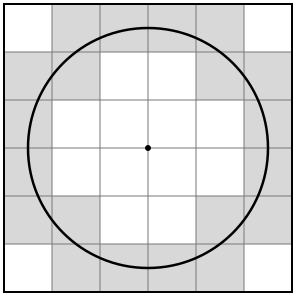

## Statement

Soit $n$ un entier strictement positif. On dessine un échiquier de $2n \times 2n$ cases, chaque case
étant un carré de côté $1$. On trace un cercle de diamètre $2n - 1$ dont le centre est le centre de
l'échiquier.

Combien de cases le cercle traverse-t-il, c'est-à-dire combien de cases ont une partie du cercle à
l'intérieur ?

## Hints

1. Fais un dessin pour $n = 2$ et $n = 3$, et compte.
2. Combien de fois le cercle coupe-t-il les lignes du quadrillage ? Pense aux lignes qui vont d'un
   bord de l'échiquier à l'autre.
3. Le cercle peut-il passer exactement par un coin de case ? Utilise le théorème de Pythagore.
4. Entre deux points où il coupe le quadrillage, le cercle reste dans une seule case. Peut-il
   repasser plus tard par une case qu'il a déjà quittée ?

## Solution

**Des coordonnées.** On place l'origine au centre $O$ de l'échiquier, les axes le long des lignes du
quadrillage. Comme l'échiquier a un nombre pair de cases de côté, les lignes du quadrillage sont les
droites $x = k$ et $y = k$ pour les entiers $k$ de $-n$ à $n$. Le cercle a pour rayon
$r = n - \frac{1}{2}$.

**Le cercle coupe chaque ligne intérieure deux fois.** À l'intérieur de l'échiquier, il y a
$2n - 1$ lignes verticales $x = k$ avec $-(n - 1) \leqslant k \leqslant n - 1$, et autant de lignes
horizontales. La distance de $O$ à la ligne $x = k$ est $|k| \leqslant n - 1 < r$ : le cercle coupe
cette ligne en deux points. Les bords de l'échiquier, eux, sont à la distance $n > r$ et ne sont pas
touchés. Le cercle coupe donc le quadrillage en

$$2 \times (2n - 1) + 2 \times (2n - 1) = 8n - 4 \text{ points}.$$

**Le cercle ne passe par aucun coin de case.** Un coin de case a des coordonnées entières $(a, b)$.
S'il était sur le cercle, on aurait par Pythagore $a^2 + b^2 = r^2 = n^2 - n + \frac{1}{4}$. À
gauche c'est un entier, à droite non. C'est impossible. Ainsi, chacun des $8n - 4$ points est sur
une seule ligne du quadrillage, et à cet endroit le cercle passe d'une case à la case voisine.

**Le cercle est coupé en arcs.** Les $8n - 4$ points coupent le cercle en $8n - 4$ arcs. Chaque arc
ne rencontre aucune ligne entre ses extrémités, donc il reste à l'intérieur d'une seule case.

**Le cercle ne revient jamais dans une case qu'il a quittée.** Les axes passent par des lignes du
quadrillage, donc chaque case est entièrement dans un des quatre quarts du plan. Prenons le quart en
haut à droite. Quand on parcourt le quart de cercle de $(r, 0)$ à $(0, r)$, l'abscisse $x$ ne fait
que diminuer et l'ordonnée $y$ ne fait qu'augmenter. Quand le cercle sort d'une case par le haut,
$y$ dépasse un entier et ne redescendra plus. Quand il sort par la gauche, $x$ passe sous un entier
et ne remontera plus. Dans les deux cas il ne peut plus revenir dans cette case. Il en va de même
dans les trois autres quarts.

Chaque case traversée contient donc exactement un arc, et chaque arc est dans une case. Il y a
autant de cases traversées que d'arcs.

Pour $n = 3$, on trouve bien $8 \times 3 - 4 = 20$ cases, en gris sur la figure.

**Conclusion.** Le cercle traverse exactement $8n - 4$ cases. C'est aussi, curieusement, le nombre de
cases du bord de l'échiquier.
