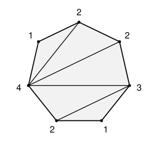

## Statement

On trace certaines diagonales d'un polygone convexe, de façon à le découper en triangles. Deux de ces
diagonales ne se coupent jamais, sauf éventuellement en un sommet du polygone.

Sur chaque sommet du polygone, on écrit ensuite le **nombre de triangles** qui ont ce sommet pour
sommet. Voici un exemple avec un heptagone :

Puis on efface les diagonales, et il ne reste que les nombres.

Peut-on toujours retrouver les diagonales effacées, en connaissant seulement les nombres écrits sur
les sommets ?

## Hints

1. Que peut-on dire d'un sommet où est écrit le nombre $1$ ? Quel est le seul triangle qui le touche,
   et quelle diagonale contient-il forcément ?
2. Si l'on connaît une diagonale qui découpe un triangle « tout au bord », peut-on enlever ce
   triangle et recommencer avec un polygone plus petit ? Comment changent les nombres ?
3. Il reste à montrer qu'il y a toujours un sommet portant un $1$ quand le polygone a au moins
   $4$ sommets. Regarde la diagonale qui « saute » le moins de sommets.

## Solution

La réponse est **oui**. Voici une méthode qui retrouve les diagonales une par une.

Si le polygone est un triangle, il n'y a aucune diagonale et il n'y a rien à retrouver. Supposons
donc que le polygone a au moins $4$ sommets.

**Étape 1 : un sommet qui porte un $1$ donne une diagonale.** Soit $v$ un sommet où est écrit $1$, et
soient $x$ et $y$ ses deux voisins sur le bord du polygone. Le côté $[vx]$ du polygone appartient à
un triangle, et le côté $[vy]$ aussi. Comme un seul triangle touche $v$, c'est le même triangle : il
contient les côtés $[vx]$ et $[vy]$, donc c'est le triangle $xvy$.

Le segment $[xy]$ est donc un côté de ce triangle. Ce n'est pas un côté du polygone, puisque le
polygone a au moins $4$ sommets : c'est donc **une des diagonales tracées**.

**Étape 2 : on enlève ce triangle.** La diagonale $[xy]$ coupe le polygone en deux morceaux : le
triangle $xvy$, et un polygone convexe avec un sommet de moins (on a enlevé $v$). Les autres
diagonales sont toutes dans ce polygone plus petit et le découpent en triangles.

Les nombres du petit polygone se déduisent des anciens : on a enlevé un triangle, qui touchait $x$,
$v$ et $y$. Donc il suffit d'**enlever $1$ aux nombres écrits sur $x$ et $y$**, et de rayer $v$. Les
autres nombres ne changent pas.

On recommence alors avec le petit polygone et ses nouveaux nombres, jusqu'à arriver à un triangle.
À chaque tour, on a retrouvé une diagonale, et on finit par les retrouver toutes.

**Étape 3 : il y a toujours un sommet qui porte un $1$.** La méthode ne marche que si, à chaque tour,
un des sommets porte le nombre $1$. Montrons que c'est toujours le cas dès que le polygone a au moins
$4$ sommets.

Il y a au moins une diagonale tracée, sinon le polygone ne serait pas découpé en triangles. Chaque
diagonale sépare le bord du polygone en deux chemins, et laisse d'un côté un certain nombre de
sommets : disons qu'elle les « saute ». Choisissons la diagonale $[xy]$ qui saute **le moins** de
sommets, et soit $v$ un des sommets qu'elle saute.

Aucune diagonale ne part de $v$. En effet, une diagonale partant de $v$ ne peut pas couper $[xy]$,
donc elle resterait du côté des sommets sautés, et elle sauterait moins de sommets que $[xy]$. C'est
impossible par le choix de $[xy]$.

Or les triangles qui touchent $v$ se partagent l'angle du polygone en $v$, et ils sont séparés
les uns des autres par les diagonales qui partent de $v$. S'il en part $d$, il y a $d + 1$
triangles autour de $v$. Ici $d = 0$, donc un seul triangle touche $v$, et le nombre écrit sur $v$
est $1$.

**Exemple.** Dans la figure, le deuxième sommet en partant du haut, à gauche, porte un $1$ : on trace
la diagonale entre ses deux voisins, on enlève $1$ à leurs nombres, et l'on continue.

**Conclusion.** Oui, on peut toujours retrouver les diagonales. Tant qu'il reste au moins $4$
sommets, il existe un sommet portant le nombre $1$. La diagonale qui joint ses deux voisins est
alors forcément tracée. On enlève ce sommet, on retire $1$ aux nombres de ses deux voisins, et
l'on recommence.

## Going further

En additionnant tous les nombres écrits sur les sommets, chaque triangle est compté trois fois, une
fois par sommet. Un polygone à $n$ sommets est toujours découpé en $n - 2$ triangles, ce qui se
montre avec la même méthode d'enlèvement. La somme des nombres vaut donc toujours $3(n - 2)$. Dans
l'exemple : $2 + 1 + 4 + 2 + 1 + 3 + 2 = 15 = 3 \times 5$.
