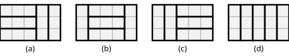

## Statement

On dispose d'un rectangle quadrillé de $3$ cases de haut sur $5$ cases de large, soit $15$ cases.

De combien de façons peut-on le découper entièrement en cinq bandes de $3$ cases, chaque bande étant posée soit horizontalement, soit verticalement ?

Les bandes ne doivent ni se chevaucher ni dépasser du rectangle. Le rectangle reste posé comme il est : on ne le retourne pas et on ne le fait pas tourner.

## Hints

1. Une bande verticale occupe une colonne entière, puisque le rectangle n'a que $3$ cases de haut.
2. Regarder une ligne du rectangle : elle a $5$ cases. Combien de bandes **horizontales** peuvent tenir dans une même ligne ?
3. En déduire qu'il y a au plus trois bandes horizontales en tout.
4. Les colonnes qui ne sont pas occupées par une bande verticale sont couvertes uniquement par des bandes horizontales. Combien de colonnes une bande horizontale traverse-t-elle ?
5. Montrer que s'il y a au moins une bande horizontale, alors il y en a exactement trois, et qu'elles occupent les mêmes trois colonnes, forcément consécutives.

## Solution

**Deux remarques de départ.**

Le rectangle a $3$ cases de haut. Une bande **verticale** occupe donc une colonne complète, de haut en bas. Une bande **horizontale** occupe trois cases consécutives d'une même ligne, donc trois colonnes voisines.

Notons $h$ le nombre de bandes horizontales et $v$ le nombre de bandes verticales. On a $h + v = 5$.

**Au plus une bande horizontale par ligne.**

Une ligne compte $5$ cases. Deux bandes horizontales dans la même ligne occuperaient $6$ cases : impossible. Chaque ligne contient donc au plus une bande horizontale, et comme il y a $3$ lignes,

$$h \leqslant 3 .$$

**Les colonnes « libres ».**

Appelons colonne *pleine* une colonne occupée par une bande verticale, et colonne *libre* une autre colonne. Il y a $v$ colonnes pleines et $5 - v$ colonnes libres.

Toutes les cases d'une colonne libre sont couvertes par des bandes horizontales. Or une bande horizontale traverse trois colonnes voisines, et aucune de ces trois colonnes ne peut être pleine (elle serait alors occupée deux fois). Donc :

> **dès qu'il existe une bande horizontale, il existe au moins trois colonnes libres.**

**Séparer en deux cas.**

*Cas 1 : $h = 0$.* Il n'y a que des bandes verticales, donc $v = 5$ : chacune des cinq colonnes porte une bande verticale. Cela donne **un** découpage, et il est bien valable.

*Cas 2 : $h \geqslant 1$.* Il y a alors au moins trois colonnes libres, donc $5 - v \geqslant 3$, soit $v \leqslant 2$ et donc $h = 5 - v \geqslant 3$. Avec $h \leqslant 3$, on obtient

$$h = 3 \qquad \text{et} \qquad v = 2 .$$

Il y a donc exactement une bande horizontale par ligne, et exactement $3$ colonnes libres. Chaque bande horizontale occupe trois colonnes libres consécutives ; comme il n'y a que trois colonnes libres en tout, les trois bandes occupent **les mêmes** trois colonnes, qui sont donc trois colonnes consécutives.

Trois colonnes consécutives parmi cinq : il y a trois possibilités, les colonnes $1$-$2$-$3$, ou $2$-$3$-$4$, ou $3$-$4$-$5$. Dans chaque cas, le découpage est entièrement déterminé : trois bandes horizontales empilées sur ces colonnes, et une bande verticale dans chacune des deux colonnes restantes. Cela donne **trois** découpages.

**Conclusion.** Il y a $1 + 3 = \boxed{4}$ découpages.

## Going further

1. Combien y a-t-il de découpages d'un rectangle $3 \times 6$ en bandes de $3$ cases ?
2. Et d'un rectangle $3 \times 4$ ? Et d'un rectangle $3 \times 7$ ?
3. Notons $u_n$ le nombre de découpages d'un rectangle $3 \times n$. Trouver une relation entre $u_n$, $u_{n-1}$ et $u_{n-3}$, et la justifier en regardant la colonne la plus à gauche.
