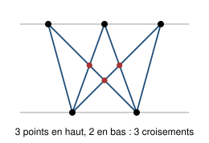

## Statement

On trace deux droites parallèles. On place des points sur chacune d'elles, puis on relie **chaque point du haut à chaque point du bas** par un segment.

On appelle **croisement** un point où deux segments se coupent ailleurs qu'à une extrémité qu'ils auraient en commun. Les points sont placés de façon que jamais trois segments ne passent par le même croisement.

1. On place $4$ points en haut et $3$ points en bas. Combien de segments trace-t-on ?
2. Combien y a-t-il de croisements ?
3. Et si l'on place $N$ points en haut et $M$ points en bas ?

## Hints

1. Pour la question 1, chaque point du haut envoie un segment vers chacun des points du bas.
2. Pour la question 2, ne compte surtout pas les croisements un par un sur le dessin. Cherche plutôt à **associer** à chaque croisement un objet plus simple à compter.
3. Un croisement est sur exactement deux segments. Ces deux segments peuvent-ils avoir une extrémité commune ? Combien d'extrémités différentes ont-ils en tout, en haut et en bas ?
4. Prends le problème dans l'autre sens. Choisis deux points en haut et deux points en bas, et regarde les quatre segments qui les relient : combien de croisements fabriquent-ils ? Fais le dessin, il n'y a pas beaucoup de cas.

## Solution

**Question 1.** Chacun des $4$ points du haut est relié à chacun des $3$ points du bas, ce qui donne

$$4 \times 3 = 12 \ \text{segments}.$$

**Question 2.** L'idée est de remplacer « compter les croisements » par « compter des choix de points », ce qui est bien plus facile.

**D'un croisement vers quatre points.** Un croisement est le point de rencontre de deux segments. Ces deux segments ne peuvent pas partir du même point du haut : deux segments issus d'un même point ne se rencontrent qu'en ce point, qui est une extrémité commune et ne compte donc pas. Même chose pour le bas. Les deux segments ont donc **quatre extrémités distinctes** : deux points en haut et deux points en bas.

À chaque croisement on associe ainsi un choix de $2$ points en haut et de $2$ points en bas.

**De quatre points vers un croisement.** Réciproquement, choisissons deux points $A$ et $B$ en haut, avec $A$ à gauche de $B$, et deux points $C$ et $D$ en bas, avec $C$ à gauche de $D$. Quatre segments relient ces quatre points : $[AC]$, $[AD]$, $[BC]$, $[BD]$. Mais on ne peut en prendre que deux à la fois sans réutiliser un point, et il n'y a que deux façons de faire :

- $[AC]$ et $[BD]$ : **pas de croisement**. À chaque hauteur, le point de $[AC]$ est à gauche du point de $[BD]$, puisque c'est vrai tout en haut ($A$ à gauche de $B$) et tout en bas ($C$ à gauche de $D$), et que les segments sont droits.
- $[AD]$ et $[BC]$ : **un croisement**. Ici $[AD]$ part à gauche et arrive à droite, tandis que $[BC]$ part à droite et arrive à gauche : ils doivent se rencontrer.

Donc chaque choix de deux points en haut et de deux points en bas fabrique **exactement un** croisement, et des choix différents donnent des croisements différents, puisqu'un croisement détermine ses quatre extrémités.

**Le compte.** Il reste à compter les choix.

- Choisir $2$ points parmi les $4$ du haut : $\dfrac{4 \times 3}{2} = 6$ façons.
- Choisir $2$ points parmi les $3$ du bas : $\dfrac{3 \times 2}{2} = 3$ façons.

Il y a donc

$$6 \times 3 = 18 \ \text{croisements}.$$

**Question 3.** Le raisonnement n'a utilisé nulle part les nombres $4$ et $3$. Avec $N$ points en haut et $M$ points en bas, il y a $N \times M$ segments et

$$\binom{N}{2} \times \binom{M}{2} = \frac{N(N-1)}{2} \times \frac{M(M-1)}{2} = \frac{N(N-1)\,M(M-1)}{4} \ \text{croisements}.$$

**Vérification sur la figure** : $N = 3$ et $M = 2$ donnent $3 \times 1 = 3$ croisements, ce qu'on lit bien sur le dessin.

## Going further

James Tanton, qui propose ce problème, appelle ce compte la « multiplication des croisements » et écrit $4 \times 3 = 18$. Le plus amusant est que deux autres jeux de comptage tout différents donnent exactement le même nombre.

- **Les rectangles.** Dans un tableau de $4$ rangées sur $3$ colonnes de points, on compte les rectangles dont les quatre sommets sont des points du tableau : il y en a $18$. C'est le même compte, car un rectangle se choisit en prenant $2$ rangées et $2$ colonnes.
- **Le dîner.** On a $4$ amis et $3$ amies, et on veut inviter $2$ amis et $2$ amies : il y a $18$ dîners possibles. Même compte encore.

Le nombre $\dfrac{N(N-1)}{2}$ est le $(N-1)$-ième **nombre triangulaire**, c'est-à-dire $1 + 2 + \cdots + (N-1)$. La « multiplication des croisements » est donc simplement le produit de deux nombres triangulaires. Par exemple

$$963 \times 4036 \ \text{« croisements »} \ = \ \frac{963 \times 962}{2} \times \frac{4036 \times 4035}{2} = 3\,771\,690\,643\,890 .$$
