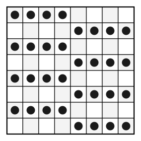

## Statement

Sofia pose des grains de riz sur les cases d'un échiquier $8 \times 8$, avec au plus un grain par case. Elle veut qu'il n'y ait jamais plus de $4$ grains sur une même ligne, ni sur une même colonne, ni sur une même diagonale.

Attention : les diagonales comptent **toutes**, pas seulement les deux grandes. Toute suite de cases qui se touchent par un coin en allant toujours dans la même direction est une diagonale, même si elle ne contient que deux ou trois cases.

Combien de grains Sofia peut-elle poser au maximum ?

## Hints

1. Une question de maximum se traite toujours en deux temps : montrer qu'on ne peut pas dépasser un certain nombre, puis montrer qu'on peut l'atteindre.
2. Pour la majoration, oublie les colonnes et les diagonales : les lignes seules suffisent. Combien y a-t-il de lignes, et combien de grains au plus sur chacune ?
3. Pour la construction, il faut maintenant atteindre ce nombre. Chaque ligne doit donc porter exactement $4$ grains.
4. Essaie un motif très régulier : quatre grains collés à gauche sur une ligne, quatre grains collés à droite sur la suivante, et on alterne.

## Solution

**La réponse : $32$ grains.**

**Étape 1 : Sofia ne peut pas dépasser $32$ grains.**

L'échiquier a $8$ lignes. Chaque ligne porte au plus $4$ grains, par hypothèse. Donc le nombre total de grains est au plus

$$8 \times 4 = 32 .$$

Les colonnes et les diagonales n'ont même pas servi : la seule contrainte sur les lignes donne déjà la majoration.

**Étape 2 : Sofia peut atteindre $32$ grains.**

Il reste le vrai travail : trouver une disposition. Comme il faut exactement $4$ grains par ligne, on n'a aucune marge, et il faut que les colonnes et les diagonales suivent.

Voici une disposition qui convient. On alterne, d'une ligne à l'autre, un bloc de quatre grains à gauche et un bloc de quatre grains à droite :

Vérifions les trois familles de contraintes.

*Les lignes.* Chaque ligne porte exactement un bloc de $4$ grains. ✓

*Les colonnes.* Les colonnes $1$ à $4$ sont remplies sur les lignes $1, 3, 5, 7$ et vides sur les lignes $2, 4, 6, 8$ : cela fait $4$ grains. Les colonnes $5$ à $8$ sont remplies sur les lignes $2, 4, 6, 8$ : cela fait $4$ grains aussi. ✓

*Les diagonales.* Numérotons les lignes et les colonnes de $1$ à $8$. La case de la ligne $L$ et de la colonne $C$ porte un grain exactement quand

- $L$ est impair et $C \le 4$ (bloc de gauche), ou
- $L$ est pair et $C \ge 5$ (bloc de droite).

Fixons une diagonale et parcourons-la. À chaque pas, la ligne augmente de $1$ et la colonne varie de $1$ (vers la droite ou vers la gauche selon le sens de la diagonale). En particulier, **les colonnes rencontrées sont toutes différentes**, et **les lignes rencontrées sont des entiers consécutifs**.

Séparons les cases de cette diagonale en deux paquets : celles des colonnes $1$ à $4$, et celles des colonnes $5$ à $8$.

- Le paquet de gauche contient au plus $4$ cases, puisque les colonnes rencontrées sont deux à deux différentes et qu'il n'y a que quatre colonnes de $1$ à $4$. De plus, ces cases se suivent sur la diagonale, donc leurs lignes sont des entiers consécutifs. Parmi au plus $4$ entiers consécutifs, il y en a au plus $2$ d'impairs. Or une case du paquet de gauche n'est occupée que si sa ligne est impaire : ce paquet porte donc **au plus $2$ grains**.
- Le paquet de droite contient lui aussi au plus $4$ cases, de lignes consécutives, et une telle case n'est occupée que si sa ligne est paire. Parmi au plus $4$ entiers consécutifs, il y en a au plus $2$ de pairs : ce paquet porte donc **au plus $2$ grains**.

Au total, toute diagonale porte au plus $2 + 2 = 4$ grains. ✓

**Conclusion.** Sofia peut poser au plus $32$ grains, et elle peut effectivement en poser $32$. Le maximum cherché est

$$\boxed{32} .$$

## Going further

Que devient la réponse sur un échiquier $n \times n$ avec au plus $k$ grains par ligne, par colonne et par diagonale ? La majoration donne toujours $nk$, mais atteindre ce nombre n'est possible que pour certains couples $(n, k)$ : les diagonales sont bien plus nombreuses que les lignes ($2n-1$ dans chaque sens) et deviennent vite la contrainte qui bloque.
