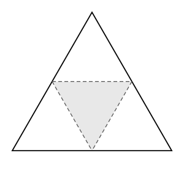

## Statement

On place $5$ points quelconques dans un triangle équilatéral de côté $2$ (les points peuvent être à l'intérieur ou sur les bords).

Montrer qu'il y en a forcément au moins deux dont la distance est inférieure ou égale à $1$.

## Hints

1. L'énoncé demande deux points proches. Le principe des tiroirs donne deux points dans une même zone : il faut donc découper le triangle en zones dans lesquelles deux points quelconques sont à distance $\leqslant 1$.
2. Combien de zones faut-il, au plus, pour que $5$ points forcent deux points dans la même ?
3. Un triangle équilatéral se découpe naturellement en quatre triangles équilatéraux plus petits. Comment ?
4. Dans un triangle équilatéral de côté $1$, quelle est la plus grande distance possible entre deux de ses points ?

## Solution

### Le découpage

Joignons les milieux des trois côtés du grand triangle. Cela le découpe en **quatre** triangles équilatéraux de côté $1$ : trois « aux coins » et un retourné au milieu.

Ces quatre petits triangles recouvrent entièrement le grand : tout point du grand triangle appartient à au moins l'un d'eux. (Les points sur les lignes de découpe appartiennent à deux petits triangles ; on en choisit alors un arbitrairement.)

### Le principe des tiroirs

Les **tiroirs** sont les quatre petits triangles, les **chaussettes** sont les cinq points. Comme $5 > 4$, deux points au moins se trouvent dans le même petit triangle.

### Deux points d'un petit triangle sont à distance $\leqslant 1$

Il reste à justifier que dans un triangle équilatéral de côté $1$, deux points quelconques sont à distance au plus $1$.

Soient $M$ et $N$ deux points d'un triangle $PQR$ équilatéral de côté $1$. Dans un triangle, le plus grand côté fait face au plus grand angle. Si l'on considère le triangle $MNP$... plus simplement, voici l'argument standard : la distance maximale entre deux points d'une figure convexe (un triangle en est une) est atteinte entre deux sommets. Or les trois distances entre sommets valent toutes $1$. Donc $MN \leqslant 1$.

*(Justification du fait admis, si l'on veut : fixons $M$ et faisons varier $N$. La fonction « distance à $M$ » est convexe, donc son maximum sur le triangle est atteint en un sommet. On recommence en fixant ce sommet et en faisant varier $M$.)*

### Conclusion

Deux des cinq points sont dans un même petit triangle de côté $1$, donc à distance au plus $1$ l'un de l'autre.

### Pourquoi cinq et pas quatre

Avec seulement $4$ points, le résultat tombe : on peut placer les trois sommets du grand triangle et son centre. Les distances entre sommets valent $2$, et la distance du centre à un sommet vaut $\dfrac{2}{\sqrt3} \approx \text{1,15}$, toutes strictement plus grandes que $1$.

## Going further

1. On place $10$ points dans un triangle équilatéral de côté $3$. Montrer que deux d'entre eux sont à distance au plus $1$.
2. Combien de points faut-il placer dans un carré de côté $2$ pour être sûr que deux d'entre eux soient à distance au plus $\sqrt2$ ?
